# 任务撮合平台 · Web 端总体设计

> **文档类型**：总体设计（技术栈 + 需求分析 + 系统概要设计）
> **版本**：**v1.6**　**日期**：2026-10-15　**阶段**：Web 端先行设计（桌面端 / 微信小程序 / 手机 App 复用同一后端，见 §5.10、**§5.15**）
> **读者**：产品、后端、前端、测试、运维、法务/合规
> ⭐ **评审进度**：**§6.1 待确认清单 32 / 32 已全部闭环**（2026-10-15 评审）—— 28 项经问答逐条拍板，决策已落到 `sys_config` / `sys_role_conflict` / `task_category` 并实跑验证
> **配套产物**（见 §6.6）：数据库 DDL（63 表，实跑通过）｜ OpenAPI 契约（95 路径 / 114 操作）｜ 小程序原型（14 屏）
> **本次评审已拍板的 15 项决策**（见 §1.7 决策记录）：
> ① 业务领域 = **通用悬赏/众包（线上 + 线下混合）**
> ② 系统规模 = **公司产品级，有运维与合规要求**
> ③ 技术栈 = **Java：Spring Boot 3 + Vue 3**
> ④ 资金 = **平台托管 + 真实在线支付（微信支付电商收付通 + 支付宝分账）**
> ⑤ **平台抽成 = 向接单方抽，基准费率 + 分类/阶梯/信誉分三重调节**（§4.8、§5.12）
> ⑥ **信誉分 = 双向计分 + 硬门槛 + 权益强联动（含费率与提现周期）**（§4.9、§5.11）
> ⑦ **角色 = 3 个平台身份不变，岗位用 RBAC 细分**（§4.7、§5.13）
> ⑧ **任务类型 = 三维正交：业务分类 + 任务形态 + 计酬方式**（§4.10、§5.14）
> ⑨ **任务状态 = 细粒度 18 个**，含"待托管/招募中/待选标/待开始/待验收/返工/逾期/争议/已结算"（§4.11、§5.6.1）
> ⑩ **统一结算单元 `delivery_unit`**，解决"里程碑 × 多人拆单"的二维冲突（§5.14.3）
> ⑪ **安全合规目标 = 等保三级**（含身份证等敏感个人信息 + 承载资金 + 目标 100 万用户）（§5.8.18）
> ⑫ **风控 = 自建全套**：规则引擎 + 设备指纹 + 关系图谱（§5.8.5）
> ⑬ **客户端加固 = 标准档**：混淆 + 证书绑定 + root/越狱检测 + 反调试（§5.8.14）
>
> **v1.1 新增**：§4.7 角色体系完善 ｜ §4.8 平台抽成规则 ｜ §4.9 信誉分规则 ｜ §5.11 信誉分机制设计 ｜ §5.12 抽成与分成机制设计 ｜ §5.13 岗位细分与 RBAC 落地
> **v1.2 新增**：§4.10 任务类型体系 ｜ §4.11 任务状态全集 ｜ §5.14 **任务模型全量设计与缺口补全（15 项 G1–G15）** ｜ §5.15 多端预留设计
> **v1.3 新增**：§5.8 安全设计（**6 → 19 个小节**）｜ §5.8.0 威胁模型与信任边界 ｜ 7 条安全红线 S1–S7 ｜ 越权用例 T1–T34 ｜ 等保三级映射
> **v1.4 新增**：§6.6 配套产物索引 ｜ **DDL / OpenAPI / 小程序原型三件可执行产物**（均已机器验证）
> **v1.6 变更**：⭐ **全产物缺陷审计（14 项：3 项 P0 + 9 项 P1 + 6 项 P2 中的 2 项计入 P1）已全部修复** —— 新增 §6.7 缺陷审计台账 ｜ DDL **63 → 71 表** / 807 → 898 列 ｜ OpenAPI **95 → 108 路径** / 114 → 132 操作 ｜ 新增 `api/websocket-protocol.md`
> **v1.5 变更**：⭐ **§6.1 待确认清单 32 项全部闭环**（28 项经问答拍板）｜ ADR 补 **D19–D22** ｜ 种子数据 +20 条系统参数 · +2 对互斥岗位 · 新增「公益求助」分类 ｜ 里程碑工期与开工前置条件随之收敛

---

## 目录

- [0. 文档说明与术语表](#0-文档说明与术语表)
- [1. 技术栈总览](#1-技术栈总览)
- [2. 主要开发工具](#2-主要开发工具)
- [3. 技术简介（是什么 / 解决什么 / 为什么不用替代品）](#3-技术简介是什么--解决什么--为什么不用替代品)
- [4. 需求分析](#4-需求分析)
- [5. 系统概要设计](#5-系统概要设计)
- [6. 附录](#6-附录)

---

## 0. 文档说明与术语表

### 0.1 设计范围

| 项 | 本次覆盖 | 说明 |
|---|---|---|
| Web 端（用户端 `web-user`） | ✅ 完整设计 | 发单、接单、订单、钱包、IM、争端 |
| Web 端（管理端 `web-admin`） | ✅ 完整设计 | 系统管理员 + 操作员共用一个工程，按角色裁剪 |
| 后端服务 | ✅ 完整设计 | 四端共用；模块化单体，预留拆分阈值 |
| 桌面端 / 微信小程序 / 手机 App | ⚠️ 仅接口与兼容性预留 | 不在本轮细化，但接口规范、鉴权、附件策略已为其留位（§5.7.4 能力协商 ｜ **§5.15 完整预留设计**） |
| 数据库物理设计（建表 DDL） | ❌ 下一阶段 | 本文只到「核心数据模型」级别 |
| 接口清单（逐字段） | ❌ 下一阶段 | 本文只到「接口设计规范 + 错误码分段」级别 |

### 0.2 术语表

| 术语 | 英文 / 字段 | 含义 |
|---|---|---|
| **发单方** | Publisher | 发布任务的用户（`task.publisher_id`） |
| **接单方** | Taker / Provider | 承接任务的用户 |
| **任务** | Task | 平台上的需求单元：标题、描述、预算、交付要求、截止时间 |
| **任务形态** 🆕 | `task_form` | 维度二：`ONLINE` 线上交付 / `OFFLINE` 线下履约 / `HYBRID` 混合。**它会改变表单与校验规则**，发布后不可改（§4.10.3） |
| **计酬方式** 🆕 | `pay_mode` | 维度三：`FIXED` 一口价 / `BID` 竞价 / `BY_QUANTITY` 按量 / `BY_DAY` 按天 / `MILESTONE` 里程碑（§4.10.4） |
| **验收标准** 🆕 | Acceptance Criteria | 结构化验收项清单（`task_acceptance_item`）。**没有它，恶意驳回就无法裁决** —— 是 v1.1 最严重的缺口（§5.14.1 G1） |
| **履约单元** 🆕 | `delivery_unit` | **统一结算单元**：普通任务 1 个、里程碑 N 个、多人拆单各 1 个。所有资金动作都挂在它上面（§5.14.3） |
| **主任务状态聚合** 🆕 | TaskStatusAggregator | MULTI 下由子订单状态按优先级推导主任务状态，**唯一实现**（§4.11.6） |
| **抢单** | Grab | `task.grant_mode = GRAB`，先到先得，一人独占 |
| **竞拍** | Bid / Auction | `task.grant_mode = BID`，接单方提交报价与条件，发单方选定 |
| **中标** | Award | 发单方从报价中选定接单方的动作 |
| **子订单** | SubOrder | `award_mode = MULTI` 时，每个中标人对应一份独立履约单元 |
| **托管** | Escrow | 发单方资金冻结在平台托管账户，验收后结算给接单方 |
| **分账** | Profit Sharing | 通过支付渠道把托管资金拆分给接单方与平台佣金，**资金不落平台自有账户** |
| **操作员** | Operator | 平台内部人员：内容审核、实名审核、争端裁决；**无账号管理与权限配置权** |
| **系统管理员** | Admin | 平台内部人员：账号、角色权限、系统参数、费率、风控规则、全量审计 |
| **信用分 / 信誉分** | Credit Score | **0–100，初始 60，双向计分**（发单行为与接单行为作用于同一本账）。决定抢单门槛、接单上限、排序权重、**抽成费率修正**、**提现周期**、平台介入优先级（§4.9） |
| **信誉等级** | Credit Level | 黑名单 / 较差 / 一般 / 良好 / 优秀 / 平台认证 六档，权益矩阵的载体（§4.9.2） |
| **平台抽成 / 佣金** | Commission | 平台从成交金额中按费率抽取的服务费，**向接单方抽取**（§4.8） |
| **计费基数** | Base Amount | 子订单成交金额（中标金额或抢单酬劳），**不含**发单方额外支付的渠道手续费 |
| **平台身份** | Identity | `USER` / `OPERATOR` / `ADMIN` 三种，**这是安全边界，只有 3 个，不再增加**（§4.7.1） |
| **岗位** | Duty Role | 内部人员的细分职责，用 **RBAC 角色**实现：内容审核员 / 实名审核员 / 仲裁专员 / 客服 / 财务 / 超管 / 运营 / 风控 / 财务管理员（§4.7.3、§4.7.4） |
| **职责分离** | SoD (Separation of Duties) | 高风险动作需多个岗位分别确认；互斥岗位不得由同一人兼任（§4.7.5） |
| **二清** | — | 平台以自有账户归集他人资金再转付，属无证从事支付结算业务（**合规红线**，见 §5.5.4） |
| **信任边界** 🆕 | Trust Boundary | 数据从不可信区进入可信区的那条线；跨线必须加密、鉴权、审计（§5.8.0） |
| **越权 / IDOR** 🆕 | Insecure Direct Object Reference | 通过改 ID 访问他人资源（水平越权），或用户调用管理接口（垂直越权）。**本项目最高频的致命漏洞类型** |
| **信封加密** 🆕 | Envelope Encryption | 数据用 DEK 加密、DEK 用 KEK 加密后存库；**KEK 永不落库**，轮换时不必重刷全表（§5.8.10） |
| **设备指纹** 🆕 | Device Fingerprint | 多维度特征组合标识设备，用于识别同设备多账号与设备黑名单（§5.8.5） |
| **关系图谱** 🆕 | Relation Graph | 以设备/账号/银行卡/IP 为节点识别团伙（自买自卖闭环、星型团伙、资金汇聚）（§5.8.5） |
| **MFA** 🆕 | Multi-Factor Authentication | 双因素认证；**内部账号强制**（§5.8.1） |
| **SBOM** 🆕 | Software Bill of Materials | 软件物料清单，每次发布归档，用于供应链追溯与合规审计（§5.8.13） |
| **PIA** 🆕 | 个人信息保护影响评估 | 个保法要求，对敏感信息处理/自动化决策/对外提供三类场景上线前评估并留档（§5.8.15） |
| **SDL** 🆕 | 安全开发生命周期 | 把安全活动嵌入需求→设计→编码→构建→测试→发布→运行全流程（§5.8.17） |
| **WORM / 哈希链** 🆕 | Write Once Read Many | 审计日志一次性写入不可改；哈希链（每条含前一条哈希）+ 每日锚定实现防篡改（§5.8.4） |
| **Runbook** 🆕 | — | 应急处置的可执行手册；⛔ 没演练过的预案等于没有预案（§5.8.16） |

### 0.3 五条不能违反的设计红线

> 另有 **7 条安全红线（S1–S7）** 与 8 类威胁对手（T1–T8）见 **§5.8.0 威胁模型与信任边界**。

1. **抢单的唯一性只能由数据库判定**。任何"先查再改"的写法都是错的；Redis 锁只能用于削峰，不能作为正确性依据（§5.5.1）。
2. **平台的资金必须走渠道分账，不得归集**。自有对公账户收款再转付 = 二清，是监管红线（§5.5.4）。
3. **操作员与系统管理员的权限必须硬隔离**。操作员能碰钱（受上限约束）、能碰内容，但**不能碰账号与权限**；所有裁决与资金动作必须留审计（§4.2、§5.8）。
4. **抽成的每一笔账都必须逐笔可解释**。费率规则快照必须落库（否则日后改费率，历史订单的抽成说不清）；**佣金与接单方实得必须严格配平** —— 只算佣金，实得用减法得出，不允许 1 分误差（§5.12）。
5. **信誉分只能有一个出口**。所有"信誉分决定什么"的地方必须调 `CreditService.privileges(userId)`，⛔ 禁止在业务代码里散写 `if (score >= 80)` —— 否则调整等级门槛时要改几十处，必然漏（§5.11.2）。

---

## 1. 技术栈总览

### 1.1 全景一览

| 层 | 技术选型 | 版本 | 在本系统中的用途 |
|---|---|---|---|
| **运行时** | JDK (Eclipse Temurin) | **21 LTS** | 虚拟线程（抢单与回调洪峰的抗并发利器）、Record、模式匹配 |
| **后端框架** | Spring Boot | **3.2.x** | 应用主框架、自动装配、Actuator 健康检查 |
| | Spring Security | 6.2.x | 认证鉴权、方法级权限、密码编码 |
| | Spring WebSocket / Netty | 6.2.x / 4.1.x | IM 长连接（独立进程 `app-ws`） |
| | Spring StateMachine | 3.2.x | 任务/订单/工单状态机（**禁止散落 if-else**） |
| **持久层** | MyBatis-Plus | 3.5.x | ORM、分页、乐观锁插件、逻辑删除 |
| | HikariCP | 5.x | 连接池 |
| | Flyway | 10.x | 数据库版本化迁移（DDL 纳入 Git） |
| | ShardingSphere-JDBC | 5.4.x（可选） | 读写分离；IM 消息表分片 |
| **数据存储** | MySQL | **8.0.36** | 主业务库（InnoDB、READ COMMITTED） |
| | Redis | **7.2** | 缓存、分布式锁（Redisson）、限流、会话、排行榜、延迟队列 |
| | MinIO / 阿里云 OSS | — | 附件、交付物、举证材料、头像 |
| | Elasticsearch | 8.13（Phase 2） | 任务全文检索与多条件筛选 |
| **消息与调度** | RocketMQ | **5.1** | 领域事件、异步通知、资金事件、事务消息 |
| | XXL-Job | 2.4.x | 定时任务：竞拍截止、自动验收、超时释放、T+1 对账 |
| | Redisson | 3.27.x | 分布式锁、限流器、延时队列 |
| **支付与合规** | wechatpay-java | 0.2.x | 微信支付 **电商收付通**（合单支付、分账、退款、提现） |
| | alipay-sdk-java | 4.x | 支付宝**资金预授权 + 分账** |
| | 持牌机构 SDK（备选） | — | 汇付 / 易宝 / 连连 存管（`PaymentGateway` 接口的另一实现） |
| **接口与文档** | SpringDoc OpenAPI | 2.x | 自动生成 OpenAPI 3 + Swagger UI |
| | MapStruct + Lombok | 1.5 / 1.18 | DTO 转换、样板代码消除 |
| **可观测** | SkyWalking / OTel | 9.x | 全链路追踪（`traceId` 贯穿前后端与 MQ） |
| | Prometheus + Grafana | 2.5x / 10.x | 指标采集与看板 |
| | Loki + Promtail | 3.x | 日志聚合（比 ELK 轻，够用） |
| **前端框架** | Vue | **3.4** | 组合式 API + `<script setup>` |
| | TypeScript | **5.4** | 全量类型，接口类型由 OpenAPI 自动生成 |
| | Vite | **5.x** | 构建与 HMR |
| | Pinia | 2.1 | 状态管理（含持久化插件） |
| | Vue Router | 4.3 | 路由 + 动态路由（按角色下发菜单） |
| **前端 UI 与能力** | Element Plus | 2.7 | 组件库（用户端 + 管理端统一，降低维护成本） |
| | ECharts | 5.5 | 管理端报表：交易额、工单 SLA、资金对账 |
| | Axios | 1.7 | HTTP 封装：拦截器、错误码映射、Token 无感刷新 |
| | SparkMD5 + 分片上传 | — | 大附件断点续传（交付物可达 GB 级） |
| | 原生 WebSocket 封装 | — | IM：心跳、重连、离线补偿、已读回执 |
| | wangEditor 5 / Tiptap | — | 任务描述富文本（**服务端必须做 XSS 白名单过滤**） |
| **前端工程化** | pnpm | 9.x | 包管理（monorepo 可选） |
| | ESLint + Prettier + Stylelint | — | 代码规范 |
| | Husky + lint-staged + commitlint | — | 提交前门禁、Conventional Commits |
| | Vitest + Vue Test Utils | 1.x | 单元测试 |
| | Playwright | 1.4x | E2E（下单全链路、裁决链路） |
| **测试（后端）** | JUnit 5 / Mockito | 5.10 / 5.x | 单元测试 |
| | Testcontainers | 1.19 | 集成测试（真 MySQL/Redis/RocketMQ 容器） |
| | k6 / JMeter | — | 抢单并发压测、回调洪峰压测 |
| **基础设施** | Docker / Docker Compose | 26.x | 开发与测试环境 |
| | Kubernetes（或 K3s） | 1.29 | 生产编排、HPA 弹性伸缩 |
| | Nginx / Ingress | 1.25 | TLS 卸载、限流、静态资源、WS 反向代理 |
| | Jenkins / GitLab CI | — | 流水线：构建 → 单测 → 镜像 → 部署 |
| **配置与网关** | Nacos（或 K8s ConfigMap） | 2.3 | 配置中心 + 服务发现（拆分后启用） |

### 1.2 后端技术栈选型理由（关键取舍）

| 决策点 | 选定 | 被否方案 | 理由 |
|---|---|---|---|
| 架构形态 | **模块化单体 + 独立 WS 进程** | 微服务全拆 | 抢单唯一性 / 竞拍多选中标 / 资金冻结分账三处都要**强一致**，单库本地事务是最便宜的正确解。微服务是在用工程复杂度换组织并行度，当前团队规模不需要（§5.10 给了拆分阈值） |
| ORM | **MyBatis-Plus** | Spring Data JPA | 资金与统计场景需要手写复杂 SQL 与精确控制（`UPDATE ... WHERE status=?` 的原子更新）；JPA 的脏检查在一等公民是"原子条件更新"的系统里反而碍事 |
| 权限框架 | **Spring Security 6 + JWT** | Sa-Token | 产品级 + 等保 + 审计要求下，Spring Security 的标准化、生态与审计能力更强；Sa-Token 更轻但拓展审计链路要自己补 |
| 状态机 | **Spring StateMachine + 数据库状态日志双写** | 纯枚举 + switch | 任务/订单/资金/工单四类状态机分支组合爆炸，散落 if-else 必然漏分支。状态机集中定义 + `*_status_log` 表留痕，既防漏又满足审计 |
| 消息队列 | **RocketMQ 5** | RabbitMQ / Kafka | 需要**事务消息**（本地事务 + 消息发送一致性，用于"中标成功→发通知→建托管"）与**延时消息**（超时未验收）；Kafka 更适合日志流而非业务事件 |
| 缓存与锁 | **Redis 7 + Redisson** | 纯 Jedis | Redisson 的看门狗续期、限流器、延时队列开箱即用，少写易错代码 |
| 全文检索 | **Phase 1 用 MySQL 组合索引，Phase 2 上 ES** | 一开始就上 ES | 任务量 < 100 万时 MySQL 多条件筛选够用；过早引入 ES 会带来同步一致性负担 |
| 支付 | **微信电商收付通 + 支付宝分账** | 平台自有账户归集 | 合规红线（§0.3 第 2 条） |

### 1.3 前端技术栈选型理由

| 决策点 | 选定 | 理由 |
|---|---|---|
| 框架 | Vue 3.4 + `<script setup>` + TS | 团队既有 Vue 资产可复用；组合式 API 在"发单方视图 / 接单方视图共用同一数据模型"的场景下复用性最好 |
| 工程划分 | **两个工程** `web-user` + `web-admin` | 二者布局、权限模型、发布节奏完全不同。硬塞一个工程会让路由守卫与权限指令长成意大利面（§5.7.5） |
| UI 库 | **Element Plus（两工程统一）** | 管理端天然需要表格/表单/穿梭框等重型组件；用户端也能覆盖。统一库 = 一套主题变量 + 一套二次封装，长期维护成本最低 |
| 状态管理 | Pinia | Vue 3 官方推荐，TS 推导友好，模块化清晰 |
| 接口类型 | **OpenAPI → `openapi-typescript` 自动生成** | 禁止手写接口类型。契约变了编译就报错，比联调时发现强得多 |
| 富文本 | wangEditor 5（国内生态好、中文文档全） | **必须配合服务端白名单过滤**，否则 XSS 直接打进任务详情页 |
| IM | 原生 WebSocket 自封装 | 只需文本 + 图片 + 系统卡片 + 已读回执，不需要完整 XMPP 协议栈；自封装约 300 行，可控 |

### 1.4 数据与中间件版本与容量基线

| 组件 | 版本 | 部署形态 | 关键参数基线 |
|---|---|---|---|
| MySQL | 8.0.36 | 一主两从 + 读写分离 | `innodb_buffer_pool_size` = 物理内存 60%；`transaction_isolation = READ-COMMITTED` |
| Redis | 7.2 | 3 主 3 从 Cluster（生产）/ 单机（开发） | `maxmemory-policy = allkeys-lru`（缓存实例）；锁与队列使用独立 DB 或独立实例 |
| RocketMQ | 5.1 | 2 主 2 从（同步双写） | 3 个 Topic：`domain-event`、`notify`、`pay-callback` |
| MinIO / OSS | — | 集群 / 云服务 | 附件生命周期 3 年，冷数据转归档 |
| XXL-Job | 2.4 | 调度中心 2 副本 + 执行器随应用部署 | 见 §5.9.4 任务清单 |

### 1.5 环境与部署矩阵

| 环境 | 用途 | 数据 | 支付 | 域名 |
|---|---|---|---|---|
| `dev` | 本地开发 | 本地 Docker Compose | **Mock 渠道** | `localhost` |
| `test` | 联调与自动化测试 | 测试库（每日重置） | 渠道**沙箱** | `test-*.example.com` |
| `staging` | 预发，与生产同构 | 脱敏生产数据 | 渠道沙箱 | `stg-*.example.com` |
| `prod` | 生产 | 生产库 | 正式渠道 | `*.example.com` |

> ⚠️ **`staging` 必须与生产同构**：抢单并发、支付回调、对账这三类问题只在真实中间件配置下才暴露。

### 1.6 成本与资源估算（首年，参考量级）

| 项 | 规格 | 数量 | 说明 |
|---|---|---|---|
| 应用节点 | 4C8G | 3（`app-api`）+ 2（`app-ws`） | 按 DAU 8 万设计 |
| MySQL | 8C16G + 500G SSD | 3 | 一主两从 |
| Redis | 4C8G | 6 | Cluster 3 主 3 从 |
| RocketMQ | 4C8G | 4 | 2 主 2 从 |
| 对象存储 | 12 TB | — | 按 §4.5.5 容量测算 |
| 可观测 | 4C8G | 2 | SkyWalking + Prometheus/Grafana |

### 1.7 决策记录（ADR 摘要）

| # | 决策 | 备选 | 结论 | 影响面 |
|---|---|---|---|---|
| D1 | 架构形态 | 微服务全拆 / Serverless | **模块化单体**（拆分阈值见 §5.10） | 全局 |
| D2 | 接单模式模型 | 只抢单 / 只竞拍 | **`grant_mode` 双模式，同表不同流转** | 任务域、订单域 |
| D3 | 竞拍中标语义 | 单选 / 多选 / 入围 | **数据模型同时支持 `award_mode = SINGLE \| MULTI`**（Phase 1 只开放 SINGLE，Phase 2 开放 MULTI），入围作为中间态 | 数据模型 +15% 复杂度，换取需求不用赌 |
| D4 | 支付合规 | 自有账户 / 渠道分账 | **微信电商收付通 + 支付宝分账**，`PaymentGateway` 抽象 | 资金域、法务 |
| D5 | 前端工程 | 单工程分区 / 两工程 | **`web-user` + `web-admin` 两工程** | 前端 |
| D6 | 权限模型 | 纯 RBAC | **RBAC + 资源所有权判定**（用户不需"切角色"） | 身份域、全局 |
| D7 | 任务审核时机 | 先审后发 / 先发后审 | **先发后审**（机审 + 举报复核），避免审核成为发布瓶颈 | 任务域、操作员端 |
| D8 | 交易数据保留 | 3 年 | **5 年**（高于法务下限，便于跨年纠纷举证） | 存储成本 |
| **D9** | **抽成方向** | 向发单方抽 / 双向 / 按分类可配 | **向接单方抽**（从接单方所得中扣），发单方所见即所付 | 定价展示、结算、发票、纠纷口径 |
| **D10** | **费率结构** | 单一固定 / 只做阶梯 | **基准费率 + 分类覆盖 + 金额阶梯 + 信誉分修正 + 活动减免**（优先级：活动 > 分类 > 阶梯 > 基准） | 结算链路复杂度 +30%，换取运营策略空间 |
| **D11** | **信誉分计分范围与强度** | 只给接单方 / 只做展示 | **双向计分**（发单方行为同样扣分）+ **硬门槛 + 权益强联动**（含抽成费率与提现周期） | 三个机制被串成一张网，是平台治理的主抓手 |
| **D12** | **角色体系** | 只写细三角色 / 新增平台身份 | **平台身份仍为 3 个不变**（安全边界稳定），岗位用 RBAC 角色细分（操作员 5 岗位、管理员 4 岗位） | RBAC 种子数据、复核流程、审计粒度 |
| **D13** | **任务类型建模** | 单一"任务类型"大枚举 / 只做分类树 | **三维正交：业务分类 + 任务形态 + 计酬方式**，配维度间互斥约束 | 任务表单、校验规则、检索、线下任务 |
| **D14** | **任务状态粒度** | 保持 11 个 / 粗粒度 8 个 | **细粒度 18 个**（拆开 `PUBLISHED` 与 `ASSIGNED` 的语义过载）+ 状态分组 + 状态 × 操作矩阵 | 状态机、运营看板、定时任务扇入点 |
| **D15** | **结算单元** | 直接以子订单为结算粒度 | **引入 `delivery_unit` 作为统一结算单元**（Phase 1 就建表） | 让 Phase 2 放开"里程碑 × 多人拆单"时**不必重写结算链路**；成本仅一张表 |
| **D16** | **安全合规目标** | 等保二级 / 只做基线 | **直接按等保三级设计**（含身份证等敏感个人信息 + 承载资金 + 目标 100 万用户） | 增加网络分区、集中管控、可信验证、更严的审计与备份要求；测评需提前 3 个月启动 |
| **D17** | **风控引擎** | 全第三方 / 混合 | **自建全套**：规则引擎 + 设备指纹 + 关系图谱 | 数据不出境、规则可调可回测、与信誉分/抽成联动；开发量 +3~4 周 |
| **D18** | **客户端加固** | 不加固 / 金融级 | **标准加固**：混淆 + 证书绑定 + root/越狱检测 + 反调试 | 性价比最高；金融级（安全键盘、防截屏、加固壳）成本显著上升，当前不必要 |
| **D19** | **任务审核时机** | 全部先审后发 / 全部先发后审 | **机审为主 + 高风险分类必人审**（生活服务/教育培训/市场营销） | 与 `task_category.audit_level` 一致；避免审核成为发布瓶颈，同时守住高风险类目 |
| **D20** | **个税处理** | 不代扣 / 走灵活用工平台 | **平台代扣代缴（劳务报酬所得）** | 合规最稳；需税务登记与申报流程，⚠️ 执行细节待税务书面确认 |
| **D21** | **里程碑首付款** | 不预付 / 强制预付 50% | **可设最高 30% 预付** | 降低接单方垫资压力，又不让发单方风险过高 |
| **D22** | **等保启动时机** | 上线后启动 / 不做测评 | **W1 就启动差距分析，预留 4 周整改** | 等保**管理要求占测评项一半以上**（制度/人员/运维记录），比技术整改更耗时；晚启动必延期 |

---

## 2. 主要开发工具

### 2.1 后端与数据库

| 类别 | 工具 | 版本 | 用途 | 备注 |
|---|---|---|---|---|
| IDE | IntelliJ IDEA Ultimate | 2024.x | 后端主 IDE | 必装插件：Lombok、MapStruct、MyBatisX、SonarLint、Alibaba Java Coding Guidelines |
| JDK 管理 | SDKMAN / 手动 | — | 多 JDK 切换 | 锁定 21 LTS |
| 构建 | Maven | 3.9.x | 多模块构建 | 或 Gradle 8；本文按 Maven 组织 |
| 数据库客户端 | DBeaver / Navicat | 24.x / 16.x | 建表、查数、执行计划 | DBeaver 免费且跨平台，推荐 |
| Redis 客户端 | RedisInsight | 2.x | 观察 Key、慢查询、内存 | |
| 消息队列 | RocketMQ Dashboard | 5.x | Topic/消费组/堆积监控 | |
| 接口调试 | **Apifox** | 最新 | 接口设计 + Mock + 测试 + 文档 | 国内团队协作优于 Postman：一个工程管 API 文档/调试/自动化测试 |
| 压测 | **k6**（脚本化）/ JMeter | 0.5x / 5.6 | 抢单并发、回调洪峰 | 抢单必须能跑"5000 并发抢同一单"的场景 |
| 数据库迁移 | Flyway CLI | 10.x | 本地校验/修复 | DDL 全部进 Git，禁止手改生产库 |
| 代码质量 | SonarQube | 10.x | 静态扫描门禁 | 阻断规则：空指针、资源泄漏、SQL 注入、硬编码密钥 |

### 2.2 前端

| 类别 | 工具 | 版本 | 用途 |
|---|---|---|---|
| IDE | VS Code | 最新 | 主前端 IDE；插件：Volar、ESLint、Prettier、Stylelint、Error Lens |
| 包管理 | pnpm | 9.x | 依赖安装（快、省盘、天然支持 workspace） |
| 脚手架 | `create-vue` | 最新 | 生成 Vue3 + TS + Vite 骨架 |
| 构建分析 | `rollup-plugin-visualizer` | — | 包体积分析（小程序端尤其敏感） |
| 浏览器调试 | Chrome DevTools | — | 网络、性能、内存、WebSocket 帧 |
| 抓包 | Charles / Fiddler | — | 移动端与桌面端联调（为后续多端预留） |
| 原型与设计 | Figma / 即时设计 | — | 高保真原型、标注、切图 |
| 图表 | ECharts（+ vue-echarts） | 5.5 | 管理端数据看板 |

### 2.3 协作、流程与文档

| 类别 | 工具 | 用途 | 约定 |
|---|---|---|---|
| 版本控制 | Git + GitLab（或 Gitee 私有） | 代码托管、MR、Code Review | 分支模型：`main` / `release/*` / `feature/*` / `hotfix/*` |
| 提交规范 | commitlint + Conventional Commits | 生成 CHANGELOG | 类型集：`feat` / `fix` / `docs` / `refactor` / `test` / `chore`；格式 `type(scope): subject` |
| 提交门禁 | Husky + lint-staged | 提交前 lint + 单测 | 前端；后端交给 CI |
| CI/CD | Jenkins 或 GitLab CI | 构建→测试→镜像→部署 | 门禁：单测通过 + Sonar 质量门 + 镜像扫描 |
| 容器 | Docker + Docker Compose | 本地一键起全套依赖 | `docker-compose.dev.yml` |
| 建模与画图 | draw.io / PlantUML / **Mermaid** | 架构图、ER、时序图 | **文档内统一用 Mermaid**，可随代码一起做版本管理 |
| 文档协作 | Markdown + Git（本仓库）/ 语雀 | 设计文档、接口文档 | 接口文档以 OpenAPI 为唯一事实来源 |
| 任务管理 | Jira / 禅道 / Tapd | 需求、缺陷、迭代 | 缺陷必须关联环境与 `traceId` |
| 监控告警 | SkyWalking + Prometheus + Grafana + Loki | 追踪、指标、日志 | 告警到钉钉/飞书：抢单失败率、支付回调失败率、对账差异数 |
| 密钥管理 | Vault / K8s Secret | 数据库密码、渠道私钥 | ⛔ 禁止入库入 Git |

### 2.4 安全与合规工具

| 类别 | 工具 | 用途 |
|---|---|---|
| **密钥扫描** | **gitleaks** / trufflehog | 提交前 + CI 扫描硬编码密钥（§5.8.10 铁律 1） |
| **SAST** | SonarQube + 语义规则、CodeQL | 源码级漏洞扫描（注入、越权、反序列化） |
| **SCA** | OWASP Dependency-Check、Snyk、`pnpm audit` | 依赖 CVE 扫描 + **SBOM 生成（CycloneDX）** |
| **容器/镜像** | **Trivy**、cosign | 镜像 CVE + 配置基线扫描；镜像**签名与准入校验** |
| **DAST** | AWVS / Burp Suite Pro | 动态扫描（XSS、SQLi、SSRF、越权） |
| **渗透测试** | 第三方安全公司 | 上线前 + 每年至少一次；重大版本前一次 |
| **WAF** | 云 WAF / ModSecurity | OWASP 核心规则 + 自定义规则 + CC 防护 |
| **主机/入侵** | 云安全中心 / HIDS（如 Wazuh） | 恶意进程、异常外连、文件完整性监控 |
| **SIEM / 日志** | Loki + Grafana 告警 或 云 SIEM | 安全事件关联与告警（§5.8.16 规则表） |
| **堡垒机** | 云堡垒机 / JumpServer | 运维通道统一管控 + 命令审计 + 录屏 |
| **密钥管理** | **Vault** / 云 KMS（+ HSM） | 信封加密、动态凭据、密钥轮换（§5.8.10） |
| **密钥合规扫描** | K8s 准入（Kyverno/OPA） | 校验 Pod 安全基线（非 root、只读 FS、资源限制） |
| **越权自检** | 自研用例集 **T1–T34** | **水平越权与垂直越权逐接口覆盖，上线前必须全绿** |
| **业务逻辑漏洞** | 人工用例集（§5.8.17 专项表） | 支付/竞拍/信誉分/抽成/状态机/凭证六类，自动化扫不出来 |
| **漏洞管理** | DefectDojo / Jira | 漏洞生命周期；高危 7 天、中危 30 天修复 SLA |
| **等保测评** | 有资质的测评机构 | 目标 **等保三级**；建议提前 3 个月做差距分析（§5.8.18） |
| **合规审查** | 法务 + 外部律师 + DPO | 用户协议、隐私政策、资金托管协议、佣金规则公示、**PIA 评估** |

---

## 3. 技术简介（是什么 / 解决什么 / 为什么不用替代品）

> 本节只写「与本系统强相关」的技术点。泛泛而谈的框架介绍略过，重点在**它替我们挡住了哪个具体的坑**。

### 3.1 后端核心

#### 3.1.1 JDK 21 + 虚拟线程（Virtual Threads）

- **是什么**：JDK 21 正式转正的轻量级线程，由 JVM 调度而非 OS 调度，单机可承载百万级并发任务。
- **在本系统解决什么**：抢单高峰与支付回调洪峰都是**大量阻塞在 I/O 上**的请求（等数据库行锁、等渠道 HTTP）。传统平台线程模型下，连接池与 Tomcat 线程池会先于数据库成为瓶颈；虚拟线程让"一个请求一个线程"的同步写法可以扛住高并发，**不必为了并发把代码改成响应式**。
- **为什么不用替代品**：WebFlux / Reactor 能把资源压得更低，但会污染整个技术栈——MyBatis 是阻塞的、渠道 SDK 是阻塞的、事务边界在响应式里很难写对。对一个**正确性优先于极限吞吐**的交易系统，虚拟线程 + 同步阻塞代码是风险最低的选择。

#### 3.1.2 Spring Boot 3.2

- **是什么**：Spring 生态的应用基座（自动装配、起步依赖、Actuator、可观测集成）。
- **在本系统解决什么**：统一 9 个业务模块的装配方式、事务管理（`@Transactional`）、健康检查（K8s 探针）、指标暴露（Prometheus）。
- **为什么不用替代品**：Quarkus / Micronaut 启动更快、内存更低，但团队 Java 资产、招聘面、第三方 SDK 兼容性（尤其是支付渠道 SDK 的 Spring 集成）都偏向 Spring。

#### 3.1.3 Spring Security 6 + JWT

- **是什么**：认证与授权的标准实现；JWT 是自包含的无状态令牌。
- **在本系统解决什么**：
  - **认证**：Access Token（15 分钟）+ Refresh Token（7 天，存 Redis 可吊销，实现"异地登录踢下线"）。
  - **鉴权**：方法级 `@PreAuthorize` + 数据权限切面（同一接口，用户只能看自己的订单，操作员能看全部）。
  - **多端共用**：Web / 小程序 / App / 桌面端用同一套令牌体系，通过 `X-Client` 头区分客户端能力。
- **为什么不用替代品**：Sa-Token 上手更快，但产品级 + 等保要求下，Spring Security 的标准化、审计与安全更新更可靠；且 JWT 必须配合**刷新令牌可吊销**（纯 JWT 无法登出，这是常见的设计事故）。

#### 3.1.4 MyBatis-Plus

- **是什么**：MyBatis 的增强工具：通用 CRUD、分页、乐观锁、逻辑删除、条件构造器。
- **在本系统解决什么**：
  - **原子条件更新**：抢单靠 `UPDATE ... WHERE status='RECRUITING' AND assignee_id IS NULL` 一条语句定胜负，这需要**精确控制 SQL**，MyBatis 天然支持。
  - **乐观锁插件**：`@Version` 处理任务编辑、钱包更新等并发场景。
  - **多租户/数据权限**：用拦截器统一注入 `publisher_id = ?` / `taker_id = ?` 条件，**从机制上防水平越权**，而不是靠每个开发者记得加条件。
- **为什么不用替代品**：Spring Data JPA 的脏检查与延迟加载在一等公民是"条件原子更新"的系统里弊大于利（还容易写出 N+1 与意外的全字段 UPDATE）。

#### 3.1.5 Spring StateMachine

- **是什么**：状态机框架：集中定义状态、事件、迁移条件与动作。
- **在本系统解决什么**：系统有 **5 类状态机**（任务、子订单、竞价、争端工单、托管单），且互相耦合（任务状态影响能否抢单，子订单状态影响能否结算）。散落的 `if (status == ...)` 必然漏分支，且新人改动时无法判断影响面。状态机把"允许的迁移"集中成一张表，非法迁移直接抛异常。
- **配套**：每次迁移同时写 `*_status_log`（旧状态、新状态、操作人、原因、时间），既做审计又做问题复盘。
- **为什么不用替代品**：纯枚举 + switch 在 5 个状态机 × 10+ 状态的组合下不可维护；工作流引擎（Flowable/Activiti）过重，且本系统的流转是**代码驱动**而非**人工审批驱动**。

#### 3.1.6 Flyway

- **是什么**：数据库版本迁移工具，DDL 以 SQL 脚本形式纳入版本控制。
- **在本系统解决什么**：资金与订单表结构演进必须可追溯、可回滚、可复现（开发/测试/预发/生产四套环境结构必须一致）。**禁止手改生产库结构**。
- **为什么不用替代品**：Liquibase 的 XML 抽象层对复杂索引/分区支持不如直接写 SQL 直观。

#### 3.1.7 MapStruct + Lombok

- **是什么**：编译期 Bean 映射代码生成；样板代码消除。
- **在本系统解决什么**：Entity ↔ DTO ↔ VO 三层转换量大且易错（尤其金额字段与脱敏字段），MapStruct 编译期生成、性能等同手写、字段漏映射时给出警告。
- **注意**：Lombok 的 `@Data` 禁止用在 Entity 上（会生成 `equals/hashCode` 引发意外），统一用 `@Getter/@Setter`。

### 3.2 数据存储

#### 3.2.1 MySQL 8（InnoDB）+ READ COMMITTED

- **是什么**：主业务库。
- **在本系统解决什么**：
  - **抢单唯一性的最终判定者**：InnoDB 行锁保证并发 `UPDATE` 串行化，配合 `WHERE` 条件实现"只有一个人能成功"（§5.5.1 详解）。
  - **金额精度**：所有金额字段用 `DECIMAL(18,2)`，⛔ **绝不用 `FLOAT/DOUBLE`**（浮点误差在资金系统里是事故）。
  - **隔离级别选 READ COMMITTED 而非默认的 REPEATABLE READ**：转账/扣减场景下 RC 减少间隙锁（gap lock）带来的死锁概率；且"先检查后更新"的竞态由**条件 UPDATE**解决，不依赖可重复读。
- **为什么不用替代品**：PostgreSQL 在功能上更强（更强的约束、更好的 JSON、原生分区），但团队熟悉度、云厂商托管成熟度、国内运维生态仍以 MySQL 为主。若从零开始且团队无偏好，PG 是同样合理的选项。

#### 3.2.2 Redis 7

- **是什么**：内存数据库。
- **在本系统解决什么**：
  | 用途 | 具体场景 |
  |---|---|
  | 缓存 | 任务详情、分类树、用户摘要（防缓存穿透：空值短 TTL + 布隆过滤器；防击穿：逻辑过期 + 互斥重建；防雪崩：TTL 加随机抖动） |
  | 分布式锁 | **削峰用**：抢单前 `SET NX PX` 抢占，减少打到数据库的并发（**正确性仍由 DB 判定**） |
  | 限流 | 抢单接口用户级 + 接口级令牌桶（Redisson `RRateLimiter`），防脚本刷单 |
  | 会话 | Refresh Token、登录态、验证码 |
  | 排行榜 | 接单方信用/成交量榜单（ZSet） |
  | 延时队列 | 竞拍截止提醒、验收倒计时（Redisson DelayedQueue） |
- **为什么不用替代品**：Memcached 无持久化与数据结构；本地缓存（Caffeine）只能做一级缓存，无法跨节点。

#### 3.2.3 对象存储（MinIO / 阿里云 OSS）

- **是什么**：文件存储服务。
- **在本系统解决什么**：任务附件、交付物（可达 GB）、争端举证材料、头像、实名证件（**独立私有 Bucket + 单独加密 + 单独访问策略**）。采用**前端直传 + 服务端签名**，避免大文件穿透应用层。
- **为什么不用替代品**：文件放应用服务器磁盘会导致多副本不一致、扩容即丢文件；放数据库会撑爆库并拖慢备份。

#### 3.2.4 Elasticsearch（Phase 2 引入）

- **是什么**：分布式全文检索引擎。
- **在本系统解决什么**：任务的多条件 + 关键词检索（分类 / 预算区间 / 地区 / 截止时间 / 信用门槛 / 关键词）。任务量突破百万后，MySQL 的 `LIKE '%kw%'` 与多条件组合排序会成为慢查询重灾区。
- **为什么不在 Phase 1 就上**：ES 需要维护"MySQL → ES"的同步一致性（用 Canal 或 MQ 双写），是实打实的复杂度。**在数据量与查询复杂度到达阈值前，MySQL 组合索引 + 覆盖索引够用**（§5.10 给出触发线）。

### 3.3 消息与调度

#### 3.3.1 RocketMQ 5

- **是什么**：分布式消息队列。
- **在本系统解决什么**：
  - **事务消息**：解决"本地事务成功但消息没发出去"的一致性问题。典型链路：`中标成功（本地事务）→ 发"中标事件" → 通知中标人 / 落选人 / 建托管单`。若消息丢了，会出现"钱冻了但人没收到通知"。
  - **延时消息**：超时未接单自动流标、提交交付后 N 天自动验收、工单 SLA 超时升级。
  - **削峰**：支付回调洪峰先入队再异步处理（但**回调落库仍要同步做**，见 §5.9.2）。
- **为什么不用替代品**：RabbitMQ 的事务/延时能力较弱（延时靠插件）；Kafka 面向日志流，缺少事务消息与按业务键的顺序消费便利性。

#### 3.3.2 XXL-Job

- **是什么**：分布式任务调度平台，带可视化管理界面。
- **在本系统解决什么**：见 §5.9.4 的定时任务清单——竞拍截止、自动验收、超时释放、T+1 对账、僵尸订单清理。**必须有可视化 + 失败重试 + 执行日志**，因为其中多个任务直接决定资金动作。
- **为什么不用替代品**：`@Scheduled` 在多副本下会重复执行（对资金任务是灾难）；Quartz 无管理界面、集群配置繁琐。

#### 3.3.3 Redisson

- **是什么**：Redis 的 Java 客户端，封装分布式对象。
- **在本系统解决什么**：分布式锁（带看门狗自动续期，避免业务没跑完锁就过期）、限流器、延时队列、布隆过滤器。

### 3.4 支付与合规（**本系统最高风险区**）

#### 3.4.1 微信支付 · 电商收付通

- **是什么**：微信支付面向**电商平台型商户**的资金托管与分账产品。平台作为"服务商/平台商户"，二级商户（本系统的接单方）直接收款，平台按规则**分账**抽取佣金。
- **在本系统解决什么**：解决"钱从发单方 → 平台托管 → 验收后分给接单方 + 平台佣金"的合规资金流转。资金**不进入平台自有账户**，平台佣金通过分账指令直接划取。
- **为什么不用替代品**：见 §5.5.4「二清红线」。这是监管要求而非技术偏好。

#### 3.4.2 支付宝 · 资金预授权 + 分账

- **是什么**：支付宝的授权冻结（预授权）与分账能力。
- **在本系统解决什么**：与微信侧形成双渠道；发单方可以任选支付方式。**预授权天然对应"托管"语义**：先冻结额度，验收后请款，取消则解冻。
- **注意**：微信与支付宝的托管语义并不相同（一个偏"收付通托管账户"，一个偏"预授权冻结"），因此**必须用统一抽象层抹平差异**（下条）。

#### 3.4.3 `PaymentGateway` 抽象（自研，关键设计）

- **是什么**：一个统一支付网关接口，屏蔽渠道差异。
- **在本系统解决什么**：
  ```java
  public interface PaymentGateway {
      EscrowResult  createEscrow(EscrowRequest req);      // 创建托管/预授权
      EscrowResult  release(EscrowReleaseRequest req);    // 结算（可分账）
      RefundResult  refund(RefundRequest req);            // 退款/解冻
      WithdrawResult withdraw(WithdrawRequest req);       // 提现
      CallbackEvent  parseCallback(String channel, String body, Map<String,String> headers);
  }
  ```
  好处：① 换渠道不改业务代码；② 测试环境注入 `MockPaymentGateway`，让**开发与自动化测试完全不依赖真实支付**；③ 为将来接持牌机构存管预留。
- **为什么必须自研这层**：渠道 SDK 的模型（金额单位、状态码、回调格式、证书管理）差异极大，直接散落在业务代码里会让"再加一个渠道"变成重写。

#### 3.4.4 双分录记账（复式记账思想）

- **是什么**：任何资金变动记录为**两条互为借贷的流水**，而非只记一条余额变化。
- **在本系统解决什么**：这是资金系统的**自证机制**。任何时刻 `Σ 借方 == Σ 贷方`，若不等就说明有 bug。加上 T+1 与渠道账单对账，形成"账账相符 + 账实相符"的双保险。
- **为什么不用替代品**：单边记账（只记"用户 +100"）在出现重复回调、并发扣款、部分退款时无法自证，只能靠人肉翻日志。

### 3.5 前端核心

#### 3.5.1 Vue 3.4 + 组合式 API

- **是什么**：渐进式前端框架，组合式 API 以函数组织逻辑。
- **在本系统解决什么**：**同一份"任务"数据要服务两种视角**（发单方看"我的任务被谁接了"、接单方看"我要不要接"），组合式 API 可以把 `useTaskDetail()`、`useGrabAction()` 这类逻辑抽成可复用函数，两个视角共享而视图各自独立。这是选项式 API 做不到的。

#### 3.5.2 TypeScript 5.4 + OpenAPI 类型自动生成

- **是什么**：静态类型 + 由后端 OpenAPI 文档自动生成前端类型。
- **在本系统解决什么**：前后端联调最常见的浪费是"字段名对不上/类型对不上"。**契约驱动**下，后端改字段 → 重新生成 → 前端编译报错，问题在开发机暴露而非测试环境。
- **约定**：⛔ 禁止手写 `interface` 描述接口返回；生成的类型文件不手工修改。

#### 3.5.3 Vite 5

- **是什么**：基于 ESM 的前端构建工具。
- **在本系统解决什么**：开发态冷启动秒级（管理端工程体量大，Webpack 会拖到分钟级）；生产构建用 Rollup，支持按路由分包（管理端首屏必须瘦身）。

#### 3.5.4 Pinia + Vue Router 4（动态路由）

- **是什么**：状态管理与路由。
- **在本系统解决什么**：**管理端与操作员端共用一个工程**，菜单与路由必须**按角色动态下发**：登录后调 `/api/v1/auth/menus` 拿到该角色的路由树 → `router.addRoute` 动态挂载。这样操作员根本看不到账号管理菜单，**且即使手动敲 URL 也会被路由守卫 + 后端 `@PreAuthorize` 双重拦截**（前端路由只是体验，后端才是安全边界）。

#### 3.5.5 Element Plus 2.7

- **是什么**：Vue 3 组件库。
- **在本系统解决什么**：管理端重度依赖 `el-table`（虚拟滚动）、`el-form`（校验）、`el-transfer`、`el-tree` 等；用户端也能满足。两工程统一组件库 = 一套主题与二次封装，长期成本最低。

#### 3.5.6 分片上传 + 断点续传（SparkMD5）

- **是什么**：大文件切块、秒传、断点续传。
- **在本系统解决什么**：交付物（设计源文件、代码包、视频）可达 GB 级。直传会超时并占用应用连接；分片 + 服务端签名 + OSS 直传让应用层只处理元数据。

#### 3.5.7 WebSocket 自封装

- **是什么**：IM 与实时通知的长连接通道。
- **在本系统解决什么**：任务被抢走的实时提醒、新报价提醒、聊天消息、系统卡片。封装要点：心跳保活、指数退避重连、**消息序号与离线补偿**（重连后用最大序号拉增量）、已读回执、多标签页去重（一个标签页持连，其余走 `BroadcastChannel`）。
- **合规提示**：聊天记录是争端举证材料，**必须服务端持久化且用户不可删除**（前端"删除"只做本地隐藏）。

#### 3.5.8 工程化（pnpm / ESLint / Husky / Vitest / Playwright）

- **是什么**：包管理、规范、门禁、测试。
- **在本系统解决什么**：两个工程 + 未来多端，需要统一规范降低协作成本；Playwright 承载"发单→抢单→验收→结算"和"发起争端→操作员裁决"两条端到端链路回归——**这两条链路一旦回归失败就是资损**。

### 3.6 可观测与运维

| 技术 | 是什么 | 在本系统解决什么 |
|---|---|---|
| **SkyWalking / OTel** | 分布式链路追踪 | 一次抢单请求跨越 网关→应用→MySQL→Redis→MQ，出问题必须能凭 `traceId` 还原全链路耗时。**`traceId` 必须回传前端**（响应体字段），用户报障时直接给号 |
| **Prometheus + Grafana** | 指标采集与看板 | 核心看板：抢单成功率与 P99、支付回调失败率、MQ 堆积、慢 SQL、对账差异数、工单 SLA 达成率 |
| **Loki + Promtail** | 日志聚合 | 比 ELK 轻量；按 `traceId` 检索 |
| **Docker / K8s** | 容器与编排 | `app-api` 无状态可 HPA 扩容；`app-ws` 按连接数扩容（需注意会话粘性，或改用 MQ 广播 + 网关路由表） |
| **Nginx / Ingress** | 反向代理 | TLS 卸载、限流、静态资源、WS 升级（`Upgrade`/`Connection` 头透传） |
| **Vault / K8s Secret** | 密钥管理 | 数据库密码、渠道私钥、证书 ⛔ 不入 Git、不入库 |

---

## 4. 需求分析

### 4.1 干系人分析

| 干系人 | 关注点 | 对本系统的核心诉求 | 影响 |
|---|---|---|---|
| **普通用户（发单方）** | 花了钱能不能拿到合格交付 | 报价透明、资金安全、逾期有人管 | 决定任务发布量与托管资金规模 |
| **普通用户（接单方）** | 干了活能不能拿到钱 | 结算及时、验收标准明确、被恶意驳回有申诉 | 决定供给端活跃度，是平台的稀缺资源 |
| **操作员** | 工单处理的效率与免责 | 证据齐全、裁决有依据、操作留痕、金额超限能上报 | 决定争端处理时效与用户信任 |
| **系统管理员** | 平台秩序与合规 | 账号可管、权限可控、风险可查、账目可对 | 决定平台能否通过审计与等保 |
| **平台运营方** | GMV、抽佣、留存 | 交易闭环顺畅、费率可配、数据可看 | 商业目标 |
| **法务 / 合规** | 支付合规、个人信息保护 | 资金不归集、隐私政策落地、数据可删除 | **一票否决权**，见 §5.5.4 |
| **支付渠道（微信/支付宝）** | 商户资质与风控 | 二级商户进件合规、分账规则清晰 | 决定资金链路能否跑通 |
| **监管机构** | 平台责任落实 | 电子商务法、网络安全法、个保法、支付条例合规 | 决定业务能否持续经营 |

> **关键洞察**：**接单方是双边平台里更脆弱的一方**——他先付出劳动，回款却依赖发单方验收。因此本系统在设计上必须偏向接单方：验收超时**自动验收**（而不是自动退回）、争端**举证责任在发单方**、裁决 SLA 公开。这直接决定了 §4.3.5 和 §5.6.2 的设计。

### 4.2 角色职责与权限边界矩阵

#### 4.2.1 三个平台身份的职责定义

> ⚠️ **先分清两个概念**（详见 §4.7）：
> **平台身份（`sys_user.identity`）只有 3 个** —— 这是**安全边界**，路径域隔离（`/api/**` `/api/v1/op/**` `/api/v1/admin/**`）直接依赖它，**不再增加**。
> **岗位**（内容审核员、仲裁专员、财务……）用 **RBAC 角色**实现，一个内部账号可挂多个岗位，加岗位不动安全模型。

| 平台身份 | 代码 | 定位 | 一句话职责 | 岗位细分 |
|---|---|---|---|---|
| **用户** | `USER` | 平台外部用户 | **既能发任务也能接任务**，同一账号双向；同一本信誉分账 | — （发单方/接单方是**行为态**，不是角色） |
| **操作员** | `OPERATOR` | 平台内部执行层 | 内容审核 + 实名审核 + **争端裁决** + 客服 + 财务执行（均受金额上限约束） | 5 个：内容审核员 / 实名审核员 / 仲裁专员 / 客服专员 / 财务专员（§4.7.3） |
| **系统管理员** | `ADMIN` | 平台内部管理层 | **账号与权限管理** + 系统参数 + **费率配置** + 风控 + 全量审计 | 4 个：超级管理员 / 运营管理员 / 风控管理员 / 财务管理员（§4.7.4） |

#### 4.2.2 ⚠️ 核心设计点：用户为什么不需要"切换角色"

用户既是发单方又是接单方，但**这不需要角色切换**，也不能用角色来判权限：

- ❌ 错误设计：给用户加 `PUBLISHER` / `TAKER` 两个角色，靠角色判断"能不能取消这个任务"。
  → 后果：用户 A 发布了任务 X，又接了任务 Y；在任务 X 页面他是发单方，在任务 Y 页面他是接单方。角色判定会让权限模型直接崩溃。
- ✅ 正确设计：**角色的粒度是"平台身份"（外部用户/内部操作员/内部管理员），权限的粒度是"资源所有权"**。
  → 所有用户态接口统一走 `ResourceOwnerChecker`：`task.publisher_id == currentUserId` 才能编辑/取消；`sub_order.taker_id == currentUserId` 才能提交交付。
  → 实现方式：MyBatis 拦截器统一注入所有权条件（§3.1.4），**从机制上防水平越权**。

#### 4.2.3 权限边界矩阵（⭐ 必须严格遵守）

| 能力 | 用户 | 操作员 | 系统管理员 |
|---|:---:|:---:|:---:|
| 发布任务 / 承接任务 | ✅ | ❌ | ❌ |
| 发起争端 / 举证 / 申诉 | ✅（仅本人订单） | ❌ | ❌ |
| 查看任务与订单列表 | 仅本人相关 | ✅（只读、手机号脱敏） | ✅（全部） |
| 实名认证审核 | ❌ | ✅ | ✅ |
| 任务内容审核（通过/驳回） | ❌ | ✅ | ✅ |
| 受理并裁决争端工单 | ❌ | ✅ | ✅ |
| **裁决资金动作金额上限** | — | **≤ 2000 元**（超出需管理员复核） | 无上限 |
| 复核申诉（改判） | ❌ | ✅（但**不得是原裁决人**） | ✅ |
| 冻结 / 解冻用户账号 | ❌ | ❌ | ✅ |
| 重置用户密码 / 强制下线 | ❌ | ❌ | ✅ |
| **创建 / 停用操作员账号** | ❌ | ❌ | ✅ |
| 角色与权限配置 | ❌ | ❌ | ✅ |
| 系统参数（费率、信用门槛、超时天数） | ❌ | ❌ | ✅ |
| 风控规则配置 | ❌ | ❌ | ✅ |
| 资金对账与差异处理 | ❌ | ❌（只能查看） | ✅ |
| 审计日志查看 | 仅本人操作 | 仅本人操作 | ✅ 全部 |
| 导出数据 | 仅本人订单 | 仅工单相关 | ✅ |

**三条硬隔离**（安全测试必测）：
1. 操作员**永远不能**访问 `/api/v1/admin/account/**`（账号管理）与 `/api/v1/admin/rbac/**`（权限配置）→ 垂直越权测试用例。
2. 用户**永远不能**访问 `/api/v1/op/**` 与 `/api/v1/admin/**` → 垂直越权测试用例。
3. 用户 A **永远不能**读写用户 B 的任务/订单/钱包 → 水平越权测试用例（逐接口覆盖）。

### 4.3 业务流程

#### 4.3.1 业务全景

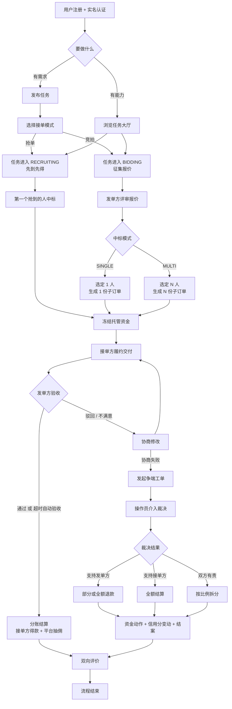

#### 4.3.2 发单流程

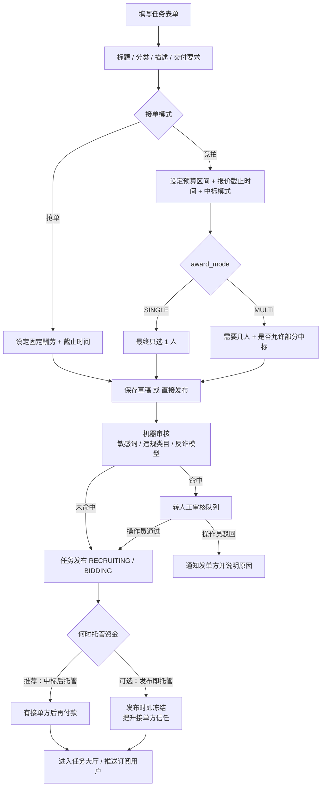

> **决策说明**：**默认「中标后托管」**。理由是"发布即托管"会在无人接单时长期冻结用户资金，引发大量退款工单。但对高价值或冷门任务，允许发单方主动选择"发布即托管"，并在列表页给这些任务打「**已托管**」标识以提升接单意愿——这是用产品手段解决供需信任问题，而不是靠技术。

#### 4.3.3 抢单流程（⭐ 并发正确性是本流程的核心）

```mermaid
sequenceDiagram
    autonumber
    participant U as 接单方
    participant FE as Web 前端
    participant API as app-api
    participant R as Redis
    participant DB as MySQL
    participant MQ as RocketMQ

    U->>FE: 点击「立即抢单」
    FE->>FE: 生成 requestId 并禁用按钮
    FE->>API: POST /api/v1/tasks/{id}/grab<br/>Idempotency-Key: requestId
    API->>API: 前置闸门校验
    Note over API: ① 实名已通过<br/>② 信用分 ≥ 门槛<br/>③ 进行中任务数 &lt; 上限<br/>④ 非发单方本人<br/>⑤ 未被发单方拉黑
    API->>R: SET grab:task:{id} NX PX 3000<br/>（仅削峰，非正确性依据）
    alt 未拿到 Redis 锁
        API-->>FE: 31001 该任务正在被抢，请重试
    else 拿到锁
        API->>DB: UPDATE task SET status='PENDING_START',<br/>assignee_id=?, version=version+1<br/>WHERE id=? AND status='RECRUITING'<br/>AND assignee_id IS NULL
        alt 影响行数 = 1（抢单成功）
            DB-->>API: 1
            API->>DB: 写 task_grab_log（成功）+ task_status_log
            API->>MQ: 发送「任务已中标」事务消息
            API-->>FE: 成功，跳转订单页
            MQ->>MQ: 通知发单方 + 通知其他抢单失败者
        else 影响行数 = 0（已被抢走）
            DB-->>API: 0
            API->>DB: 写 task_grab_log（失败原因=已被抢）
            API-->>FE: 31002 已被他人抢走，可查看相似任务
        end
    end
```

**为什么必须是条件 UPDATE**：

| 错误写法 | 后果 |
|---|---|
| `SELECT` 查状态 → 判断 → `UPDATE` | 两个请求同时查到 `RECRUITING`，都判定可抢，**两人都抢到**（经典 check-then-act 竞态） |
| 只靠 Redis 锁 | Redis 主从切换/锁过期/网络分区时会丢锁，**正确性不能建立在会失效的东西上** |
| 先 `SELECT ... FOR UPDATE` 再更新 | 虽然正确，但多一次往返且易在复杂事务中持有锁过久 |
| ✅ **条件 UPDATE + 判断影响行数** | 一条语句，由 InnoDB 行锁保证串行；条件与更新原子发生 |

#### 4.3.4 竞拍流程（含 MULTI 多选中标）

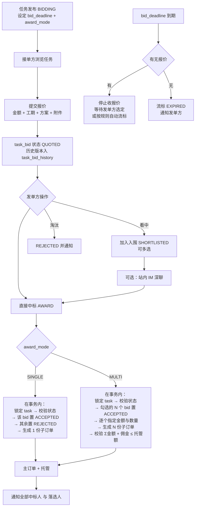

**MULTI 模式的关键约束**（写进接口校验，缺一不可）：

1. `Σ 各子订单金额 + 平台佣金 ≤ 主订单托管金额`，否则拒绝中标（**不能超发**）。
2. 每个子订单**独立**走履约、验收、结算、争端——A 的交付不影响 B 的回款。
3. 子订单**独立超时**：A 逾期不牵连 B。
4. 任一子订单进入争端，**只冻结该子订单的托管份额**，其余正常结算。
5. 中标后总金额减少（如发单方发现只需要 2 人而非 3 人）→ **只能通过"取消单个子订单"实现**，且需按规则赔付该接单方，不得私自改小金额。

#### 4.3.5 履约与验收流程

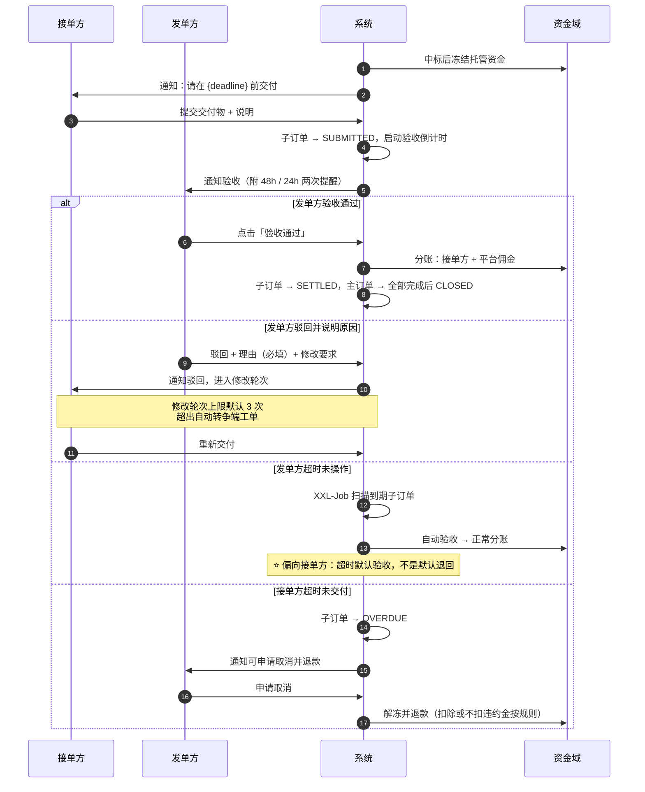

#### 4.3.6 争端处理流程

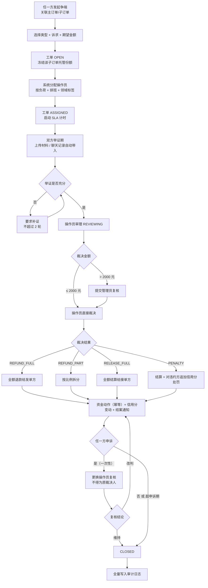

#### 4.3.7 资金托管与结算流程

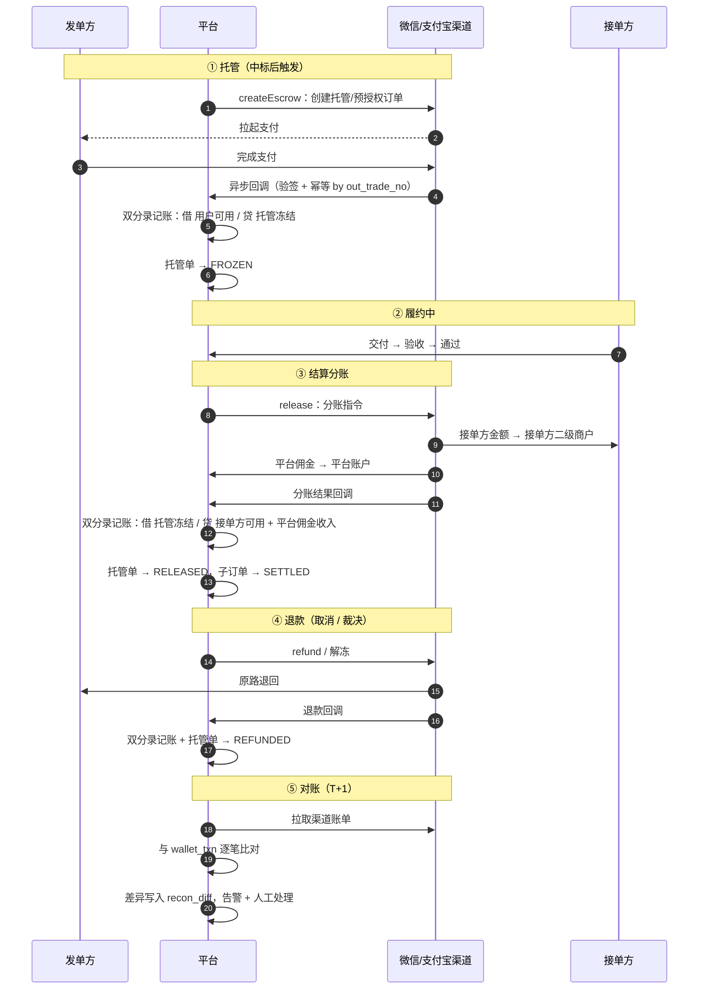

### 4.4 功能需求（用例清单）

> 编号规则：`UC-U-xx` 用户端 ｜ `UC-O-xx` 操作员端 ｜ `UC-A-xx` 管理员端。
> 优先级：**P0** = MVP 必须 ｜ **P1** = 第二阶段 ｜ **P2** = 可选/增强。

#### 4.4.1 用户端（`web-user`）

**M1 账户与认证**

| 编号 | 用例 | 说明 | 优先级 |
|---|---|---|---|
| UC-U-01 | 手机号注册 / 登录 | 短信验证码；图形验证码防刷 | P0 |
| UC-U-02 | 密码登录 / 找回密码 | 密码强度校验、连续失败锁定 | P0 |
| UC-U-03 | 实名认证 | 个人：姓名+身份证+人脸或三要素；企业：营业执照+法人 | P0 |
| UC-U-04 | 个人资料维护 | 昵称、头像、简介、技能标签、服务区域 | P0 |
| UC-U-05 | 信用分查看与明细 | 分值、变动流水、影响说明 | P1 |
| UC-U-06 | 安全设置 | 修改密码、设备管理、强制下线、注销账号 | P0 |
| UC-U-07 | 消息通知偏好 | 站内 / 短信 / 微信模板消息开关 | P1 |

**M2 发单（发单方视角）**

| 编号 | 用例 | 说明 | 优先级 |
|---|---|---|---|
| UC-U-10 | 创建任务 | 分类、标题、描述（富文本）、附件、交付要求、截止时间 | P0 |
| UC-U-11 | 选择接单模式 | 抢单（固定酬劳）/ 竞拍（预算区间） | P0 |
| UC-U-12 | 配置竞拍参数 | 报价截止时间、`award_mode`（SINGLE/MULTI）、所需人数 | P0 |
| UC-U-13 | 预算与佣金预估 | 实时显示"接单方实得 / 平台佣金"，避免事后争议 | P0 |
| UC-U-14 | 保存草稿 / 编辑 / 删除 | 仅 `DRAFT` 状态可删 | P0 |
| UC-U-15 | 发布任务 | 触发机审；高风险转人工 | P0 |
| UC-U-16 | 支付托管资金 | 渠道收银台；支持"发布即托管"开关 | P0 |
| UC-U-17 | 取消任务 | 未中标可免费取消；已中标需按规则赔付 | P0 |
| UC-U-18 | 任务延期 | 修改截止时间（需通知已报价方） | P1 |
| UC-U-19 | 我的任务列表 | 按状态筛选：草稿/进行中/已完成/已取消 | P0 |
| UC-U-20 | 查看报价列表与对比 | 按金额/工期/信用分排序，可入围、可 IM 深聊 | P0 |
| UC-U-21 | 选定中标方 | SINGLE 单选；MULTI 多选并分配金额与数量 | P0 |
| UC-U-22 | 邀请指定用户接单 | 定向邀请（跳过公开竞争） | P2 |

**M3 接单（接单方视角）**

| 编号 | 用例 | 说明 | 优先级 |
|---|---|---|---|
| UC-U-30 | 任务大厅 | 多条件筛选 + 排序 + 分页 | P0 |
| UC-U-31 | 任务详情 | 完整需求、附件预览、发单方信用、已有报价数 | P0 |
| UC-U-32 | **抢单** | 一键抢单；失败给出明确原因与相似任务推荐 | P0 |
| UC-U-33 | **提交报价** | 金额 + 工期 + 方案 + 附件 | P0 |
| UC-U-34 | 修改 / 撤回报价 | 截止前可改，历史留痕 | P0 |
| UC-U-35 | 我的报价列表 | 状态：待评审/已入围/已中标/已落选 | P0 |
| UC-U-36 | 订阅与提醒 | 按分类/关键词订阅，新任务推送 | P1 |
| UC-U-37 | 收藏任务 | | P2 |

**M4 订单与履约**

| 编号 | 用例 | 说明 | 优先级 |
|---|---|---|---|
| UC-U-40 | 订单列表与详情 | 主订单 + 子订单结构展示（MULTI 模式下多份） | P0 |
| UC-U-41 | 提交交付物 | 分片上传大文件 + 交付说明；可多次提交 | P0 |
| UC-U-42 | 验收通过 | 触发分账结算 | P0 |
| UC-U-43 | 驳回并说明 | 理由必填；计入修改轮次 | P0 |
| UC-U-44 | 自动验收提醒与倒计时 | 48h / 24h 两次提醒；超时自动验收 | P0 |
| UC-U-45 | 申请取消订单 | 双方协商取消，进入退款流程 | P0 |
| UC-U-46 | 交付物下载与版本对比 | 保留每轮交付记录 | P1 |
| UC-U-47 | 双向评价 | 评分 + 标签 + 文字；互评完成或超时后公开 | P1 |

**M5 资金**

| 编号 | 用例 | 说明 | 优先级 |
|---|---|---|---|
| UC-U-50 | 钱包总览 | 可用余额 / 冻结中 / 累计收入 / 累计支出 | P0 |
| UC-U-51 | 资金流水 | 按类型/时间筛选，每笔可追溯到订单 | P0 |
| UC-U-52 | 充值 | 渠道支付 | P0 |
| UC-U-53 | 提现 | 实名 + 绑卡 + 结算周期（T+1）；风控校验 | P0 |
| UC-U-54 | 提现记录与状态 | 申请中/处理中/已到账/已驳回 | P0 |
| UC-U-55 | 账单导出 | 导出 CSV/PDF（对账用） | P1 |
| UC-U-56 | 发票申请 | 平台佣金发票 | P2 |

**M6 沟通与通知**

| 编号 | 用例 | 说明 | 优先级 |
|---|---|---|---|
| UC-U-60 | 站内 IM | 文本、图片、订单卡片；已读回执；离线消息补偿 | P0 |
| UC-U-61 | 系统通知中心 | 中标/落选/交付/验收/结算/工单进展 | P0 |
| UC-U-62 | 敏感词与反诈提示 | 命中即拦截 + 提示"请勿脱离平台交易" | P0 |
| UC-U-63 | 举报用户 / 任务 | 提交举报，进入操作员队列 | P1 |

**M7 争端**

| 编号 | 用例 | 说明 | 优先级 |
|---|---|---|---|
| UC-U-70 | 发起争端 | 选类型、写诉求、传证据、提出期望金额 | P0 |
| UC-U-71 | 补充举证 | 举证期内上传材料 | P0 |
| UC-U-72 | 查看工单进展 | 时间轴展示每步操作与操作员 | P0 |
| UC-U-73 | 申诉 | 一次性；由另一位操作员复核 | P1 |
| UC-U-74 | 裁决结果确认与资金到账 | 展示裁决书与资金动作 | P0 |

**M8 信誉分与权益**（v1.1 新增，见 §4.9）

| 编号 | 用例 | 说明 | 优先级 |
|---|---|---|---|
| UC-U-80 | **信誉分总览** | 当前分值、等级、距下一等级还差多少分、进度条 | P0 |
| UC-U-81 | **权益对照表** | 当前等级享有的权益（抢单门槛、接单上限、排序权重、**抽成费率**、**提现周期**、平台介入优先级），并展示上下相邻等级的差异 | P0 |
| UC-U-82 | **信誉分明细** | 逐笔变动：事件、分值、变动前后、关联订单、原因、时间；可点击跳转到对应订单 | P0 |
| UC-U-83 | **扣分申诉** | 对扣分项发起申诉（限时 7 天、一次性），进入仲裁专员队列 | P1 |
| UC-U-84 | 提升指引 | "再做 N 单好评可升到良好，费率降 0.5%、提现周期 T+3 → T+1" | P1 |
| UC-U-85 | 扣分预警提醒 | 分数接近等级边界时提前提醒（如 62 分时提示"再扣 3 分将降级"） | P1 |

**M9 任务类型与状态**（v1.2 新增，见 §4.10 / §4.11）

| 编号 | 用例 | 说明 | 优先级 |
|---|---|---|---|
| UC-U-90 | **类型化发单** | 按三维（分类 / 形态 / 计酬）**动态渲染表单**：选 OFFLINE 才出现地点与服务时间段；选 BY_QUANTITY 才出现单价×数量 | P0 |
| UC-U-91 | **填写验收标准** | 结构化验收项清单（至少 1 项，可标"必过"，可设权重）；支持从模板带出 | P0 |
| UC-U-92 | 知识产权与合规条款 | 设计/开发类必填归属；可设保密要求、是否允许转包 | P0 |
| UC-U-93 | 设置接单方门槛 | `min_credit_level`、可见性（公开 / 仅认证 / 定向邀请） | P1 |
| UC-U-94 | 里程碑编排 | 添加/删除/排序里程碑阶段，分配金额与期限，Σ金额须等于总预算 | P1 |
| UC-U-95 | **状态驱动的操作面板** | 任务详情页按 `状态 × 操作矩阵` 渲染可用按钮（⛔ 前端不硬编码状态字符串，由**状态字典接口**下发） | P0 |
| UC-U-96 | **状态时间轴** | 展示任务从发布到结算的完整状态变迁历史（含每次变更的时间与原因） | P1 |
| UC-U-97 | 线下任务签到 | 到场签到（定位 + 拍照），可触发 `PENDING_START → IN_PROGRESS` | P1 |
| UC-U-98 | 按量/按天交付台账 | 展示已交付批次/天数、已结算与待结算金额 | P1 |
| UC-U-99 | 任务模板与续单 | 存为模板、从模板发单、基于已完成任务再发一单 | P2 |

#### 4.4.2 操作员端（`web-admin` 内按角色裁剪）

| 编号 | 用例 | 说明 | 优先级 |
|---|---|---|---|
| UC-O-01 | 待办工作台 | 我的工单队列 + SLA 倒计时 + 今日处理量 | P0 |
| UC-O-02 | 实名认证审核 | 查看证件（脱敏水印）、通过/驳回并填原因 | P0 |
| UC-O-03 | 任务内容审核 | 机审命中任务的复核；通过/驳回/下架 | P0 |
| UC-O-04 | 举报处理 | 举报队列、核实、处理（警告/下架/转工单） | P1 |
| UC-O-05 | **争端工单受理** | 接单、查看双方证据、IM 记录只读调阅 | P0 |
| UC-O-06 | **下达裁决** | 选裁决类型 + 金额 + 理由；≤2000 元直接生效 | P0 |
| UC-O-07 | 超限裁决提交复核 | >2000 元提交管理员 | P0 |
| UC-O-08 | 申诉复核 | 仅非原裁决人可接 | P1 |
| UC-O-09 | 工单时间轴与备注 | 内部备注（用户不可见） | P1 |
| UC-O-10 | 我的处理统计 | 处理量、平均时长、SLA 达成率、改判率 | P2 |
| UC-O-11 | 用户风险查询 | 查信用分、历史工单数、历史违约次数（只读） | P1 |
| UC-O-12 | **工单受理与分派** | 客服：接收咨询/举报/申诉入口单，按类型分派给对应岗位 | P0 |
| UC-O-13 | **提现审核** | 财务专员：审核 5000–50000 元提现（实名一致性、异常行为判定） | P0 |
| UC-O-14 | **对账差异处理** | 财务专员：查看 T+1 差异单，标记原因、发起补单或转人工核查 | P0 |
| UC-O-15 | **扣分申诉受理** | 仲裁专员：受理用户对信誉分扣分的申诉，回滚或维持 | P1 |
| UC-O-16 | 我的岗位待办台 | 按岗位展示队列（审核/实名/仲裁/客服/财务各自不同） | P0 |

#### 4.4.3 系统管理员端（`web-admin`）

| 编号 | 用例 | 说明 | 优先级 |
|---|---|---|---|
| UC-A-01 | 用户查询与详情 | 多条件检索；查看资料、订单、资金、工单全貌 | P0 |
| UC-A-02 | 冻结 / 解冻账号 | 必填原因；即时生效并踢下线 | P0 |
| UC-A-03 | 重置密码 / 强制下线 | 触发短信通知 | P0 |
| UC-A-04 | 调整信用分 | 必填原因，写审计 | P0 |
| UC-A-05 | **内部账号管理** | 创建/停用操作员与管理员账号、绑定角色 | P0 |
| UC-A-06 | **角色与权限配置** | 角色 CRUD、权限点勾选、数据范围设置 | P0 |
| UC-A-07 | 组织与数据权限 | 操作员分组、组间数据隔离 | P1 |
| UC-A-08 | **系统参数配置** | 平台佣金费率、信用门槛、自动验收天数、SLA 时长、修改轮次上限、裁决金额上限 | P0 |
| UC-A-09 | 任务分类管理 | 分类树维护 | P0 |
| UC-A-10 | 风控规则配置 | 频次限制、黑名单、反诈关键词、异常行为阈值 | P1 |
| UC-A-11 | 黑名单管理 | 用户/设备/IP 黑名单 | P1 |
| UC-A-12 | **资金对账与差异处理** | 查看 T+1 对账结果、处理差异单 | P0 |
| UC-A-13 | 退款 / 补单（受控） | 特殊场景人工干预，**双人复核** | P1 |
| UC-A-14 | 提现审核 | 大额提现人工审核 | P1 |
| UC-A-15 | **审计日志查询** | 按操作人/时间/对象/动作检索，不可篡改 | P0 |
| UC-A-16 | 通知模板管理 | 站内/短信/微信模板内容维护 | P1 |
| UC-A-17 | 数据看板 | GMV、订单量、托管余额、争端率、SLA 达成率、资金对账差异 | P0 |
| UC-A-18 | 操作员绩效看板 | 处理量、时长、改判率 | P1 |
| UC-A-19 | 数据导出 | 按权限导出（脱敏） | P1 |
| UC-A-20 | 系统公告 | 首页公告与弹窗 | P1 |
| UC-A-21 | **抽成费率配置** | 运营管理员：基准费率、分类覆盖费率、金额阶梯、最低/最高抽成、上下限钳制 | P0 |
| UC-A-22 | **活动费率配置** | 运营管理员：限时/定向活动费率，设生效时间、适用范围、是否与信誉分折扣叠加 | P1 |
| UC-A-23 | **费率变更审批与公示** | 双人审批（运营 + 超管）、预约生效、**只影响变更后新订单**、提前 7 天公示 | P0 |
| UC-A-24 | **信誉分规则配置** | 风控管理员：各事件的分值、单日上限、是否可衰减、生效时间 | P0 |
| UC-A-25 | **信誉等级配置** | 风控管理员：等级区间与权益参数（上限、门槛、排序权重、费率修正、提现周期） | P0 |
| UC-A-26 | **信誉分人工调整** | 风控管理员单次 ≤20 分（超 20 分需超管）；必填原因 + 审计 | P0 |
| UC-A-27 | **岗位与互斥配置** | 超级管理员：角色 CRUD、权限点勾选、**互斥岗位对配置**、内部账号岗位分配 | P0 |
| UC-A-28 | **双人/三人复核台** | 超限裁决、大额提现、人工调账、费率变更的复核审批 | P0 |
| UC-A-29 | 抽成与信誉分看板 | 佣金收入趋势、费率分布、各信誉等级用户分布与迁移 | P1 |

### 4.5 非功能需求

#### 4.5.1 性能指标

| 指标 | 目标 | 验证方式 |
|---|---|---|
| **抢单接口** | P99 ≤ **300ms**；单任务 **5000 并发**下**成功数恒为 1** | k6 并发压测 + 结果断言 |
| 常规读接口（任务详情、列表） | P99 ≤ 200ms | 压测 |
| 写接口（发单、交付、裁决） | P99 ≤ 500ms | 压测 |
| **支付回调处理** | P99 ≤ 1s 完成落库与记账（异步动作走 MQ） | 回放压测 |
| 峰值 QPS | 抢单 3000 ｜ 读 8000 ｜ IM 消息 5000/s | 容量测试 |
| IM 消息端到端延迟 | P99 ≤ 500ms | 埋点统计 |
| 列表首屏 | ≤ 1.5s（4G 网络） | Lighthouse / 真机 |

#### 4.5.2 可用性与可靠性

| 指标 | 目标 |
|---|---|
| 核心链路可用性 | **99.95%**（年停机 ≤ 4.38h） |
| 非核心链路（报表、导出） | 99.5% |
| RPO / RTO | RPO ≤ 5min（MySQL 半同步 + binlog）｜ RTO ≤ 30min |
| 故障降级 | 支付回调与抢单**必须可用**；推荐、榜单、搜索可降级 |
| 限流与熔断 | Sentinel 或自研：按用户/接口/渠道三维限流；渠道超时熔断并降级为"稍后重试" |
| 幂等 | 抢单、中标、支付回调、分账、退款、裁决**全部必须幂等** |

#### 4.5.3 安全性

> **完整安全设计见 §5.8**（威胁模型 / 接口安全 / 资金安全 / 内部人管控 / 密钥管理 / 基础设施 / 供应链 / 客户端 / 隐私合规 / 应急响应 / SDL / 等保三级映射，共 19 个小节）。本节只列**需求级指标**。
>
> **合规目标：等保三级**（因含身份证等敏感个人信息 + 承载资金 + 目标 100 万用户）。

| 维度 | 要求 |
|---|---|
| 传输 | 全站 HTTPS（TLS 1.2+），HSTS + preload |
| 认证 | JWT（Access 15min + Refresh 7d **一次性可吊销**）；内部账号强制 **MFA**；登录失败 5 次锁定 15 分钟；**防撞库、防账号枚举、防验证码轰炸**（§5.8.1） |
| 授权 | 三层鉴权（平台身份 / 权限点 / 数据范围 + 资源所有权）；**前后端双向校验，后端为唯一安全边界** |
| 越权防护 | 水平越权（IDOR）与垂直越权**逐接口用例覆盖**，累计 **T1–T34** 共 34 条（§5.8.2、§5.8.7） |
| 注入 / XSS / CSRF | MyBatis 全参数化 + `${}` 禁用；富文本**服务端白名单**过滤 + CSP；管理端 CSRF Token |
| **数据分级** | **L1–L4 四级**；L4（身份证、银行卡、证件图、人脸、渠道私钥）加密存储 + 单独密钥 + 访问审批 + 水印（§5.8.3） |
| **密钥管理** | **信封加密**（KMS/Vault 管 KEK，DEK 加密后存库）；⛔ 源码/镜像/配置/日志中禁止出现任何密钥（§5.8.10） |
| **资金安全** | 回调验签 + 幂等 + 金额服务端计算 + 双人复核 + 每日 5 项不变量校验（§5.8.8） |
| **内部人管控** | 最小权限 + 职责分离 + 敏感操作二次认证 + 行为基线告警 + 离职回收（§5.8.9） |
| 审计 | **三类审计**（业务 / 访问 / 安全）；独立存储 + 只增不改 + 哈希链 + 可信时间源；留存 ≥6 个月（业务审计 5 年）（§5.8.4） |
| 风控 | **自建全套**：规则引擎（热更新、可回测、可解释）+ 设备指纹 + 关系图谱（§5.8.5） |
| 隐私合规 | 个保法 12 项义务落地（告知同意 / 单独同意 / 最小必要 / 可携带 / 可删除 / 自动化决策告知 / PIA / 泄露通知）（§5.8.15） |
| 应急响应 | P0–P3 四级 + 三类专项 Runbook（资金异常 / 数据泄露 / 大规模盗号）+ **每季度演练**（§5.8.16） |
| 供应链 | SCA + SBOM + 制品签名 + 镜像扫描 + CI 加固（§5.8.13） |
| 客户端 | 标准加固：Web（CSP/SRI）+ 小程序（`session_key` 不下发）+ App（混淆/证书绑定/root 检测）+ 桌面端（包签名）（§5.8.14） |

#### 4.5.4 合规要求

| 法规 | 要求 | 落地动作 |
|---|---|---|
| 《电子商务法》 | 平台经营者义务、交易信息保存**不少于 3 年** | 本系统按 **5 年**保留（D8）；用户协议与规则公示 |
| 《网络安全法》 | 等级保护、日志留存 ≥ 6 个月 | 目标等保二级（核心冲三级）；日志留存 180 天+ |
| 《个人信息保护法》 | 告知同意、最小必要、可删除、可导出 | 隐私政策、授权清单、账号注销与数据删除流程、导出功能 |
| 《非银行支付机构监督管理条例》 | **禁止无证从事支付结算** | ⛔ 资金不归集；走电商收付通/分账（§5.5.4） |
| 《网络交易监督管理办法》 | 实名、信息公示、争议处理机制 | 实名认证强制作发单前置；公示投诉渠道与处理时限 |
| 数据出境 | 不得违规出境 | 数据全部境内存储 |

#### 4.5.5 容量估算（3 年目标基线）

**假设**：注册用户 100 万 ｜ DAU 8 万 ｜ 日均新任务 1 万 ｜ 日均订单 6000 ｜ 单任务平均 15 次浏览 + 3 次报价

| 维度 | 计算 | 结论 |
|---|---|---|
| 任务表 | 1 万/日 × 365 × 3 ≈ **1100 万行** | 单表可承受；按 `created_at` 归档冷数据 |
| 订单/子订单 | 6000/日 × 365 × 3 ≈ **660 万**（子订单约 800 万） | 单表可承受 |
| 资金流水 | 订单 3 倍 ≈ 2000 万/年 → 3 年 **6000 万行** | ⚠️ 接近单表阈值，**按年分表** |
| IM 消息 | 8 万 × 20 条 = **160 万/日** → 3 年 **17.5 亿行** | ⛔ **必须分片**：按 `session_id` hash 分 64 表；冷数据 6 个月后转归档库 |
| 附件存储 | 5000 个/日 × 2MB 均值 = **10GB/日** → 3 年约 **11TB** | 对象存储 + 生命周期策略（1 年后转低频，2 年后转归档） |
| 峰值 QPS | 读 ≈ 60 万 PV × 0.8 / (8h×3600) × 峰值系数 5 ≈ 83 | 考虑抢单热点集中，**按 3000 QPS 设计**（余量 36×） |
| 带宽 | 附件下载峰值按 500Mbps | CDN + 签名 URL 直连对象存储 |
| **通知记录** ⭐ | DAU 8 万 × 人均 5 条 = **40 万/日** → 3 年 **4.4 亿行** | ⛔ **v1.6 补漏**（原测算遗漏）：只增不改，**会比订单表先到瓶颈** → 90 天归档（`sys_archive_config`） |
| **登录日志** ⭐ | 8 万 × 1.5 次 = **12 万/日** → 3 年 **1.3 亿行** | ⛔ **v1.6 补漏**：等保要求留存 ≥6 个月 → 180 天归档 |
| **风控决策日志** ⭐ | 按事件量估 **30 万/日** → 3 年 **3.3 亿行** | ⛔ **v1.6 补漏** → 180 天归档 |
| **访问审计** ⭐ | L3/L4 访问量估 **5 万/日** → 3 年 **5500 万行** | ⛔ **v1.6 补漏**：保留 365 天（比日志久，审计需要） |

### 4.6 约束与假设

#### 4.6.1 约束

| 类型 | 约束 |
|---|---|
| 技术 | 后端锁定 Java 21 + Spring Boot 3；前端锁定 Vue 3 + TS；数据库 MySQL 8 |
| 合规 | 资金必须走渠道分账；不得归集；实名认证为发单/接单前置条件 |
| 资源 | 首年基础设施预算见 §1.6；团队按 3-8 人计（后端 3、前端 2、测试 1、运维 0.5、产品 0.5） |
| 时间 | Phase 1（MVP）目标 **10-11 周**（v1.1 引入信誉分引擎、抽成引擎与岗位细分后，较初版 +1~2 周） |
| 平台依赖 | 微信支付电商收付通需平台资质审核（**周期可能 2-4 周，必须提前启动**） |

#### 4.6.2 假设（若假设不成立则设计需调整）

| # | 假设 | 不成立时的调整 |
|---|---|---|
| A1 | 任务以"一单一结"为主，不做长期雇佣/月结 | 需引入"雇佣合同 + 周期结算 + 工时单"模型，工作量 +40% |
| A2 | 发单方与接单方**不能是同一人处理同一任务**（禁止自问自答刷单） | 若允许，需新增"自交易"风控与手续费规则 |
| A3 | 平台只做撮合与托管，**不做自营**（平台自己不接单） | 若自营，需引入"官方服务商"账号类型与特殊结算 |
| A4 | 资金结算周期为接单方提现 **T+1** | 若 T+7，需引入"在途资金"科目与更长冻结期 |
| A5 | 线下任务仅需文字描述地点，**不做打卡/轨迹/地理围栏** | 若需要，需引入 LBS 服务、轨迹存储与隐私授权，工作量 +25% |
| A6 | 单任务托管金额上限 5 万元 | 若更高，需强制人工审核 + 分期托管 |
| A7 | 不做跨境（无外汇、无多币种） | 需引入结算币种、汇率与跨境支付合规 |

### 4.7 角色体系完善（v1.1 新增）

#### 4.7.1 设计原则：平台身份 3 个不变，岗位靠 RBAC 细分

| 概念 | 字段 | 数量 | 作用 | 能否增加 |
|---|---|---|---|---|
| **平台身份** | `sys_user.identity` | **固定 3 个** | **安全边界**：路径域隔离、令牌授权范围、审计分类 | ⛔ **不增加** |
| **岗位** | `sys_role`（RBAC 角色） | 可扩展 | 细分职责：能看什么菜单、能调哪些接口 | ✅ 随时可加 |

**为什么这样切**：
- 加岗位（如新增"数据分析员"）**不动安全模型**，只加角色与权限点，改配置不改代码。
- 调岗只改角色绑定，历史审计仍能追到"当时这个动作需要哪个岗位"。
- 一个人可兼多岗（小团队常见），但**互斥岗位除外**（§4.7.5）。

#### 4.7.2 用户（`USER`）—— 发单方 / 接单方是**行为态**，不是两个角色

| 维度 | 发单方态 | 接单方态 |
|---|---|---|
| 何时成立 | 创建任务时 | 抢单成功 / 报价时 |
| 平台如何判定 | `task.publisher_id == 当前用户` | `sub_order.taker_id == 当前用户` |
| 信誉分 | **同一本账**（同一个 `credit_score`） | **同一本账** |
| 核心诉求 | 花出去的钱能拿到合格交付 | 干完的活能按时拿到钱 |
| 平台资源占用 | 曝光位、托管资金 | 曝光位、履约产能 |
| 典型履约行为 | 如实描述、及时选标、及时验收、公正评价 | 如实报价、按期交付、质量达标、不加价 |
| 典型违约形态 | **恶意驳回、拖延验收、虚假任务、骗方案、拒付** | **抢了不做、逾期交付、质量不符、中途加价、脱离平台交易** |
| 行为约束手段 | 信誉分扣分、强制发布即托管、任务曝光降权、举证责任加重 | 信誉分扣分、接单上限、抢单门槛、提现周期延长、保证金 |

> ⭐ **同一账号只有一本信誉分账**：所有行为（无论发单还是接单）都作用在同一个分上。模型简单、威慑明确 —— 不能靠"这边刷分补那边扣分"。

**用户端的信誉分可见性要求**（直接对应用例 UC-U-80 ~ UC-U-85）：

| 要求 | 说明 |
|---|---|
| 可查 | 分值、等级、距下一等级的差距 |
| 可解释 | 每一笔变动都能看到事件、分值、关联订单、原因 |
| 可预期 | 明确告知"再扣 X 分将降级，降级后会失去哪些权益" |
| 可申诉 | 扣分可申诉，申诉成功回滚并补偿 |
| 可提升 | 给出具体路径（"再做 3 单好评即可升到良好，费率降 0.5%、提现 T+3 → T+1"） |

#### 4.7.3 操作员（`OPERATOR`）—— 5 个岗位

| 岗位代码 | 岗位名 | 核心职责 | 关键权限点 | KPI |
|---|---|---|---|---|
| `ROLE_AUDITOR` | **内容审核员** | 机审命中任务的复核、违规下架、举报核实 | `task:audit` | 审核时效 ≤ 2h、误判率 ≤ 2% |
| `ROLE_RN_AUDITOR` | **实名审核员** | 个人/企业实名材料审核、证件真伪核验 | `realname:audit` | 时效 ≤ 4h、准确率 ≥ 99.5% |
| `ROLE_ARBITER` | **仲裁专员** | 争端工单受理、组织举证、**下达裁决**（≤2000 元）、受理扣分申诉 | `dispute:handle`、`dispute:verdict`、`credit:appeal` | SLA 达成率 ≥ 95%、**改判率 ≤ 5%** |
| `ROLE_SUPPORT` | **客服专员** | 咨询答复、工单受理与分派、催办、申诉初审 | `ticket:intake`、`ticket:assign` | 首响 ≤ 30min、满意度 ≥ 90% |
| `ROLE_FINANCE` | **财务专员** | 提现审核（5000–50000）、对账差异处理、退款复核 | `withdraw:audit`、`recon:handle` | 对账差异 T+1 清零、处理完成率 100% |

#### 4.7.4 系统管理员（`ADMIN`）—— 4 个岗位

| 岗位代码 | 岗位名 | 核心职责 | 关键权限点 |
|---|---|---|---|
| `ROLE_SUPER_ADMIN` | **超级管理员** | 内部账号管理、角色与权限配置、数据范围、互斥岗位配置 | `account:*`、`rbac:*` |
| `ROLE_OPS_ADMIN` | **运营管理员** | 分类管理、**抽成费率与活动配置**、公告、通知模板 | `config:commission`、`config:category`、`notice:*` |
| `ROLE_RISK_ADMIN` | **风控管理员** | 风控规则、黑名单、**信誉分规则与等级配置、信誉分人工调整** | `risk:*`、`credit:rule`、`credit:adjust` |
| `ROLE_FINANCE_ADMIN` | **财务管理员** | 对账终审、大额提现终审、**大额资金动作双人复核** | `recon:*`、`fund:dual-approve` |

#### 4.7.5 ⭐ 职责分离（SoD）与多级复核

**高风险动作的复核矩阵**：

| 高风险动作 | 需要谁 | 票数 |
|---|---|---|
| 裁决金额 ≤ 2000 元 | 仲裁专员 | 1 |
| 裁决金额 2000 – 10000 元 | 仲裁专员 + 管理员复核 | 2 |
| 裁决金额 > 10000 元 | 仲裁专员 + 财务管理员 + 超级管理员 | 3 |
| 提现 ≤ 5000 元 | 自动放行（风控规则通过） | — |
| 提现 5000 – 50000 元 | 财务专员 | 1 |
| 提现 > 50000 元 | 财务专员 + 财务管理员 | 2 |
| 人工补单 / 调账 | 财务专员 + 财务管理员 | 2 |
| 信誉分人工调整 ≤ 20 分 | 风控管理员 | 1 |
| 信誉分人工调整 > 20 分 | 风控管理员 + 超级管理员 | 2 |
| 抽成费率变更 | 运营管理员 + 超级管理员 | 2 |
| 黑名单解封 | 超级管理员 | 1 |

**互斥岗位对**（`sys_role_conflict` 配置，分配时强制校验）：

| 互斥对 | 原因 |
|---|---|
| 内容审核员 ⊗ 仲裁专员 | 防止"自己审过的任务自己裁" |
| 仲裁专员 ⊗ 财务专员 / 财务管理员 | **裁决权与资金执行权分离** |
| 运营管理员（费率） ⊗ 财务管理员（对账） | 定价与资金核对分离 |
| 超级管理员 ⊗ 任何用户态角色 | 内部账号不得参与平台交易（防自买自卖） |

#### 4.7.6 角色协同工作流

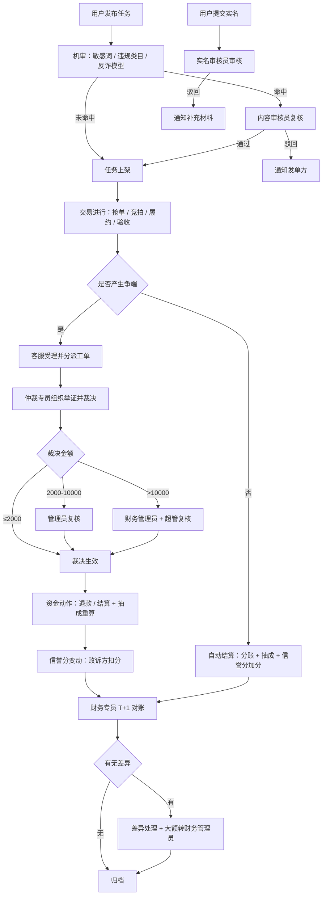

> **读图要点**：**仲裁专员只下裁决，不执行资金**；资金由 `wallet` 模块按裁决结果自动执行，由**财务专员**事后对账。三权分立（裁决 / 执行 / 核对）都留审计。

#### 4.7.7 岗位职责边界速查（"谁不能做什么"）

| 不能做的事 | 谁被禁止 | 为什么 |
|---|---|---|
| 复核自己处理过的工单 | 仲裁专员 | 自我复核无效 |
| 下达裁决同时执行资金 | 仲裁专员 | 裁决与执行分离 |
| 查看用户完整身份证号 | 除实名审核员外所有人 | 最小必要原则 |
| 配置抽成费率同时审批提现 | 运营管理员 vs 财务岗 | 定价与资金分离 |
| 给自己账号加权限 | 除超级管理员外所有人 | 提权防护（超管的提权动作也只记录不阻断，靠审计追责） |
| 删除或修改审计日志 | **所有人（含超管）** | 数据库层面收回 UPDATE/DELETE 权限 |
| 删除 IM 聊天记录 | 所有人 | 争端证据，不可篡改 |
| 内部账号参与平台交易 | 所有 `OPERATOR` / `ADMIN` | 防自买自卖与利益输送 |

### 4.8 平台抽成规则（业务口径，v1.1 新增）

#### 4.8.1 基本口径

| 项 | 口径 |
|---|---|
| **抽成方向** | **向接单方抽取**（从接单方应得款中扣除） |
| **计费基数** | 子订单成交金额（中标金额 / 抢单酬劳），**不含**发单方额外支付的渠道手续费 |
| **展示原则** | ① 发单方**看到多少就付多少**，无任何隐藏费用；② **接单方在报价/抢单时即实时看到「报价 / 平台服务费 / 实得」三行明细** |
| **结算方式** | 验收通过（或自动验收）时，随分账指令一并划取 |
| **费率快照** | 任务发布时把当时适用的费率写入任务快照，**费率变更不追溯已发布任务**（§5.12.7） |

> ⚠️ **必须点明的一件事（否则产品叙事会反噬）**：抽成"向谁收"本质是**定价展示问题，不是经济归属问题**。向接单方抽 5%，接单方的理性反应是把报价上浮约 5%，**最终仍由发单方承担**。
> 因此 ⛔ **不要把"向接单方抽"宣传成"发单方省钱"**。正确的产品叙事是「**价格透明、无隐藏费用、接单方报价即实得可见**」——这个叙事站得住，前者站不住。

#### 4.8.2 费率计算公式与优先级

```
最终费率 = 基础费率
         + 信誉分等级修正（百分点，可被活动配置为不叠加）
基础费率 = 第一个命中的规则：
           ① 活动费率（有效期内、定向范围）
           ② 分类覆盖费率（task_category.commission_rate 非空）
           ③ 金额阶梯费率（按子订单金额区间）
           ④ 基准费率（sys_config.commission_base_rate，默认 5%）

钳制：最终费率 = clamp(最终费率, MIN_RATE 1%, MAX_RATE 20%)
佣金   = ROUND_HALF_UP(子订单金额 × 最终费率, 2)
佣金   = MAX(佣金, min_fee 1.00 元)
实得   = 子订单金额 − 佣金          ← ⭐ 必须用减法，保证严格配平
```

#### 4.8.3 金额阶梯费率（默认，可配）

| 子订单金额区间 | 基准费率 | 说明 |
|---|---|---|
| ≤ 500 元 | **6%** | 叠加最低抽成 1 元，防小额订单佣金低于渠道成本 |
| 500 – 2000 元 | **5%** | 基准档 |
| 2000 – 10000 元 | **4%** | |
| > 10000 元 | **3%** | 鼓励大额订单留在平台内 |

#### 4.8.4 分类覆盖费率（示例，可配）

| 分类 | 费率 | 理由 |
|---|---|---|
| 软件开发 / 设计 | 5% | 基准 |
| 文案 / 数据处理 | 8% | 小额高频，需覆盖渠道与风控成本 |
| 跑腿 / 线下服务 | 10% | 履约风险高、平台介入多 |
| 公益 / 求助类 | **0%** | 平台不抽成（需运营审批） |

#### 4.8.5 信誉分等级费率修正（与 §4.9 联动）

| 信誉等级 | 费率修正 | 举例（基准 5% 时） |
|---|---|---|
| 优秀（80–100） | **−1.0 个百分点** | 5% → **4.0%** |
| 良好（70–79） | −0.5 个百分点 | 5% → 4.5% |
| 一般（60–69） | 基准 | 5% → 5.0% |
| 较差（40–59） | **+2.0 个百分点** | 5% → **7.0%** |
| 黑名单（< 40） | — | 禁止接单 |

> ⭐ 这是把**信誉分**与**抽成**串起来的关键一环：**表现好 = 直接省钱**。比单纯的排序加权更有说服力，也更容易被用户理解。

#### 4.8.6 抽成的边界规则

| 项 | 默认值 | 理由 |
|---|---|---|
| 最低抽成 `min_fee` | **1.00 元** | 分账接口按笔计费，小额订单佣金不能低于渠道成本 |
| 最低费率 `MIN_RATE` | **1%** | 防多重折扣叠加后趋近 0 |
| 最高费率 `MAX_RATE` | **20%** | 防配置错误导致天价抽成（配置越界直接拒绝保存） |
| 单笔最高抽成 | 不设上限 | 大额订单已由阶梯费率自然降低 |
| 最低接单金额 | 不设 | 由发单方自行决定 |

#### 4.8.7 退款与裁决场景下的抽成（⭐ 纠纷高发区）

| 场景 | 佣金处理 |
|---|---|
| 全额退款（取消 / 流标 / 接单方逾期未交付） | 佣金 **0**；若已收则全额退回 |
| **部分退款（裁决按比例拆分）** | ⛔ **按实结金额重算佣金**，**不是**按原订单金额 —— 这是最容易算错的地方 |
| 全额结算给接单方 | 按原金额正常抽成 |
| MULTI 下部分子订单退款 | **逐子订单独立重算**，不影响其他子订单的佣金 |
| 已分账后才发现需退款 | ⚠️ 逆向流程（佣金账户扣减 + 接单方余额扣减 + 双分录红字冲销）。**设计上应通过"争端发起即冻结该份额、禁止先分账"来消灭这个分支**（§5.12.4） |

**举例**：子订单 1000 元，费率 5%，佣金 50，接单方实得 950。
裁决结果"双方各担一半" → 实结 500 元 → **佣金重算为 25 元**，发单方退回 500 元，接单方最终得 475 元。

#### 4.8.8 佣金去向、开票与税务

| 项 | 说明 |
|---|---|
| 去向 | 进入平台佣金虚拟账户 `PLATFORM_COMMISSION`，**与用户资金科目物理隔离** |
| 划取方式 | ⛔ **只能通过渠道分账指令划取**，不得先归集到平台对公账户再转出（§5.5.4 二清红线） |
| 开票 | 平台向接单方开具服务费发票 / 电子凭证（金额即佣金） |
| 增值税 | 佣金收入需缴增值税，税率与纳税人资格相关 |
| 个税 | 接单方收入涉及个人所得税代扣代缴（**需财务与税务确认**，见 §6.1 Q10） |
| 对账 | 佣金作为**独立科目**参与 T+1 对账，与渠道分账明细逐笔核对 |

### 4.9 信誉分规则（业务口径，v1.1 新增）

#### 4.9.1 分值模型

| 项 | 值 |
|---|---|
| 区间 | **0 – 100**（数据库 CHECK 约束强制） |
| **初始值** | **60**（对应「一般」等级，**刚好达到接单门槛**） |
| 计分对象 | **双向**：同一账号一本账，发单行为与接单行为都影响它 |
| 变动时机 | 订单结算、订单取消、逾期、裁决结案、举报核实、申诉改判、时间衰减、人工调整 |
| 记录 | 每笔变动写 `credit_log`（事件类型、分值、变动前后分值与等级、关联订单、原因、操作人） |

> ⭐ **为什么初始值是 60 而不是 100**：如果新用户就是满分，"优秀"等级形同虚设，**等级与权益的联动会全部失效**。初始 60 的含义是「**新用户默认可信，但需要靠履约证明自己**」。
>
> ⚠️ **配套必须做冷启动保护（最容易漏的一环）**：新用户前 3 单标记为「**新手单**」，虽然排序仍受信誉分影响，但给予**固定曝光位**。否则新人永远排在末尾、永远接不到单，**供给端会直接死掉** —— 这是任何双边平台信誉体系翻车的经典原因。

#### 4.9.2 ⭐ 等级与权益矩阵（三个机制的联动核心）

| 等级 | 分数 | 标识 | 进行中上限 | 抢单门槛 | 排序权重 | **抽成修正** | **提现周期** | 保证金 | 平台介入 |
|---|---|---|---|---|---|---|---|---|---|
| **黑名单** | 0–39 | ⛔ | **0** | 禁止 | 不可见 | — | 冻结 | — | 人工审核解封 |
| **较差** | 40–59 | 🟠 | 1 | 仅限 ≤500 元任务 | ×0.5 | **+2.0%** | **T+7** | 需缴 | 优先介入 |
| **一般** | 60–69 | 🟡 | 3 | ✅ | ×1.0 | 基准 | T+3 | — | 正常 |
| **良好** | 70–79 | 🔵 | 5 | ✅ | ×1.3 | **−0.5%** | T+1 | — | 正常 |
| **优秀** | 80–100 | 🟢 | 8 | ✅ 含高价单 | ×1.6 | **−1.0%** | **T+0** | — | 快车道 |
| **平台认证** | 人工授予 | ⭐ | +2 | ✅ 含定向邀请单 | 额外加权 | 可议 | T+0 | — | 快车道 |

**发单方侧权益**（同一张表，看不同维度）：

| 等级 | 任务曝光权重 | 托管要求 | 举证责任 | 可发布金额上限 |
|---|---|---|---|---|
| 黑名单 | 不可发布 | — | — | — |
| 较差 | ×0.5 | **强制发布即托管** | **更重**（需自证已提供合理验收机会） | ≤ 2000 元 |
| 一般 | ×1.0 | 中标后托管 | 正常 | ≤ 5 万元 |
| 良好 | ×1.2 | 中标后托管 | 正常 | ≤ 5 万元 |
| 优秀 | ×1.5 | 中标后托管 | 正常 | ≤ 20 万元 |

#### 4.9.3 接单方行为计分表

| 事件 | 分值 | 上限 / 说明 |
|---|---|---|
| 完成订单并获 **5 星**好评 | **+3** | 单日加分合计 ≤ 10 |
| 完成订单并获 4 星 | +2 | |
| 完成订单并获 3 星 | +1 | |
| 完成订单（未评价，超时默认好评） | +2 | 视同 4 星 |
| 高价值订单（≥5000 元）完成 | 额外 **+2** | 需人工抽查（抽检率 10%）防刷 |
| 连续 5 单零异常 | **+5** | 每满 5 单触发一次 |
| 中标后主动放弃（未开始履约） | **−10** | 扣分不设日上限 |
| **逾期未交付** | **−15** | 可申诉 |
| 交付被驳回（责任在己） | −3 / 次 | 单订单最多 −9 |
| **裁决败诉** | **−20** | |
| 被举报核实（脱离平台交易 / 中途加价） | −10 ~ −30 | 按情节 |
| 刷分行为核实 | **清零 + 封号** | 无申诉，未提现余额冻结 |
| **申诉成功（原判有误）** | 扣分**全额回滚** + **+2** 补偿 | 保护机制 |

#### 4.9.4 发单方行为计分表

| 事件 | 分值 | 说明 |
|---|---|---|
| 正常验收并评价 | **+3** | |
| **验收超时**（触发自动验收） | **−5** | 单月最多 −15 |
| **无正当理由驳回，被裁决支持接单方** | **−15** | 约束"恶意驳回"的核心条款 |
| 发布违规任务被下架 | −10 | |
| **中标后取消订单** | **−10** | |
| 任务描述与实际严重不符（多人投诉核实） | −10 | |
| 裁决后仍拒不履行 | **−25** | 并冻结发单权限 |
| 虚假任务 / 骗方案 | **清零 + 封号** | |

> ⭐ **双向计分的意义**：如果只扣接单方的分，守规矩的只有接单方 —— 发单方可以随意拖延验收、恶意驳回而零成本。**§4.3.5 的"超时默认验收" + 本节的"发单方扣分"共同构成偏向接单方的闭环**。

#### 4.9.5 恢复机制

| 途径 | 规则 |
|---|---|
| **履约加分** | 主要途径（§4.9.3 / §4.9.4） |
| **时间衰减** | 连续 **30 天**无违规 → **+2**（衰减上限恢复到 70 分）；连续 **120 天** → 再 **+5**。<br>⛔ **惩罚性扣分（裁决败诉、封号、刷分）永不衰减** |
| **申诉回滚** | 申诉成功全额回滚并补偿 +2（限 7 天内、一次性） |
| **人工调整** | 风控管理员单次 ≤ 20 分；超 20 分需超管；必填原因 + 写审计 |
| **黑名单解封** | 仅人工，需超级管理员审批 + 缴纳保证金（金额可配） |

#### 4.9.6 防刷设计

| 手段 | 说明 |
|---|---|
| **互刷检测** | 同一对用户 30 天内互相发单/接单 ≥ 3 次 → 加分无效 + 告警 |
| 真实性校验 | 加分必须来自**已结算**的真实订单（`sub_order.status = SETTLED`） |
| 单日上限 | 加分合计 ≤ 10 / 日，超出部分不累计 |
| 大额抽查 | ≥5000 元订单的加分需人工抽查（10%） |
| 设备/IP 聚集 | 同设备多账号、同 IP 批量交易 → 冻结加分并转风控 |
| 评价加权 | 只有真实成交的互评计入信誉分；无成交的评价不计分 |
| **惩罚** | 刷分核实 → **清零 + 封号 + 冻结未提现余额** |

#### 4.9.7 三个机制的联动总览

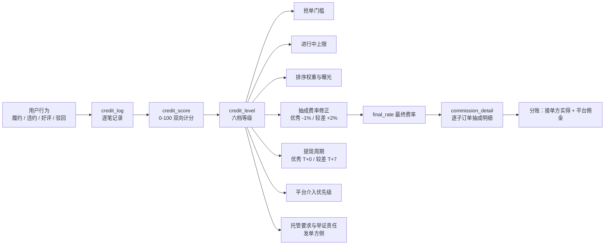

> **一句话总结**：**行为 → 信誉分 → 权益（含钱）→ 进一步影响行为**。这是本平台治理的飞轮，也是三个新机制真正的价值所在 —— 单独看每一个都不新鲜，串起来才形成约束力。

### 4.10 任务类型体系（v1.2 新增）

#### 4.10.1 三维正交设计

> **为什么不做一个大而全的"任务类型"枚举**：如果把"后端开发 / 同城跑腿 / 按天驻场 / 按篇计酬"混在一个枚举里，组合数会爆炸且无法扩展。正确做法是**拆成三个正交维度**，任意组合都合法（除少数互斥约束）。

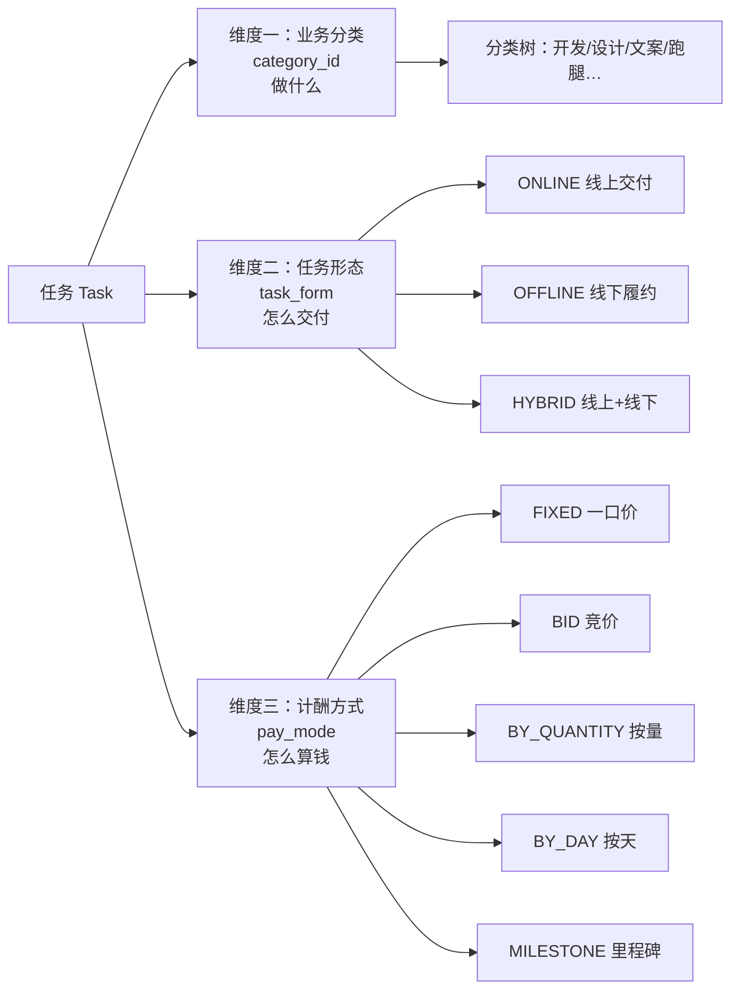

#### 4.10.2 维度一：业务分类（`category_id`，树形，可运营配置）

| 一级分类 | 二级示例 | 常见形态 | 常见计酬 |
|---|---|---|---|
| 软件开发 | 后端 / 前端 / 移动端 / 测试 / 运维 / 算法 / 小程序 | 线上 | 一口价、竞价、里程碑 |
| 设计创意 | UI / 平面 / 3D 建模 / 效果图 / 品牌 | 线上、混合 | 一口价、竞价、里程碑 |
| 文案写作 | 文章 / 脚本 / 翻译 / 校对 | 线上 | 一口价、按量 |
| 数据处理 | 标注 / 采集 / 清洗 / 录入 | 线上 | 按量 |
| 音视频制作 | 剪辑 / 配音 / 动画 / 直播支持 | 线上、混合 | 一口价、按量 |
| 市场营销 | 推广 / 投放 / 活动执行 | 混合、线下 | 按天、里程碑 |
| 生活服务 | 家政 / 维修 / 安装 / 摄影 | 线下 | 一口价、按天 |
| 跑腿代办 | 代买 / 代送 / 排队 / 陪同 | 线下 | 一口价 |
| 教育培训 | 家教 / 陪练 / 讲座 | 线下、混合 | 按天、按量 |
| 其他 | — | — | — |

**分类承载的配置**（挂在 `task_category` 上，新增任务时自动带出）：

| 配置项 | 作用 |
|---|---|
| `commission_rate` | 该分类的抽成覆盖率（§4.8.4） |
| `allow_forms` | 该分类允许的形态（如"跑腿"不允许 ONLINE） |
| `allow_pay_modes` | 该分类允许的计酬方式 |
| `require_license` | 是否需要资质证明（如电工、高空作业） |
| `audit_level` | 审核强度（机审 / 必人审） |
| `commission_snapshot` 默认值 | 该分类的费率快照 |

#### 4.10.3 维度二：任务形态（`task_form`）

| 取值 | 含义 | 触发的变化 |
|---|---|---|
| `ONLINE` | **线上交付**：全程线上，交付物是文件或线上服务 | 无需地点；交付形式限「文件 / 线上服务」；不可选按天（除非远程驻场） |
| `OFFLINE` | **线下履约**：必须到场（跑腿、维修、安装、摄影） | ⭐ **必填服务地点（含经纬度）**；可选「到场签到」；交付形式含「现场完成 / 实物寄送」；可加**差旅费报销**；发布时按距离筛接受单方 |
| `HYBRID` | **线上 + 线下**（设计 + 现场测量、开发 + 上门部署） | 两者字段都要；**里程碑计酬的天然场景**（线上设计 → 线下实施） |

> ⚠️ **`task_form` 不是描述性字段，它会改变表单与校验规则**。因此它必须在**创建任务时确定**，⛔ **发布后不可修改**（改形态等于换了一个任务，必须重新发布）。

#### 4.10.4 维度三：计酬方式（`pay_mode`）

| 取值 | 含义 | 字段 | 典型场景 |
|---|---|---|---|
| `FIXED` | **一口价** | `price`（单值） | 跑腿、简单代办 |
| `BID` | **竞价**（接单方报价，发单方选） | `budget_min` / `budget_max` | 开发、设计、复杂服务 |
| `BY_QUANTITY` | **按量计酬** | `unit_price` × `quantity` + `unit` | 标注、写稿、翻译 |
| `BY_DAY` | **按天计酬** | `day_rate` × `days` | 驻场、陪练、长期支持 |
| `MILESTONE` | **里程碑** | `milestone_plan`（JSON 数组：阶段名 / 金额 / 交付物 / 期限） | 大型开发、装修、活动执行 |

**按量 / 按天 / 里程碑的结算特点**（必须与 §5.5.3 的拆单模型打通）：

| 计酬 | 结算粒度 | 与 MULTI 拆单的关系 |
|---|---|---|
| `FIXED` / `BID` | 一单一次结算 | 兼容 |
| `BY_QUANTITY` | 可按批次结算（如交付 3 篇先结 3 篇） | 兼容，批次作为子结算单元 |
| `BY_DAY` | 按天/按周结算 | 兼容 |
| `MILESTONE` | **按阶段结算**（时间维度拆分） | ⚠️ **与 `MULTI`（人维度拆分）冲突** |

#### 4.10.5 ⛔ 维度间约束（这里有真实的冲突，必须显式处理）

| # | 约束 | 类型 | 违反后果 |
|---|---|---|---|
| 1 | `pay_mode = FIXED` → 只能 `grant_mode = GRAB` | 强互斥 | 一口价还想竞价 = 语义矛盾 |
| 2 | `pay_mode = BID` → 只能 `grant_mode = BID` | 强互斥 | 同上 |
| 3 | `task_form = ONLINE` → ⛔ 不可选 `OFFLINE` 专属字段，不可要求到场签到 | 校验 | 发布无意义字段，用户困惑 |
| 4 | `task_form = OFFLINE` → ⭐ **`location` 必填** | 必填 | 接单方无法判断能否接（**原设计的真实缺口**） |
| 5 | `allow_forms` / `allow_pay_modes` 由分类限制 | 分类约束 | 出现"跑腿任务要求线上交付" |
| 6 | ⛔ **`pay_mode = MILESTONE` 与 `award_mode = MULTI` 在 Phase 1 互斥** | **本期互斥** | 见下 |

**⭐ 关于约束 6（本次梳理发现的设计冲突）**：

`MILESTONE` 是**时间维度**的拆分，`MULTI` 是**人维度**的拆分。两者叠加会形成「子订单 × 里程碑」的二维结算矩阵，复杂度是乘法级增长（每个中标人的每个阶段都要独立托管、独立验收、独立分账、独立起争端）。

| 阶段 | 处理 |
|---|---|
| **Phase 1** | ⛔ **互斥**：选 `MILESTONE` 就不允许 `MULTI`，反之亦然。接口层直接拒绝并给出明确文案 |
| **Phase 2** | 放开。把 `sub_order` 升级为**两级结构**：`sub_order`（人维度）→ `delivery_unit`（时间维度）。所有资金与验收动作挂在 `delivery_unit` 上 |
| **数据模型预留** | Phase 1 就把 `delivery_unit` 表建出来，`MILESTONE` 与普通任务都通过它结算（普通任务只有 1 个 unit），**这样 Phase 2 放开时不需要改结算链路** |

> **这是本次补全里最有价值的一条**：如果 Phase 1 不做预留，Phase 2 放开里程碑时**整个结算链路要重写**。现在把 `delivery_unit` 作为统一结算单元，成本只是多一张表和一层间接。

#### 4.10.6 三维组合示例

| 任务 | 分类 | 形态 | 计酬 | 接单方式 | 说明 |
|---|---|---|---|---|---|
| 帮我取一份文件送到高新区 | 跑腿代办 | OFFLINE | FIXED | GRAB | 最简组合 |
| 开发一个小程序商城 | 软件开发 | ONLINE | BID | BID | 常规竞拍 |
| 给 500 条语音做标注 | 数据处理 | ONLINE | BY_QUANTITY | BID | 按量 + 竞价 |
| 周末陪练羽毛球 3 次 | 教育培训 | OFFLINE | BY_DAY | GRAB | 按天 + 到场签到 |
| 装修 120 平房子 | 生活服务 | HYBRID | MILESTONE | BID | 里程碑（Phase 1 不允许 MULTI） |
| 设计 10 张海报并现场安装 | 设计创意 | HYBRID | BY_QUANTITY | BID + **MULTI** | 拆给多个设计师（不允许 MILESTONE） |

### 4.11 任务状态全集（18 个，v1.2 新增）

#### 4.11.1 ⚠️ 为什么原来的 11 个状态不够用

原设计的 11 个状态有一个**语义过载**问题：`PUBLISHED` 同时表示"审核通过了等付款"和"在招募接单方"，`IN_PROGRESS` 同时表示"在执行"和"已交付等验收"。后果：

| 问题 | 具体表现 |
|---|---|
| 运营看板口径不准 | 想统计"有多少任务卡在无人支付"，查不出来 |
| 用户预期不清 | 任务列表页该显示"招募中"还是"待付款"，前端只能靠猜 |
| 定时任务无明确扇入点 | 自动流转要靠在 `IN_PROGRESS` 上附加条件判断，慢查询 |
| 子订单聚合困难 | MULTI 下主任务状态无法从子订单状态准确推导 |

因此**细化为 18 个状态**，并引入**状态分组**。

#### 4.11.2 状态全集

| # | 状态 | 中文 | 分组 | 含义 | 资金状态 |
|---|---|---|---|---|---|
| 1 | `DRAFT` | 草稿 | 草稿域 | 仅发单方可见，可编辑删除 | 无 |
| 2 | `PENDING_AUDIT` | 待审核 | 草稿域 | 机审或人审中 | 无 |
| 3 | `AUDIT_REJECTED` | 审核未通过 | 草稿域 | 可修改后重新提交 | 无 |
| 4 | `PENDING_ESCROW` | **待托管** 🆕 | 招募域 | 审核通过，等发单方支付托管 | **待支付** |
| 5 | `RECRUITING` | **招募中** 🆕 | 招募域 | 抢单模式，可被抢 | 已托管 / 未托管 |
| 6 | `BIDDING` | 竞价中 | 招募域 | 竞拍模式，可提交报价 | 已托管 / 未托管 |
| 7 | `PENDING_SELECT` | **待选标** 🆕 | 招募域 | 报价已截止，等发单方选定中标方 | 已托管 / 未托管 |
| 8 | `PENDING_START` | **待开始** 🆕 | 履约域 | 已中标已托管，未到约定开始时间 | **已冻结** |
| 9 | `IN_PROGRESS` | 履约中 | 履约域 | 接单方执行中 | 已冻结 |
| 10 | `PENDING_ACCEPT` | **待验收** 🆕 | 履约域 | 已提交交付物，等发单方验收 | 已冻结 |
| 11 | `REVISION` | **返工中** 🆕 | 履约域 | 被驳回，接单方修改中（含修改轮次计数） | 已冻结 |
| 12 | `OVERDUE` | **已逾期** 🆕 | 履约域 | 超过截止时间未交付 | 已冻结 |
| 13 | `DISPUTED` | **争议中** 🆕 | 履约域 | 存在未结争端工单，**相关份额冻结** | 争议份额冻结 |
| 14 | `COMPLETED` | 已完成 | 收尾域 | 全部子订单验收通过，待结算 | 待分账 |
| 15 | `SETTLED` | **已结算** 🆕 | 收尾域 | 资金全部分账完成 | 已分账 |
| 16 | `CLOSED` | 已关闭 | 终态 | 评价完成或评价期结束，归档 | 无 |
| 17 | `CANCELLED` | 已取消 | 终态 | 发单方取消或双方协商取消 | 已退款 |
| 18 | `EXPIRED` | 已流标 | 终态 | 无人接单 / 无人中标 / 超期未选定 | 已退款 |

#### 4.11.3 ⭐ 一条重要规则：争端只能在结算前发起

| 阶段 | 能否发起争端 |
|---|---|
| `IN_PROGRESS` / `PENDING_ACCEPT` / `REVISION` / `OVERDUE` | ✅ 可发起 |
| `DISPUTED` | ✅ 已在进行中 |
| `COMPLETED`（验收通过后、结算前） | ✅ **有短暂窗口**（结算前的最后一次机会） |
| `SETTLED` 及之后 | ⛔ **不可发起常规争端**，只能走「举报 + 人工处理」 |

**为什么这条规则很重要**：它从**流程上**消灭了「已分账后又要退款」这个最复杂、最容易出错的资金分支（§5.12.4）。验收通过即视为接受交付，这是主流平台的通行做法，也符合用户对"验收"这个词的直觉。

#### 4.11.4 状态迁移表

| # | 起始状态 | 触发事件 | 目标状态 | 守卫条件 | 谁触发 |
|---|---|---|---|---|---|
| 1 | `DRAFT` | 提交发布 | `PENDING_AUDIT` | 表单校验通过、实名已通过 | 发单方 |
| 2 | `DRAFT` | 删除 | —（删除） | 仅草稿可删 | 发单方 |
| 3 | `PENDING_AUDIT` | 机审通过 + 已托管 | `RECRUITING` / `BIDDING` | 选择"发布即托管"且支付成功 | 系统 |
| 4 | `PENDING_AUDIT` | 机审通过 + 未托管 | `PENDING_ESCROW` | 选择"中标后托管" | 系统 |
| 5 | `PENDING_AUDIT` | 机审通过 | `RECRUITING` / `BIDDING` | 选择"发布即托管"但**免托管**（低风险分类） | 系统 |
| 6 | `PENDING_AUDIT` | 人工审核驳回 | `AUDIT_REJECTED` | 必填驳回原因 | 内容审核员 |
| 7 | `AUDIT_REJECTED` | 修改后重提 | `PENDING_AUDIT` | — | 发单方 |
| 8 | `PENDING_ESCROW` | 托管支付成功 | `RECRUITING` / `BIDDING` | 渠道回调验签通过 | 系统 |
| 9 | `PENDING_ESCROW` | 超时未支付（30 min） | `CANCELLED` | — | 定时任务 |
| 10 | `RECRUITING` | **抢单成功** | `PENDING_START` | **条件 UPDATE 影响行数 = 1**（§5.5.1） | 接单方 |
| 11 | `RECRUITING` | 截止无人抢 | `EXPIRED` | 超过 `deadline` | 定时任务 |
| 12 | `RECRUITING` | 发单方取消 | `CANCELLED` | 未中标可免费取消 | 发单方 |
| 13 | `BIDDING` | 报价截止且有报价 | `PENDING_SELECT` | 存在 ≥1 条有效报价 | 定时任务 |
| 14 | `BIDDING` | 报价截止且无报价 | `EXPIRED` | — | 定时任务 |
| 15 | `BIDDING` | 发单方提前选定 | `PENDING_START` | 已至少 1 条报价 | 发单方 |
| 16 | `BIDDING` | 发单方取消 | `CANCELLED` | — | 发单方 |
| 17 | `PENDING_SELECT` | 选定中标方 + 托管完成 | `PENDING_START` | `Σ子订单金额 + 佣金 ≤ 托管额`（§5.5.2） | 发单方 |
| 18 | `PENDING_SELECT` | 超期未选定 | `EXPIRED` | 超过 `award_decision_days` | 定时任务 |
| 19 | `PENDING_SELECT` | 发单方取消 | `CANCELLED` | — | 发单方 |
| 20 | `PENDING_START` | 到达开始时间 / 接单方点击开始 | `IN_PROGRESS` | — | 系统 / 接单方 |
| 21 | `IN_PROGRESS` | 提交交付物 | `PENDING_ACCEPT` | 至少 1 个交付文件或线上交付确认 | 接单方 |
| 22 | `IN_PROGRESS` | 超过交付截止 | `OVERDUE` | 超过 `deadline` | 定时任务 |
| 23 | `PENDING_ACCEPT` | **验收通过** | `COMPLETED` | 全部子订单均通过 | 发单方 / 自动验收 |
| 24 | `PENDING_ACCEPT` | 驳回 | `REVISION` | 理由必填、修改轮次 < 上限 | 发单方 |
| 25 | `PENDING_ACCEPT` | 发起争端 | `DISPUTED` | 结算前 | 任一方 |
| 26 | `REVISION` | 重新交付 | `PENDING_ACCEPT` | — | 接单方 |
| 27 | `REVISION` | 修改轮次用尽 | `DISPUTED` | 超过 `modify_round_limit`（默认 3） | 系统 |
| 28 | `REVISION` | 发起争端 | `DISPUTED` | — | 任一方 |
| 29 | `OVERDUE` | 双方同意延期 | `IN_PROGRESS` | 发单方确认新截止时间 | 发单方 |
| 30 | `OVERDUE` | 发单方申请取消 | `CANCELLED` | 按规则扣违约金 | 发单方 |
| 31 | `OVERDUE` | 接单方主张部分完成 | `DISPUTED` | — | 接单方 |
| 32 | `DISPUTED` | 裁决：结算 / 部分结算 | `COMPLETED` | 裁决生效 | 仲裁专员 |
| 33 | `DISPUTED` | 裁决：全额退款 | `CANCELLED` | 裁决生效 | 仲裁专员 |
| 34 | `COMPLETED` | 分账完成 | `SETTLED` | 全部份额已分账 | 系统 |
| 35 | `COMPLETED` | 结算前发起争端 | `DISPUTED` | ⚠️ 仅限验收通过后至分账前的窗口 | 任一方 |
| 36 | `SETTLED` | 评价完成 / 评价期结束 | `CLOSED` | — | 系统 / 双方 |
| 37 | `SETTLED` | 举报（欺诈等） | —（不进状态机，转人工） | 走举报流程 | 任一方 |

**非法迁移举例**（必须被状态机拒绝，写进测试用例）：

```
DRAFT          → IN_PROGRESS     ⛔ 未审核不能履约
RECRUITING     → COMPLETED       ⛔ 未中标不能完成
PENDING_ESCROW → RECRUITING      ⛔ 未支付不能招募（除非免托管分类）
SETTLED        → DISPUTED        ⛔ 已分账不可走常规争端
CLOSED         → 任意状态         ⛔ 终态不可复活
```

#### 4.11.5 状态 × 操作矩阵

| 操作 \ 状态 | DRAFT | PENDING_AUDIT | AUDIT_REJECTED | PENDING_ESCROW | RECRUITING | BIDDING | PENDING_SELECT | PENDING_START | IN_PROGRESS | PENDING_ACCEPT | REVISION | OVERDUE | DISPUTED | COMPLETED | SETTLED | CLOSED | CANCELLED | EXPIRED |
|---|:-:|:-:|:-:|:-:|:-:|:-:|:-:|:-:|:-:|:-:|:-:|:-:|:-:|:-:|:-:|:-:|:-:|:-:|
| 编辑任务 | ✅ | ⛔ | ✅ | ⛔ | ⛔ | ⛔ | ⛔ | ⛔ | ⛔ | ⛔ | ⛔ | ⛔ | ⛔ | ⛔ | ⛔ | ⛔ | ⛔ | ⛔ |
| 删除任务 | ✅ | ⛔ | ✅ | ⛔ | ⛔ | ⛔ | ⛔ | ⛔ | ⛔ | ⛔ | ⛔ | ⛔ | ⛔ | ⛔ | ⛔ | ⛔ | ⛔ | ⛔ |
| 提交发布 | ✅ | ⛔ | ✅ | ⛔ | ⛔ | ⛔ | ⛔ | ⛔ | ⛔ | ⛔ | ⛔ | ⛔ | ⛔ | ⛔ | ⛔ | ⛔ | ⛔ | ⛔ |
| 支付托管 | ⛔ | ⛔ | ⛔ | ✅ | ⛔ | ⛔ | ✅ | ⛔ | ⛔ | ⛔ | ⛔ | ⛔ | ⛔ | ⛔ | ⛔ | ⛔ | ⛔ | ⛔ |
| **抢单** | ⛔ | ⛔ | ⛔ | ⛔ | ✅ | ⛔ | ⛔ | ⛔ | ⛔ | ⛔ | ⛔ | ⛔ | ⛔ | ⛔ | ⛔ | ⛔ | ⛔ | ⛔ |
| 提交报价 | ⛔ | ⛔ | ⛔ | ⛔ | ⛔ | ✅ | ⛔ | ⛔ | ⛔ | ⛔ | ⛔ | ⛔ | ⛔ | ⛔ | ⛔ | ⛔ | ⛔ | ⛔ |
| 修改/撤回报价 | ⛔ | ⛔ | ⛔ | ⛔ | ⛔ | ✅ | ⛔ | ⛔ | ⛔ | ⛔ | ⛔ | ⛔ | ⛔ | ⛔ | ⛔ | ⛔ | ⛔ | ⛔ |
| 入围报价 | ⛔ | ⛔ | ⛔ | ⛔ | ⛔ | ✅ | ✅ | ⛔ | ⛔ | ⛔ | ⛔ | ⛔ | ⛔ | ⛔ | ⛔ | ⛔ | ⛔ | ⛔ |
| 选定中标 | ⛔ | ⛔ | ⛔ | ⛔ | ⛔ | ✅ | ✅ | ⛔ | ⛔ | ⛔ | ⛔ | ⛔ | ⛔ | ⛔ | ⛔ | ⛔ | ⛔ | ⛔ |
| 开始履约 | ⛔ | ⛔ | ⛔ | ⛔ | ⛔ | ⛔ | ⛔ | ✅ | ⛔ | ⛔ | ⛔ | ⛔ | ⛔ | ⛔ | ⛔ | ⛔ | ⛔ | ⛔ |
| 提交交付 | ⛔ | ⛔ | ⛔ | ⛔ | ⛔ | ⛔ | ⛔ | ⛔ | ✅ | ⛔ | ✅ | ⛔ | ⛔ | ⛔ | ⛔ | ⛔ | ⛔ | ⛔ |
| 验收通过 | ⛔ | ⛔ | ⛔ | ⛔ | ⛔ | ⛔ | ⛔ | ⛔ | ⛔ | ✅ | ⛔ | ⛔ | ⛔ | ⛔ | ⛔ | ⛔ | ⛔ | ⛔ |
| 驳回 | ⛔ | ⛔ | ⛔ | ⛔ | ⛔ | ⛔ | ⛔ | ⛔ | ⛔ | ✅ | ⛔ | ⛔ | ⛔ | ⛔ | ⛔ | ⛔ | ⛔ | ⛔ |
| 申请延期 | ⛔ | ⛔ | ⛔ | ⛔ | ⛔ | ⛔ | ⛔ | ✅ | ✅ | ⛔ | ⛔ | ✅ | ⛔ | ⛔ | ⛔ | ⛔ | ⛔ | ⛔ |
| 取消任务 | ⛔ | ⛔ | ⛔ | ✅ | ✅ | ✅ | ✅ | ⚠️ | ⚠️ | ⚠️ | ⚠️ | ✅ | ⛔ | ⛔ | ⛔ | ⛔ | ⛔ | ⛔ |
| 发起争端 | ⛔ | ⛔ | ⛔ | ⛔ | ⛔ | ⛔ | ⛔ | ⛔ | ✅ | ✅ | ✅ | ✅ | ⛔ | ✅ | ⛔ | ⛔ | ⛔ | ⛔ |
| 评价 | ⛔ | ⛔ | ⛔ | ⛔ | ⛔ | ⛔ | ⛔ | ⛔ | ⛔ | ⛔ | ⛔ | ⛔ | ⛔ | ✅ | ✅ | ✅ | ⛔ | ⛔ |
| 查看详情 | ✅ | ✅ | ✅ | ✅ | ✅ | ✅ | ✅ | ✅ | ✅ | ✅ | ✅ | ✅ | ✅ | ✅ | ✅ | ✅ | ✅ | ✅ |

> ⚠️ = 需双方协商或按规则赔付；⛔ = 状态机直接拒绝并返回明确文案。

#### 4.11.6 主任务状态与子订单状态的聚合规则（⭐ MULTI 的前提）

MULTI 模式下 1 个主任务对应 N 个子订单，**主任务状态必须由子订单聚合得出**，否则会出现"主任务显示已完成、但还有个接单方没交付"的荒谬情况。

**聚合优先级**（从高到低，取最高的那个）：

```
DISPUTED > OVERDUE > REVISION > PENDING_ACCEPT > IN_PROGRESS > PENDING_START > COMPLETED > SETTLED
```

| 子订单状态组合 | 主任务状态 | 说明 |
|---|---|---|
| 全部 `PENDING_ESCROW` | `PENDING_START` | 刚中标，未开始 |
| 任一条 `IN_PROGRESS`，其余 `PENDING_START` | `IN_PROGRESS` | 有一个在干就算进行中 |
| 全部 `SUBMITTED` | `PENDING_ACCEPT` | 都交了，等验收 |
| A 已 `SETTLED`，B 仍 `IN_PROGRESS` | `IN_PROGRESS` | **取最未完成的**，不能因为 A 完成就显示完成 |
| 任一条 `DISPUTED` | `DISPUTED` | 一票否决 |
| 全部 `SETTLED` | `SETTLED` → `CLOSED` | 全部结清 |

**实现要求**：
- 聚合逻辑放在 `order` 模块的 `TaskStatusAggregator`，**唯一实现**；
- 任何子订单状态变更 → 发事件 → 聚合器重算主任务状态 → 写 `task_status_log`；
- ⛔ 禁止在业务代码里手写 `if (allSettled) task.setStatus(...)`；
- 加**每日巡检**：找出主任务状态与聚合结果不一致的记录并告警（防事件丢失导致漂移）。

#### 4.11.7 状态与计酬/形态的交叉约束

| 约束 | 说明 |
|---|---|
| `MILESTONE` 任务的 `SETTLED` 条件 | 全部**里程碑**结算完成（而非全部子订单） |
| `BY_QUANTITY` 任务 | 允许"分批交付 → 分批结算"，主任务在最后一个批次结算后进入 `SETTLED` |
| `OFFLINE` + 需签到 | `PENDING_START → IN_PROGRESS` 由**到场签到**触发，而非手动点击 |
| `OFFLINE` 任务 | 逾期判定除 `deadline` 外，可选叠加"未签到" |

---

## 5. 系统概要设计

### 5.1 总体架构

#### 5.1.1 分层架构图

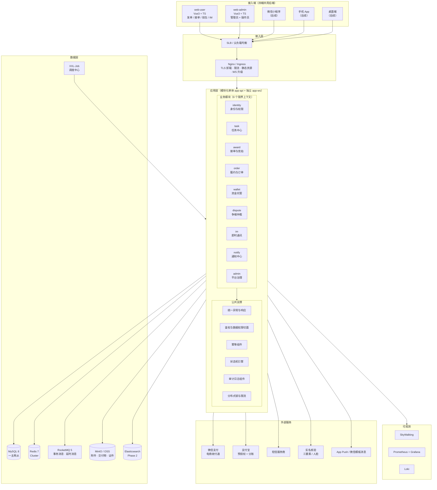

#### 5.1.2 分层职责

| 层 | 职责 | 禁止事项 |
|---|---|---|
| 接入层 | 路由、TLS、限流、静态资源、WebSocket 升级 | ⛔ 不写业务逻辑 |
| 应用层（接口层 `*.controller`） | 参数校验、鉴权注解、DTO 转换、调应用服务 | ⛔ 不写业务规则、不直接调 Mapper |
| 应用层（应用服务 `*.service`） | 用例编排、事务边界、领域事件发布 | ⛔ 不跨模块直接访问对方 Mapper |
| 领域层（`*.domain`） | 实体、值对象、领域规则、状态机定义 | ⛔ 不依赖 Spring Web / Mapper |
| 基础设施层（`*.mapper` / `*.client`） | 持久化、外部渠道调用（支付/短信/实名） | ⛔ 不含业务判断 |

#### 5.1.3 为什么是「模块化单体 + 独立 WS 进程」

| 理由 | 说明 |
|---|---|
| **强一致** | 抢单唯一性、MULTI 中标拆单、资金冻结与记账三处必须强一致。单库本地事务 = 一行 `@Transactional`；微服务 = Seata/Saga/本地消息表 + 对账兜底 |
| **故障半径小** | 单体一个进程，出问题只需查一个日志文件 + 一个 `traceId` |
| **拆分路径清晰** | 9 个模块之间**只通过应用服务接口与领域事件通信**，天然是将来拆服务的切缝。模块边界一旦被破坏（跨模块查表），拆分成本立刻翻倍——**这是本项目最重要的一条代码纪律** |
| **WS 独立** | 长连接是**有状态**的，与无状态的 HTTP 应用扩缩容策略完全不同（HTTP 看 QPS，WS 看连接数），必须独立进程 |

### 5.2 部署架构

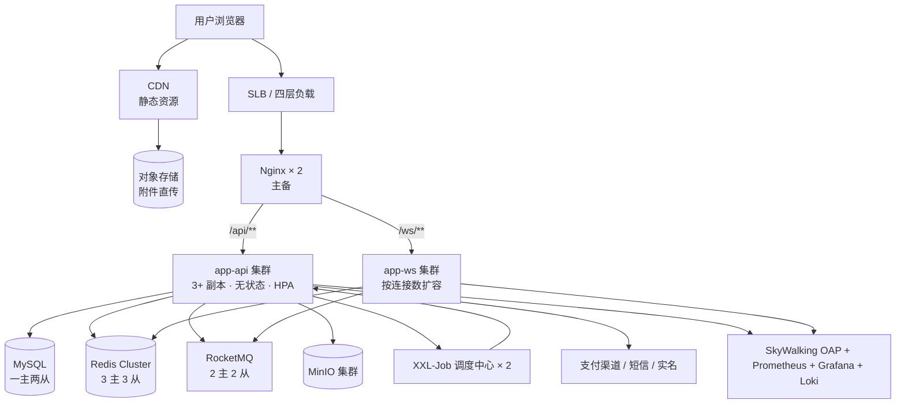

**部署要点**：

| 要点 | 做法 |
|---|---|
| `app-api` 无状态 | 会话在 Redis，任何副本可处理任何请求；HPA 按 CPU + QPS 扩容 |
| `app-ws` 有状态 | 连接数扩容；网关层按 `userId` 一致性哈希路由，或用 Redis Pub/Sub 广播跨节点消息 |
| 数据库读写分离 | 写走主库；**强一致读（下单后立刻查订单）必须走主库**，靠注解 `@Master` 强制路由 |
| 灰度发布 | Nginx 按 Header/Cookie 分流；资金相关模块灰度比例从 1% 起 |
| 支付回调入口 | **独立域名 + 独立 Nginx location + 单独限流策略**（渠道回调 IP 固定，可白名单） |
| 数据库备份 | 每日全量 + binlog 增量；**每季度做一次真实恢复演练**（没演练过的备份等于没有备份） |

### 5.3 模块划分与职责边界

#### 5.3.1 九个模块

| # | 模块 | 职责 | 核心聚合根 | 对外提供的应用服务 |
|---|---|---|---|---|
| 1 | `identity` | 用户注册登录、实名认证、信用分、RBAC、会话 | `SysUser`、`RealName`、`Role` | `UserQueryService`、`AuthService`、`CreditService` |
| 2 | `task` | 任务创建、编辑、审核、发布、检索、状态机 | `Task` | `TaskCommandService`、`TaskQueryService` |
| 3 | `award` | 抢单、报价、入围、中标、拆单 | `TaskBid`、`Award` | `GrabService`、`BidService`、`AwardService` |
| 4 | `order` | 子订单、交付、验收、取消、评价 | `BizOrder`、`SubOrder` | `OrderCommandService`、`DeliveryService`、`AcceptanceService` |
| 5 | `wallet` | 托管、冻结、结算、退款、分账、提现、对账 | `WalletAccount`、`Escrow`、`WalletTxn` | `EscrowService`、`SettlementService`、`WithdrawService`、`ReconService` |
| 6 | `dispute` | 争端工单、举证、裁决、申诉、SLA | `DisputeTicket` | `TicketService`、`VerdictService` |
| 7 | `im` | 会话、消息、已读、敏感词、证据留存 | `ImSession`、`ImMessage` | `ImService`（HTTP）、`ImWsHandler`（WS） |
| 8 | `notify` | 站内信、短信、微信模板消息、Push、模板管理 | `NotifyRecord` | `NotifyService` |
| 9 | `admin` | 账号管理、权限配置、系统参数、风控规则、审计、报表 | `SysConfig`、`AuditLog`、`RiskRule` | `AccountAdminService`、`ConfigService`、`AuditService` |

#### 5.3.2 依赖规则（⭐ 强制）

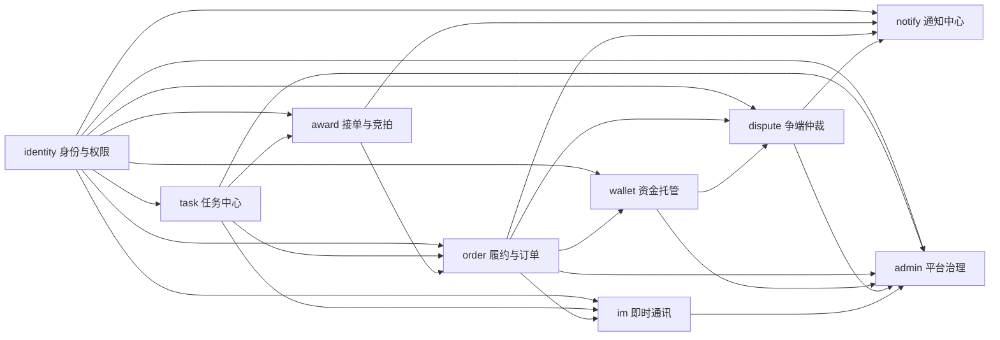

> **读图方式**：箭头 `A --> B` 表示 **「A 依赖 B」**。所有依赖只能沿箭头方向，⛔ 不得出现反向依赖或环形依赖。

**四条铁律**：

1. **依赖只能单向**（沿箭头方向），禁止反向依赖、禁止环形依赖——用 **ArchUnit 单元测试强制校验**，纳入 CI 门禁，违反即构建失败。
2. **跨模块只能调对方 `api` 包下的应用服务接口**，⛔ **禁止跨模块注入 Mapper、禁止跨模块 JOIN 查询、禁止跨模块直接用对方 Entity**。
3. **跨模块的副作用走领域事件**（RocketMQ 事务消息）。例：`award` 中标成功后发 `TaskAwardedEvent`，由 `order`、`notify`、`wallet` 各自订阅——`award` 不需要知道谁在关心这件事。
4. **跨模块只读查询允许"接口+DTO"**，但**禁止返回对方 Entity**（否则对方加个字段就可能泄露数据）。

> **为什么这条纪律如此重要**：它是「模块化单体」唯一的价值来源。一旦允许跨模块 JOIN，9 个模块就会退化成 9 个包名，将来想拆服务时每一处 JOIN 都是一个要重写的分布式查询。

#### 5.3.3 模块内部分层

```
com.example.platform.task
├── api/                    # 对外暴露（其他模块只能用这里的接口与 DTO）
│   ├── TaskQueryService.java
│   ├── TaskCommandService.java
│   └── dto/                # 跨模块 DTO（不含敏感字段）
├── controller/             # HTTP 接口（web-user / web-admin 分开）
│   ├── TaskUserController.java
│   └── TaskAdminController.java
├── service/                # 应用服务（事务边界、用例编排）
│   ├── TaskCommandServiceImpl.java
│   └── TaskQueryServiceImpl.java
├── domain/                 # 领域模型（实体、值对象、领域服务、状态机）
│   ├── Task.java
│   ├── TaskStatus.java
│   └── TaskStateMachineConfig.java
├── mapper/                 # 持久化（只有本模块能访问）
├── event/                  # 领域事件（发布与订阅）
└── convert/                # MapStruct 转换器
```

### 5.4 核心数据模型

#### 5.4.1 核心 ER 图

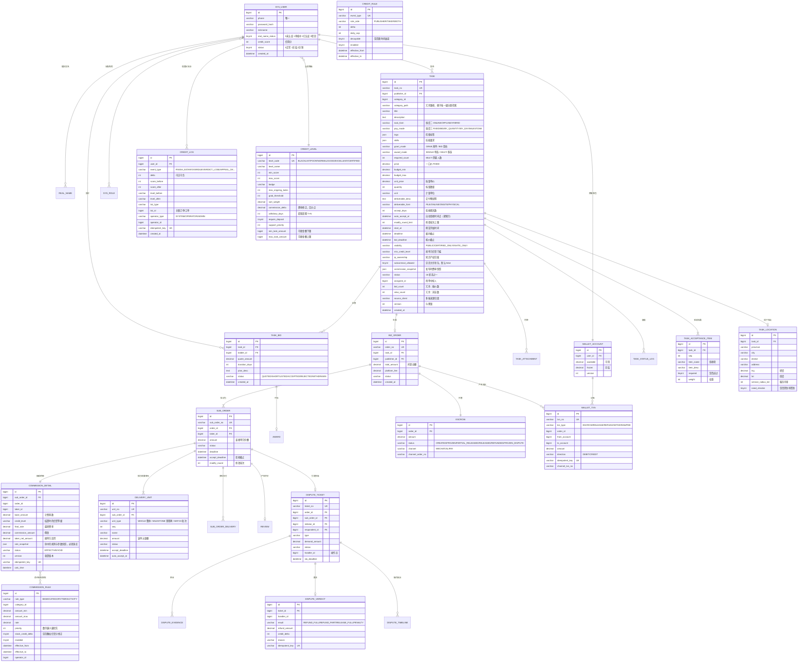

#### 5.4.2 关键表说明与设计要点

| 表 | 关键设计点 |
|---|---|
| `sys_user` | `phone` 唯一索引；`password_hash` 用 BCrypt；`identity`（`USER`/`OPERATOR`/`ADMIN`，**安全边界，只有 3 个**）；`credit_score` **初始 60**（CHECK 约束 0–100），抢单门槛默认 60（可配）；`credit_level` 冗余列便于检索排序 |
| `sys_real_name` | 身份证号 **AES-256 加密**、证件图独立私有 Bucket；审核人、审核时间、驳回原因 |
| `sys_role` / `sys_permission` / `sys_user_role` / `sys_role_permission` | 标准 RBAC 五表；`sys_role.data_scope` 支持 `SELF / GROUP / ALL` 三档数据范围 |
| `task` | `grant_mode` + `award_mode` 两个字段是**双模式双中标语义**的载体；`status` 上有索引（大厅查询）；`assignee_id` 用于抢单结果的强一致落点 |
| `task_bid` | **唯一索引 `uk(task_id, bidder_id)`**（一人一份报价，可覆盖更新，历史进 `task_bid_history` 以保证争议时可回溯"我当时报了多少"） |
| `task_grab_log` | **唯一索引 `uk(task_id, user_id, request_id)`** 实现抢单幂等；同时记录失败原因（用于风控与产品分析） |
| `biz_order` / `sub_order` | **主订单承载资金，子订单承载履约**。MULTI 模式下 1 主 N 子；子订单可独立交付、验收、结算、起争端 |
| `escrow` | 托管单与主订单 1:1；记录渠道单号；状态变更必须幂等 |
| `wallet_account` | **双余额**（`available` + `frozen`）+ 乐观锁 `version`；⛔ 金额一律 `DECIMAL(18,2)` |
| `wallet_txn` | **双分录**：一笔资金变动写两条（借/贷），`idempotent_key` 唯一索引；`Σ借方 == Σ贷方` 是资金系统的自证不变量（每日校验） |
| `dispute_ticket` | 关联到**子订单**而非仅主订单（MULTI 模式下必须能只冻结一份份额）；`sla_deadline` 驱动超时升级 |
| `dispute_verdict` | `idempotent_key = ticket_id + version` 防重复裁决导致重复退款；`credit_delta` 记录信用分处罚 |
| `sys_audit_log` | **只增不改不删**（数据库账号层面收回 UPDATE/DELETE 权限）；记录旧值与新值 |
| `im_message` | 按 `session_id` hash 分 64 表；**逻辑不可删除**（前端"删除"只做本地隐藏），因为它是争端证据 |
| `sys_config` | 费率、信用门槛、自动验收天数、SLA 时长、修改轮次上限、裁决金额上限——**全部可配，禁止硬编码** |
| `credit_log` 🆕 | **信誉分流水（只增不改）**：`idempotent_key = event_type + biz_id + user_id` 唯一索引实现幂等；记录变动前后分值与等级 |
| `credit_level` 🆕 | 等级与权益配置表（§4.9.2 的矩阵落到这张表）；数据量极小 → 本地缓存（Caffeine） |
| `credit_rule` 🆕 | 事件计分规则表；`event_type` 唯一；支持生效时间段与单日上限 |
| `commission_rule` 🆕 | 费率规则表：BASE / CATEGORY / TIER / ACTIVITY 四类，`priority` 决定优先级；⛔ 保存时校验 `rate ∈ [1%, 20%]` |
| `commission_detail` 🆕 | **逐子订单抽成明细**：`uk(sub_order_id, version)`；⭐ **`rule_snapshot` 必须落库**——记录"当时用了哪条规则、什么参数"，否则日后改费率，历史订单的抽成无法解释 |
| `approval_task` / `approval_record` 🆕 | 双人/三人复核（§4.7.5）：`uk(biz_type, biz_id, approver_id)` 防同一人投两票；原操作人不得为自己的动作投票 |
| `sys_role_conflict` 🆕 | 互斥岗位对配置；分配角色时强制校验 |

#### 5.4.3 关键索引设计（性能相关）

| 表 | 索引 | 目的 |
|---|---|---|
| `task` | `idx(status, category_id, created_at)` | 任务大厅默认列表 |
| `task` | `idx(status, grant_mode, bid_deadline)` | 竞拍截止扫描（XXL-Job） |
| `task` | `idx(publisher_id, status)` | 我的任务 |
| `task_bid` | `uk(task_id, bidder_id)` + `idx(task_id, status, quote_amount)` | 报价列表排序 |
| `sub_order` | `idx(taker_id, status)` + `idx(status, accept_deadline)` | 我的订单 / 自动验收扫描 |
| `wallet_txn` | `uk(idempotent_key)` + `idx(order_id)` + `idx(created_at)` | 幂等 / 按订单追溯 / 按时间对账 |
| `dispute_ticket` | `idx(status, sla_deadline)` + `idx(handler_id, status)` | SLA 扫描 / 操作员工作台 |

### 5.5 关键机制设计

#### 5.5.1 抢单的原子性与并发正确性（⭐ 全系统最高优先级）

**目标**：同一个任务，无论多少并发，**有且只有一个人抢到**。

**错误做法与后果**：

```java
// ❌ 错误 1：check-then-act 竞态 —— 两人都判定"可抢"，两人都抢到
Task task = taskMapper.selectById(taskId);
if (task.getStatus() == RECRUITING && task.getAssigneeId() == null) {
    task.setAssigneeId(userId);
    task.setStatus(PENDING_START);
    taskMapper.updateById(task);   // 无条件更新！
}

// ❌ 错误 2：只用 Redis 锁 —— 主从切换 / 锁过期 / 网络分区时锁会丢
if (redisson.getLock("task:" + taskId).tryLock()) {
    // ... 仍然后面是无条件 UPDATE
}

// ❌ 错误 3：先 SELECT ... FOR UPDATE 再 UPDATE —— 正确但多一次往返，
//            且在复杂业务事务中持有行锁过久，热点任务会拖垮连接池
```

**正确做法**：**条件 UPDATE + 判断影响行数**。条件与更新在同一条语句内原子发生，由 InnoDB 行锁保证串行。

```java
// ✅ 正确：一条 UPDATE 定胜负
@Transactional(rollbackFor = Exception.class)
public GrabResult grab(Long taskId, Long userId, String requestId) {
    // ① 幂等：同一 requestId 重复提交直接返回上次结果
    GrabLog exist = grabLogMapper.selectByRequestId(taskId, userId, requestId);
    if (exist != null) return GrabResult.of(exist);

    // ② 前置闸门（读多写少，全部走缓存；失败快速返回，不占数据库行锁）
    gateChecker.check(taskId, userId);
    //   a. 实名已通过          b. 信用分 >= sys_config.grab_credit_threshold
    //   c. 进行中任务数 < 上限  d. userId != task.publisher_id（不能抢自己的单）
    //   e. 未被发单方拉黑       f. 任务仍在 RECRUITING 且在有效期内

    // ③ 削峰：Redis 锁只为减少打到 DB 的并发，不承担正确性
    RLock peakLock = redisson.getLock("grab:task:" + taskId);
    if (!peakLock.tryLock(0, 3, TimeUnit.SECONDS)) {
        throw new BizException(ErrorCode.GRAB_BUSY);   // 31001 正在被抢，请重试
    }

    try {
        // ④ 唯一判定：条件更新
        int affected = taskMapper.grabAtomic(taskId, userId);
        if (affected == 1) {
            grabLogMapper.insertSuccess(taskId, userId, requestId);
            taskStatusLogMapper.insert(taskId, RECRUITING, PENDING_START, userId, "抢单成功");
            eventPublisher.publish(new TaskAwardedEvent(taskId, userId, GRANT_GRAB));
            return GrabResult.success();
        }
        // ⑤ 失败：回读真实原因，给出可操作的反馈
        Task current = taskMapper.selectById(taskId);
        grabLogMapper.insertFail(taskId, userId, requestId, current.getStatus());
        throw new BizException(GrabFailReason.of(current));   // 31002/31003/31004
    } finally {
        if (peakLock.isHeldByCurrentThread()) peakLock.unlock();
    }
}
```

```xml
<!-- ✅ 唯一的判定语句 -->
<update id="grabAtomic">
    UPDATE task
       SET status      = 'PENDING_START',
           assignee_id = #{userId},
           assigned_at = NOW(),
           version     = version + 1
     WHERE id          = #{taskId}
       AND status      = 'RECRUITING'
       AND grant_mode  = 'GRAB'
       AND assignee_id IS NULL
</update>
```

**为什么这条 SQL 是对的**（必须写进代码注释，防止后人"优化"掉）：

| 机制 | 作用 |
|---|---|
| `WHERE id = ?` 走主键等值 | InnoDB 加**行级排他锁**（不是表锁、不是间隙锁） |
| 并发事务到达 | 后到者**阻塞等待**前者提交 |
| 前者提交后 | 后者重新读取最新版本 → `status` 已是 `PENDING_START` → **条件不满足，影响行数 0** |
| `assignee_id IS NULL` | 双保险：即使状态被误改回 `RECRUITING`，也不会覆盖已有归属 |
| `version = version + 1` | 供其他编辑场景（改描述、改截止时间）做乐观锁 |

**体验与风控细节**（这些决定产品好不好用）：

| 场景 | 处理 |
|---|---|
| 抢单失败 | **必须返回可操作的信息**：是"被抢走了"（推荐相似任务 + 一键订阅）、"你的信用分不足"（告知差多少）、"你有 3 个进行中任务未完成"（给跳转链接）。⛔ 不能只回"操作失败" |
| 抢单成功但 15 秒内未确认 | 可选机制：**预占 + 确认窗口**（`RESERVED` 状态，超时自动释放）。默认关闭；对高价值任务可开启以降低"抢了不做"的浪费 |
| 恶意抢单刷量 | 信用分门槛 + 进行中任务上限 + 抢单频次限制（如 10 次/分钟）+ 抢到后放弃率统计（超阈值降权） |
| 前端体验 | 点击后**立即禁用按钮 + 显示"正在抢单"**，避免重复提交；失败后按钮恢复并展示原因 |
| 发单方自己抢 | 前置闸门直接拒绝（`publisher_id == userId`），返回明确文案 |
| 任务在抢到瞬间被发单方取消 | 取消操作同样走条件更新（`WHERE status IN ('RECRUITING','BIDDING')`）；两者竞争同一行锁，**必有一个失败**，不会出现"既取消又中标" |

**验收标准（写进测试用例，不通过不允许上线）**：

```
测试 1：5000 个线程并发抢同一个任务
        断言：成功数 == 1；失败数 == 4999；task.assignee_id 恰好为成功者
        断言：task_grab_log 成功记录数 == 1
        断言：P99 < 300ms

测试 2：同一用户用同一 requestId 连续提交 100 次
        断言：唯一索引生效；grab_log 只有 1 条；返回同一结果（幂等）

测试 3：抢单 与 发单方取消 并发
        断言：两者不可能同时成功

测试 4：抢单过程中 kill 掉应用实例
        断言：数据库状态要么 RECRUITING 要么 PENDING_START，不存在中间态
```

#### 5.5.2 竞拍与 MULTI 多选中标

**报价模型**：

| 项 | 规则 |
|---|---|
| 谁能报价 | 实名已通过 + 信用分达标 + 非发单方本人 |
| 报价内容 | 金额（`quote_amount`）、工期（`duration_days`）、方案说明（`plan_desc`）、附件 |
| 报价区间 | 必须在发单方设定的 `budget_min ~ budget_max` 内？→ **不强制**。允许上浮但需高亮提示发单方（强制会扼杀优质高价供给）。低于预算下限 **50%** 的报价标记「⚠️ 异常低价」并在列表中提示（防范"低价中标后加价"） |
| 修改报价 | 截止前可修改；**每次修改写入 `task_bid_history`**（争议时"我当时报的是多少"是核心证据） |
| 撤回报价 | 截止前可撤回（`WITHDRAWN`），撤回后不可再报（防利用撤回规避记录） |
| 报价数量上限 | 单任务默认 50 条（超出关闭报价），防止刷屏与恶意围标 |
| 报价可见性 | **默认互相不可见**（暗标），可配置为公开（明标）。暗标可显著减少恶性压价 |

**中标事务（SINGLE 与 MULTI 共用一套骨架）**：

```java
@Transactional(rollbackFor = Exception.class)
public AwardResult award(AwardCommand cmd) {
    // ① 锁定任务，防止与"取消任务""截止流标"并发冲突
    Task task = taskMapper.selectForUpdate(cmd.getTaskId());      // SELECT ... FOR UPDATE
    Assert.isTrue(task.getStatus() == BIDDING, ErrorCode.TASK_NOT_BIDDING);
    Assert.isTrue(cmd.getPublisherId().equals(task.getPublisherId()), ErrorCode.NOT_OWNER);

    // ② 幂等：同一 (taskId, 选中集合) 重复提交返回上次结果
    Award exist = awardMapper.selectByIdempotentKey(cmd.getIdempotentKey());
    if (exist != null) return AwardResult.of(exist);

    // ③ 校验选中集合
    List<TaskBid> bids = bidMapper.selectByIds(cmd.getBidIds());
    Assert.isTrue(bids.stream().allMatch(b -> b.getTaskId().equals(task.getId())),
                  ErrorCode.BID_NOT_BELONG_TO_TASK);
    Assert.isTrue(bids.stream().allMatch(b -> b.getStatus() == QUOTED
                                          || b.getStatus() == SHORTLISTED));

    if (task.getAwardMode() == SINGLE) {
        Assert.isTrue(bids.size() == 1, ErrorCode.SINGLE_MODE_ONLY_ONE);
    } else {  // MULTI
        Assert.isTrue(bids.size() <= task.getRequiredCount(), ErrorCode.EXCEED_REQUIRED_COUNT);
        Assert.isTrue(cmd.getTotalAmount().compareTo(task.getEscrowAmount()) <= 0,
                      ErrorCode.EXCEED_ESCROW_AMOUNT);   // ⛔ 不能超发
    }

    // ④ 逐个中标 → 生成子订单（每人一份，独立履约独立结算）
    BigDecimal sum = BigDecimal.ZERO;
    for (TaskBid bid : bids) {
        BigDecimal amount = cmd.amountOf(bid.getId());          // MULTI 下可人工调整每人金额
        Assert.isTrue(amount.compareTo(BigDecimal.ZERO) > 0, ErrorCode.INVALID_AMOUNT);
        bidMapper.updateStatus(bid.getId(), ACCEPTED);
        subOrderMapper.insert(SubOrder.fromAward(task, bid, amount));
        sum = sum.add(amount);
    }
    // ⑤ 未中标的报价全部置 REJECTED（同一事务，保证不出现"悬空报价"）
    bidMapper.rejectOthers(task.getId(), bids.stream().map(TaskBid::getId).toList());

    // ⑥ 校验总额（含平台佣金）
    BigDecimal fee = feeCalculator.calc(sum);
    Assert.isTrue(sum.add(fee).compareTo(task.getEscrowAmount()) <= 0,
                  ErrorCode.EXCEED_ESCROW_AMOUNT);

    // ⑦ 落中标记录 + 任务状态推进 + 发事件
    awardMapper.insertBatch(task, bids);
    taskMapper.updateStatus(task.getId(), PENDING_START);
    eventPublisher.publish(new TaskAwardedEvent(task.getId(), bids, sum, fee));
    return AwardResult.success();
}
```

**MULTI 模式的六条硬约束**（缺一不可，全部写进接口校验与测试用例）：

| # | 约束 | 违反后果 |
|---|---|---|
| 1 | `Σ 子订单金额 + 平台佣金 ≤ 托管金额` | **超发**：平台垫钱赔付 |
| 2 | 每个子订单**独立**交付、验收、结算、起争端 | A 的纠纷冻结 B 的回款，接单方集体投诉 |
| 3 | 每个子订单**独立超时**（各自 `deadline`、`accept_deadline`） | A 逾期牵连 B |
| 4 | 子订单进入争端时**只冻结该子订单的托管份额** | 全额冻结导致其他接单方无法结算 |
| 5 | 中标后**只能取消单个子订单**，⛔ 不得直接改小金额 | 私自改金额 = 单方面违约，必起争端 |
| 6 | 主订单状态 = 全部子订单的聚合（`全部 SETTLED → CLOSED`；`部分结算 → PARTIAL_SETTLED`） | 主订单状态与子订单不一致，报表与对账全错 |

**竞拍截止与防狙击**：

| 场景 | 规则 |
|---|---|
| 无人报价 | `bid_deadline` 到期 → `EXPIRED`（流标），通知发单方；若已托管则自动退款 |
| 有人报价但发单方未选定 | 通知发单方；超过 `award_decision_days`（默认 3 天）后按配置**自动流标**或**自动选最低价**（默认流标，因为自动选中可能违背发单方真实意图） |
| 最后 5 分钟有新报价 | **可配置**的防狙击机制：自动延长 5 分钟（`anti_snipe_enabled`，默认开启）。这是拍卖机制的标配，避免"最后一秒压价"导致优质供给流失 |
| 截止时刻的并发 | 截止判定用**服务端时间 + 条件更新**（`WHERE status='BIDDING' AND bid_deadline > NOW()`），不依赖客户端时间 |

#### 5.5.3 订单拆单与结算粒度

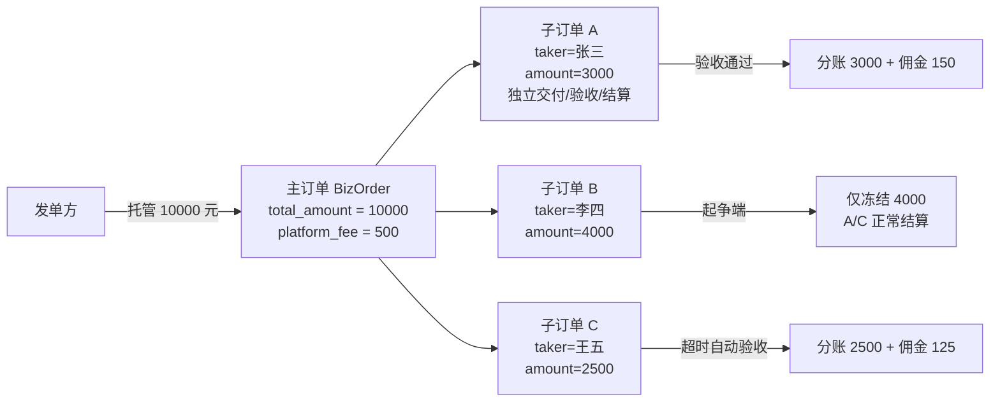

**结算粒度 = 子订单**。这是 MULTI 模式能成立的前提：

- 托管金额在**主订单**上（用户只付一次钱，体验好）。
- 但**冻结与释放的记账单位是子订单份额**（`escrow_share.share_amount`，见 §6.7 P0-① 的修复）。
- 争议冻结**只针对相关子订单份额**。
- 全部子订单终结后，主订单聚合为 `CLOSED`，多余的托管余额（若有）退还给发单方。

#### 5.5.4 资金托管、分账与合规红线（⭐ 法务一票否决区）

##### 一、三户模型

| 层 | 账户 | 说明 |
|---|---|---|
| 渠道层 | 平台在微信/支付宝的**平台商户号**（服务商模式） | 只用于发起指令，**不是资金归集账户** |
| 渠道层 | 接单方作为**二级商户**进件 | 钱直接进入接单方自己的商户号 |
| 平台层 | `wallet_account` 虚拟账户（每个用户一本） | 平台内部的记账口径，`available` + `frozen` |
| 平台层 | `wallet_txn` 双分录流水 | 自证机制：`Σ借方 == Σ贷方` |

##### 二、⛔ 二清红线（**必须让法务与业务方共同确认**）

> **平台用自有对公账户收取用户资金、再转付给接单方 = "二清"**（二次清算），属于**无证从事支付结算业务**，违反《非银行支付机构监督管理条例》。这是本系统唯一的**法律层面一票否决项**，不是技术偏好问题。

| 做法 | 判定 | 后果 |
|---|---|---|
| ⛔ 用户付款到平台对公账户 → 平台再转给接单方 | **违规（二清）** | 责令整改、罚款、支付通道被关停、严重者追究刑责 |
| ⛔ 用平台法人个人账户/微信个人收款码收款 | **严重违规** | 同上，且涉嫌偷逃税 |
| ✅ 微信支付**电商收付通**：平台型商户，资金托管，指令分账 | 合规 | 需平台资质审核，周期 2-4 周 |
| ✅ 支付宝**资金预授权 + 分账** | 合规 | 需签约对应产品 |
| ✅ 接**持牌机构/银行存管**（汇付、易宝、连连等），平台只发指令 | 合规 | 多一道对接方，费率略高，但支持更多渠道 |

**因此本系统强制**：平台佣金只能通过**分账指令**从交易资金中按比例划取，⛔ **绝不"先归集到平台账户、再转出给接单方"**。

##### 三、托管单状态机与记账

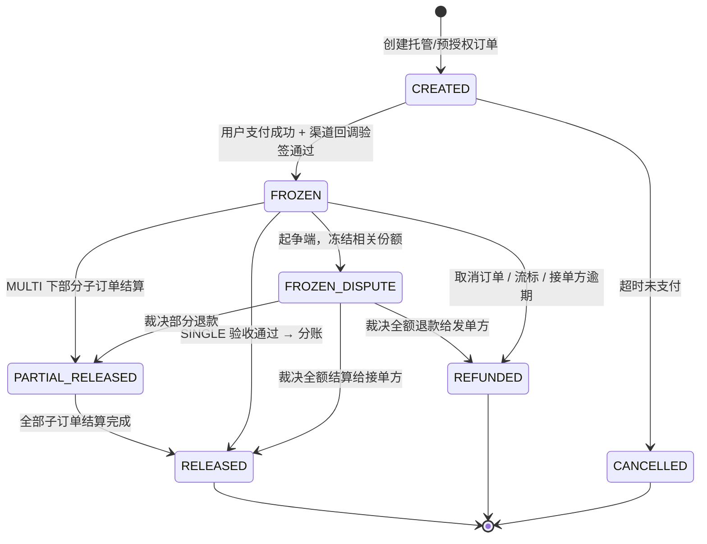

**记账示例（双分录）**：

| 动作 | 借方 | 贷方 | 说明 |
|---|---|---|---|
| 用户支付托管 10000 | 用户可用 −10000 | 托管冻结 +10000 | 资金进入托管 |
| 验收结算（子订单 3000） | 托管冻结 −3000 | 接单方可用 +2850，平台佣金收入 +150 | 分账 |
| 裁决退款（子订单 4000 全额退） | 托管冻结 −4000 | 发单方可用 +4000 | 退款 |
| 部分裁决（退 2000，结 2000） | 托管冻结 −4000 | 发单方 +2000，接单方 +1900，佣金 +100 | 按比例拆分 |

> **每日不变量校验**（XXL-Job，凌晨执行）：
> ① `Σ wallet_txn 借方 == Σ 贷方`；
> ② `Σ wallet_account.frozen == Σ escrow 未释放金额`；
> ③ `Σ wallet_account.available >= 0`（任何负余额都是 bug）；
> ④ 🆕 **`Σ commission_detail.commission_amount`（EFFECTIVE）== Σ 平台佣金科目流水**；
> ⑤ 🆕 **每一条 `commission_detail` 满足 `commission_amount + taker_net_amount == base_amount`**。
> **任一不通过立即告警并冻结提现**。抽成的计算细节见 §5.12。

##### 四、T+1 对账

```
拉取渠道账单（微信 / 支付宝） →
与 wallet_txn 逐笔比对（按 channel_txn_no 关联） →
   ├─ 渠道有、平台无  → 漏记（严重，可能有回调丢失）→ 补单 + 告警
   ├─ 平台有、渠道无  → 虚假成功（严重，可能被伪造回调）→ 冻结 + 人工核查
   ├─ 金额不一致      → 记为差异单 → 人工处理
   └─ 完全一致        → 归档
差异结果写入 recon_diff，管理端「资金对账」页面可查（UC-A-12）
```

##### 五、提现与结算周期

| 项 | 规则 |
|---|---|
| 结算周期 | 接单方提现 **T+1**（假设 A4；若为 T+7 需引入"在途资金"科目） |
| 提现门槛 | 最低 100 元（可配），避免小额高频提现冲击渠道费率 |
| 提现风控 | 实名必须已通过；绑卡姓名需与实名一致；单日限额；异常行为（新账号大额提现、多账号同卡）转人工审核 |
| 大额审核 | 超过 `withdraw_manual_threshold`（默认 5000 元）转管理员人工审核（UC-A-14） |
| 发票 | 平台佣金收入需开票，接单方收入需代扣代缴（**税务口径需财务确认**，见 §6.1 Q10） |

### 5.6 状态机设计

> **落地方式**：`Spring StateMachine` 定义迁移表 + 每次迁移写 `*_status_log`（旧状态、新状态、操作人、原因、时间、traceId）。⛔ 禁止在业务代码里散写 `if (status == ...) { status = ... }`。
> CI 门禁：用 ArchUnit 禁止除状态机配置类之外的地方直接给 `status` 字段赋值（只能通过 `StateMachineService.fire(event)`）。

#### 5.6.1 任务状态机 `task.status`（v1.2：11 → **18 状态**）

> 业务口径（状态全集、含义、资金状态、状态 × 操作矩阵）见 **§4.11**；本小节只画迁移图与实现约定。
> ⚠️ v1.1 的 `PUBLISHED`（语义过载）与 `ASSIGNED`（与"待开始"混淆）已废弃，拆分为 `PENDING_ESCROW` / `RECRUITING` / `BIDDING` / `PENDING_SELECT` / `PENDING_START`。

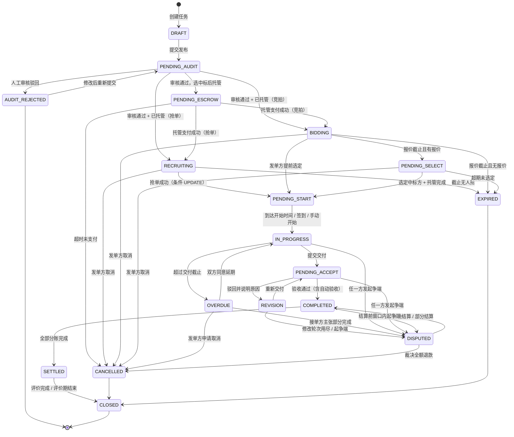

**状态分组**（用于看板与列表筛选）：

| 分组 | 状态 |
|---|---|
| 草稿域 | `DRAFT` `PENDING_AUDIT` `AUDIT_REJECTED` |
| 招募域 | `PENDING_ESCROW` `RECRUITING` `BIDDING` `PENDING_SELECT` |
| 履约域 | `PENDING_START` `IN_PROGRESS` `PENDING_ACCEPT` `REVISION` `OVERDUE` `DISPUTED` |
| 收尾域 | `COMPLETED` `SETTLED` |
| 终态 | `CLOSED` `CANCELLED` `EXPIRED` |

**实现约定（新增）**：

| 约定 | 说明 |
|---|---|
| 迁移表 37 条 | 见 §4.11.4；状态机配置类集中定义，⛔ 禁止绕过 |
| **主任务状态聚合** | `TaskStatusAggregator` 为**唯一实现**（§4.11.6），优先级 `DISPUTED > OVERDUE > REVISION > PENDING_ACCEPT > IN_PROGRESS > PENDING_START > COMPLETED > SETTLED` |
| 状态 × 操作矩阵 | §4.11.5 落为配置，**接口层统一校验**，不在各业务方法里重复判断 |
| 非法迁移必须拒绝 | 补齐测试：`DRAFT→IN_PROGRESS`、`RECRUITING→COMPLETED`、`PENDING_ESCROW→RECRUITING`、`SETTLED→DISPUTED`、`CLOSED→任意` |
| 聚合漂移巡检 | 每日比对主任务状态与聚合结果，不一致即告警（防事件丢失） |
| 索引 | `idx(status, category_id, created_at)`、`idx(status, grant_mode, bid_deadline)`、`idx(status, auto_accept_at)` |

#### 5.6.2 子订单状态机 `sub_order.status`（⭐ 含"超时默认验收"）

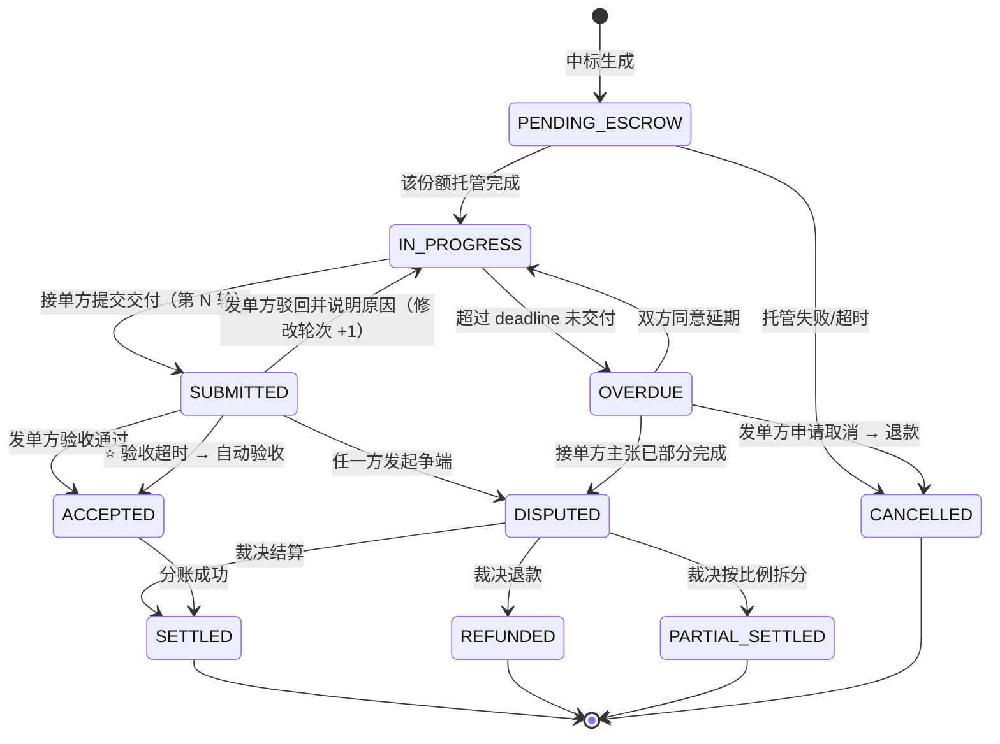

**⭐ 偏向接单方的三条规则（写进 `sys_config`，默认值如下）**：

| 规则 | 默认值 | 理由 |
|---|---|---|
| **验收超时自动验收** | 交付后 **7 天** | 接单方先付出了劳动，回款不能取决于发单方是否登录。⛔ 绝不能设计成"超时自动退回" |
| 验收前提醒 | 交付后 **48h / 24h** 各一次 | 给发单方充足机会，避免"没看到通知就被扣钱"的投诉 |
| 修改轮次上限 | **3 轮** | 无限驳回会让接单方陷入死循环；超限自动转争端工单，由操作员裁决 |

#### 5.6.3 竞价状态机 `task_bid.status`

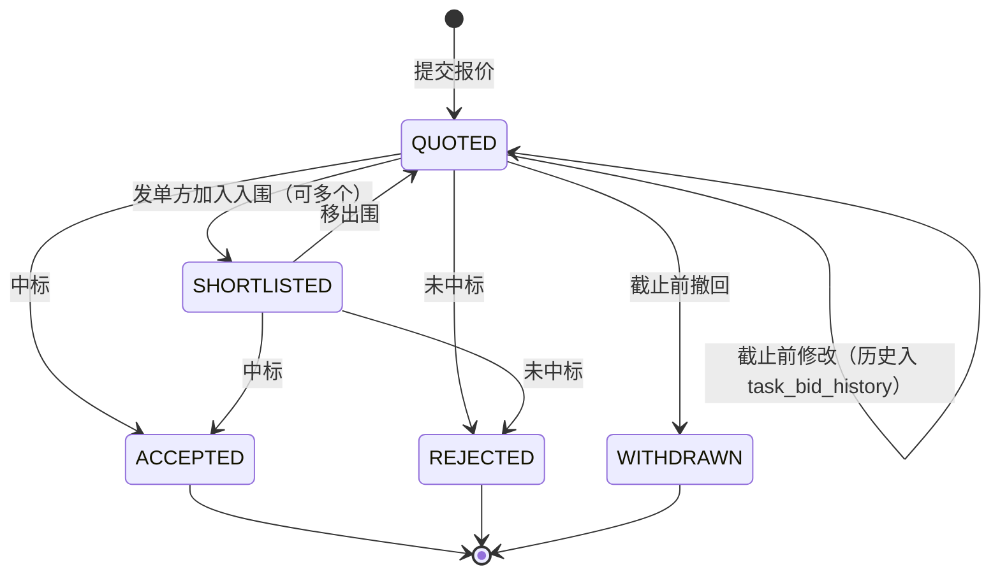

#### 5.6.4 争端工单状态机 `dispute_ticket.status`

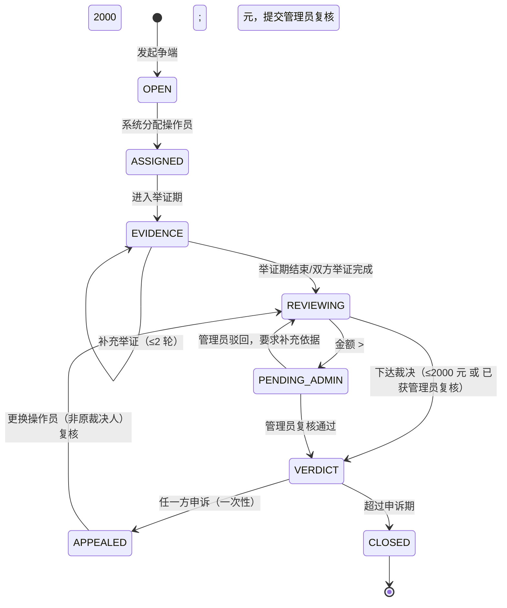

| SLA 规则 | 默认值 | 超时动作 |
|---|---|---|
| 操作员受理 | 4 小时 | 自动转下一个可用操作员 |
| 全流程（普通） | 24 小时 | 升级给管理员 |
| 全流程（加急，金额 > 5000 元） | 8 小时 | 升级给管理员 |
| 申诉期 | 裁决后 3 天 | 超期自动 `CLOSED` |

#### 5.6.5 托管单状态机

见 §5.5.4 第三节。补充约束：

| 约束 | 说明 |
|---|---|
| 状态变更必须幂等 | `idempotent_key = escrow_id + target_status + version` |
| ⛔ 禁止跨状态跳转 | `CREATED → RELEASED` 必须被状态机拒绝 |
| 每次变更写 `wallet_txn` | 状态与记账**在同一事务内**，不允许"状态变了但没记账" |
| 渠道回调延迟到达 | 若托管单已 `CANCELLED`，回调按**退款**处理并告警，不得静默丢弃 |

#### 5.6.6 状态机落地清单

| 状态机 | 事件数（估） | 状态数 | 关键校验点 |
|---|---|---|---|
| 任务 | **37** | **18** | 抢单只能从 `RECRUITING` 进入（**条件 UPDATE 判定**）；中标只能从 `BIDDING`/`PENDING_SELECT` 进入；`SETTLED` 后不可再起争端；主任务状态由 `TaskStatusAggregator` 聚合 |
| 任务（新增） | — | — | **主状态聚合**、**结算前争端窗口**、**里程碑与多人拆单互斥** |
| 子订单 | 12 | 10 | 自动验收、修改轮次上限、独立超时 |
| 竞价 | 7 | 5 | 截止时间服务端判定 |
| 工单 | 9 | 8 | 金额超限必须走管理员复核 |
| 托管单 | 8 | 7 | 状态与记账同事务 + 幂等 |

### 5.7 接口设计规范

#### 5.7.1 RESTful 约定与 URL 规划

**基本约定**：

| 项 | 约定 |
|---|---|
| 前缀 | `/api/v1/**` |
| 资源命名 | 复数、小写、中划线：`/api/v1/tasks`、`/api/v1/sub-orders` |
| 动作类接口 | 用子资源或动词后缀：`POST /tasks/{id}/grab`、`POST /tasks/{id}/bids`、`POST /sub-orders/{id}/accept` |
| 角色前缀 | 用户态 `/api/v1/**`；操作员 `/api/v1/op/**`；管理员 `/api/v1/admin/**`（**三段路径即三种权限域，便于 Nginx 与安全策略统一拦截**） |
| HTTP 方法 | `GET` 查询（幂等）、`POST` 创建/动作、`PUT` 全量更新、`PATCH` 局部更新、`DELETE` 删除 |
| 状态码 | `200` 成功、`201` 创建、`400` 参数错、`401` 未认证、`403` 无权限、`404` 不存在、`409` 状态冲突（如抢单失败）、`429` 限流、`500` 服务错 |
| 时间格式 | ISO-8601 带时区：`2026-10-15T13:20:00+08:00` |
| 金额 | **字符串**传输（`"10000.00"`），⛔ 不用 JSON number（避免 JS 精度丢失） |
| ID | 对外用 `Long` 自增 + 业务号（`task_no`），⛔ 不暴露可枚举的自增 ID 作为唯一对外标识（防遍历） |

**核心接口清单（示例，非全量）**：

| 方法 | 路径 | 说明 | 幂等要求 |
|---|---|---|---|
| `POST` | `/api/v1/auth/login` | 登录 | — |
| `POST` | `/api/v1/auth/refresh` | 刷新令牌 | — |
| `POST` | `/api/v1/real-name` | 提交实名 | ✅ |
| `GET` | `/api/v1/tasks` | 任务大厅（筛选+分页） | — |
| `GET` | `/api/v1/tasks/{id}` | 任务详情 | — |
| `POST` | `/api/v1/tasks` | 创建任务 | ✅ |
| `POST` | `/api/v1/tasks/{id}/publish` | 发布任务 | ✅ |
| `POST` | `/api/v1/tasks/{id}/grab` | **抢单** | ✅ **必须** |
| `POST` | `/api/v1/tasks/{id}/bids` | 提交报价 | ✅ |
| `PATCH` | `/api/v1/tasks/{id}/bids/{bidId}` | 修改报价（留痕） | ✅ |
| `POST` | `/api/v1/tasks/{id}/award` | **中标（SINGLE/MULTI）** | ✅ **必须** |
| `GET` | `/api/v1/orders` | 我的订单（主+子） | — |
| `POST` | `/api/v1/sub-orders/{id}/deliveries` | 提交交付 | ✅ |
| `POST` | `/api/v1/sub-orders/{id}/accept` | 验收通过 | ✅ **必须** |
| `POST` | `/api/v1/sub-orders/{id}/reject` | 驳回 | ✅ |
| `GET` | `/api/v1/wallet` | 钱包总览 | — |
| `GET` | `/api/v1/wallet/transactions` | 资金流水 | — |
| `POST` | `/api/v1/wallet/withdrawals` | 申请提现 | ✅ **必须** |
| `POST` | `/api/v1/disputes` | 发起争端 | ✅ |
| `POST` | `/api/v1/disputes/{id}/evidences` | 补充举证 | — |
| `GET` | `/api/v1/im/sessions` / `/messages` | IM | — |
| `POST` | `/api/v1/op/tickets/{id}/verdict` | **操作员裁决** | ✅ **必须** |
| `POST` | `/api/v1/admin/accounts/{id}/freeze` | 管理员冻结账号 | ✅ |
| `POST` | `/api/v1/pay/callback/{channel}` | **渠道回调**（免登录、验签、独立域名） | ✅ **必须** |
| `GET` | `/api/v1/credit` | 我的信誉分与等级 | — |
| `GET` | `/api/v1/credit/privileges` | **我要的权益**（抢单门槛/上限/费率修正/提现周期） | — |
| `GET` | `/api/v1/credit/logs` | 信誉分变动明细 | — |
| `POST` | `/api/v1/credit/appeals` | 对扣分发起申诉 | ✅ |
| `POST` | `/api/v1/commissions/preview` | **抽成预估**（报价时实时显示「报价 / 服务费 / 实得」） | — |
| `POST` | `/api/v1/admin/commission-rules` | 运营管理员配置费率 | ✅ |
| `POST` | `/api/v1/admin/credit/rules` | 风控管理员配置计分规则 | ✅ |
| `POST` | `/api/v1/admin/credit/adjust` | 信誉分人工调整（>20 分转审批） | ✅ |
| `POST` | `/api/v1/admin/approvals/{id}/vote` | **复核投票**（双人/三人复核） | ✅ **必须** |
| `POST` | `/api/v1/admin/rbac/roles` | 角色与互斥岗位配置 | ✅ |

#### 5.7.2 统一响应体

```json
{
  "code": 0,
  "message": "OK",
  "data": { },
  "traceId": "a1b2c3d4e5f6",
  "timestamp": "2026-10-15T13:20:00+08:00"
}
```

| 字段 | 说明 |
|---|---|
| `code` | 业务码，`0` 为成功。**HTTP 状态码表达协议层语义，业务码表达业务语义，两者并存不冲突** |
| `message` | 用户可读文案（已国际化预留），**不含堆栈与技术细节** |
| `data` | 业务数据；列表统一 `{ "list": [], "total": 0, "pageNum": 1, "pageSize": 20 }` |
| `traceId` | **必须回传前端**，用户报障时直接提供，运维凭此定位全链路 |
| `timestamp` | 服务端时间，前端用于倒计时校准（**倒计时一律以服务端时间为准**） |

#### 5.7.3 错误码分段

| 段 | 领域 | 示例 |
|---|---|---|
| `0` | 成功 | `0 OK` |
| `10xxx` | 通用 / 参数 | `10001` 参数校验失败、`10002` 请求过于频繁、`10999` 系统繁忙 |
| `20xxx` | 认证授权 | `20001` 未登录、`20002` 令牌过期、`20003` 无权限、`20004` 账号被冻结、`20005` 未实名 |
| `30xxx` | 任务 | `30001` 任务不存在、`30002` 任务状态不允许该操作、`30003` 非任务所有者、`30004` 审核未通过 |
| `31xxx` | 抢单 / 竞价 | `31001` 正在被抢请重试、`31002` **已被他人抢走**、`31003` 竞拍已截止、`31004` 报价超范围、`31005` 中标金额超托管额、`31006` SINGLE 模式只能选一人 |
| `32xxx` | 订单 / 交付 | `32001` 子订单状态不允许、`32002` 已超交付期、`32003` 驳回理由必填、`32004` 修改轮次已用尽 |
| `40xxx` | 资金 | `40001` 余额不足、`40002` 托管创建失败、`40003` **重复请求（幂等命中）**、`40004` 分账失败、`40005` 提现审核中、`40006` 实名与银行卡不一致 |
| `41xxx` 🆕 | **抽成与分成** | `41001` 费率规则未命中、`41002` **佣金与实得不配平**、`41003` 费率越界（1%–20%）、`41004` 阶梯区间重叠、`41005` 活动时间交叉、`41006` 抽成明细已存在（幂等）、`41007` 已分账不可重算 |
| `50xxx` | 争端 | `50001` 工单不存在、`50002` 举证期已结束、`50003` **裁决金额超操作员上限**、`50004` 已裁决不可重复裁决、`50005` 申诉机会已用 |
| `60xxx` | 平台治理 | `60001` 无管理权限、`60002` 该账号为内部账号不可操作、`60003` 参数配置非法、`60004` **岗位互斥，不可同时分配**、`60005` 审批未完成，动作被拦截、`60006` 发起人不得为自己的动作投票 |
| `70xxx` 🆕 | **信誉分** | `70001` 分值越界（0–100）、`70002` 该事件已计分（幂等）、`70003` 今日加分已达上限、`70004` **信誉分不足，无法接单**、`70005` 进行中任务数已达该等级上限、`70006` 扣分申诉已过期或已用、`70007` 人工调整超单次上限（20 分） |
| `90xxx` | 外部渠道 | `90001` 渠道超时、`90002` 渠道验签失败、`90003` 渠道返回异常 |

> **原则**：**能被用户看懂并据此采取行动的，才配拥有独立错误码**。抢单失败必须区分"被抢走"（去看别的任务）与"你不符合条件"（去完善资质），这两条路径完全不同。

> 📖 **完整的多端预留设计**（端能力矩阵、页面清单、登录/支付/推送/附件/实时通道逐项差异、Phase 1 必须为移动端做的 10 件事）见 **§5.15**。本节只保留接口层面的协商约定。

#### 5.7.4 多端兼容与能力协商（为小程序 / App / 桌面端预留）

| 维度 | 做法 |
|---|---|
| **客户端标识** | 请求头 `X-Client: web-user \| web-admin \| mp-weixin \| app-android \| app-ios \| desktop`；`X-Client-Version: 1.4.2` |
| **字段裁剪** | 同一接口按端裁剪：小程序不返回大字段（长富文本、多附件详情）以控包体与流量；桌面端可返回高清资源地址 |
| **鉴权差异** | Web 用 `Authorization: Bearer`；小程序 `code2session` 换取平台令牌；App 可用设备指纹 + 令牌；桌面端用二维码扫码登录（复用 Web 登录态） |
| **附件上传** | 策略由 `GET /api/v1/client/upload-policy` 下发：Web/桌面端用分片直传；小程序受包体限制，限制单文件大小与并发数 |
| **实时通道** | 小程序用 `wx.connectSocket`；App 用原生 WS；桌面端用 WS。**服务端协议完全一致**（同一套消息体与序号机制） |
| **推送差异** | Web 站内信；小程序订阅消息；App 厂商 Push；桌面端系统通知。由 `notify` 模块按端路由（UC-A-16 模板管理） |
| **支付差异** | ⚠️ **小程序不能直接跳 H5 支付**，必须走小程序内 `wx.requestPayment`；App 走 SDK 支付；Web 走扫码/跳转。**因此托管创建接口必须按 `X-Client` 返回不同的支付参数**——这是四端复用后端时最容易踩的坑 |
| **版本兼容** | 客户端版本低于最低支持版本时，接口返回 `10998` + 升级提示；`Deprecation` / `Sunset` 响应头标记废弃接口 |

#### 5.7.5 前端工程划分与权限路由

**两个工程，独立构建、独立部署**：

| 工程 | 使用者 | 技术要点 |
|---|---|---|
| `web-user` | 发单方 + 接单方（同一批人） | 任务大厅、发单向导（多步表单）、订单工作台、钱包、IM 面板、争端流程 |
| `web-admin` | 系统管理员 + 操作员 | 工作台、工单队列、审核台、用户管理、RBAC 配置、参数配置、对账、审计日志、报表 |

**共享方式**：`pnpm workspace` 抽一个 `packages/shared`（OpenAPI 生成的 TS 类型 + Axios 封装 + 通用工具 + 字典常量）。⛔ **不共享业务组件**——两个工程的交互模式差异太大，强行共享会造出一堆 `if (isAdmin)` 的组件。

**动态路由与权限（`web-admin` 关键实现）**：

```ts
// 登录后按角色下发菜单与路由，而非在前端硬编码 if (role === 'admin')
const menus = await api.getMenus();               // GET /api/v1/auth/menus
menus.forEach(m => router.addRoute(m.route));     // 动态挂载
// 操作员根本看不到「账号管理」「权限配置」菜单；
// 但即使手动敲 URL，也会被 (a) 路由守卫 (b) 后端 @PreAuthorize 双重拦截
```

> ⚠️ **安全边界声明**：前端的菜单裁剪与路由守卫**只是体验优化，不是安全措施**。真正的安全边界在后端。所有 `web-admin` 接口必须独立鉴权，**绝不假设"前端藏了菜单用户就调不到"**（这是最常见的越权漏洞来源）。

### 5.8 安全设计

> **合规目标**：**等保三级**（本系统含身份证等敏感个人信息、承载资金流转、目标 100 万用户 —— 三级是现实要求，见 §5.8.18 的映射表）。
> **风控**：自建全套（规则引擎 + 设备指纹 + 关系图谱，见 §5.8.5）。
> **客户端**：标准加固（混淆 + 证书绑定 + root/越狱检测 + 反调试，见 §5.8.14）。

#### 5.8.0 威胁模型与信任边界（本节是全章的总纲）

**先说清楚"我们在防谁"** —— 不同对手需要完全不同的措施，混在一起谈会既过度又不足：

| # | 对手 | 动机 | 主要手段 | 对应章节 |
|---|---|---|---|---|
| T1 | **脚本党 / 黄牛** | 抢高价值任务转卖、薅补贴 | 自动化脚本抢单、多账号、改机工具 | §5.8.2、§5.8.5、§5.8.7 |
| T2 | **欺诈者（发单方）** | 骗方案、白嫖劳动、恶意退款 | 虚假任务、恶意驳回、拒付、伪造证据 | §4.9.4、§5.8.5、§5.12.4 |
| T3 | **欺诈者（接单方）** | 收了钱不干活、套现 | 抢了不做、逾期、伪造交付、自买自卖套现 | §4.9.3、§5.8.5、§5.8.8 |
| T4 | **外部攻击者** | 拖库、篡改、勒索 | 注入、越权、CC/DDoS、Web 漏洞 | §5.8.2、§5.8.7、§5.8.11 |
| T5 | **支付欺诈者** | 伪造到账、重复退款 | 伪造回调、重放、金额篡改、退款套利 | §5.8.8 |
| T6 | **内部人（越权/牟利）** | 改数据、放行、导数据 | 越权查询、改信誉分/费率、删审计、导客户名单 | §5.8.4、§5.8.9 |
| T7 | **账号窃取者** | 盗号盗资金 | 撞库、钓鱼、SIM 劫持、验证码轰炸 | §5.8.1 |
| T8 | **恶意第三方 SDK / 供应链** | 植入后门、窃取数据 | 恶意依赖、投毒镜像、CI 攻击 | §5.8.13 |

**信任边界图**（跨越边界的数据流必须加密、鉴权、审计）：

```mermaid
flowchart TB
    subgraph Z0["❌ 不可信区（互联网）"]
        U["用户浏览器 / 小程序 / App / 桌面端"]
        ATK["攻击者 / 脚本 / 爬虫"]
    end
    subgraph Z1["🟡 边界区（DMZ）"]
        WAF["WAF + DDoS 高防"]
        NGX["Nginx / Ingress<br/>TLS 卸载 · 限流"]
    end
    subgraph Z2["🟢 可信应用区（仅内网）"]
        API["app-api 集群"]
        WS["app-ws 集群"]
        JOB["XXL-Job"]
    end
    subgraph Z3["🔴 数据区（无外网出口）"]
        DB[("MySQL 主从")]
        RD[("Redis")]
        MQ["RocketMQ"]
        OSS[("对象存储<br/>私有 Bucket")]
    end
    subgraph Z4["🔵 运维区（堡垒机）"]
        BAST["堡垒机 / VPN"]
        MON["监控告警 + SIEM"]
    end
    subgraph Z5["🟣 外部服务"]
        PAY["支付渠道"]
        SMS2["短信"]
        REAL2["实名核验"]
    end
    U --> WAF --> NGX --> API
    ATK -.->|"被拦截"| WAF
    API --> DB
    API --> RD
    API --> MQ
    API --> OSS
    API --> PAY
    API --> SMS2
    API --> REAL2
    BAST --> Z2
    Z2 --> MON
    Z3 -.->|"⛔ 无出网"| Z0
```

**七条安全红线**（与 §0.3 的设计红线并列，违反即阻断上线）：

| # | 红线 | 违反的后果 |
|---|---|---|
| S1 | ⛔ **任何写操作都必须做对象级授权（资源所有权）校验**，不能只判"登录了没" | 水平越权 = 任意改他人订单/钱包，最常见的致命漏洞 |
| S2 | ⛔ **支付回调必须验签 + 幂等**，且不得只依赖前端或自家日志判断到账 | 伪造回调直接白送钱 |
| S3 | ⛔ **敏感字段（身份证、银行卡）必须加密存储**，密钥不得与数据同库同机 | 拖库即全量泄露，等保三级直接不通过 |
| S4 | ⛔ **审计日志只增不改不删**（数据库层收回 UPDATE/DELETE 权限） | 内部人作案后无法追溯 |
| S5 | ⛔ **源码与镜像中禁止出现任何密钥**（含渠道私钥、数据库密码） | 一次仓库泄露 = 全线失守 |
| S6 | ⛔ **生产数据不得导出到非受控环境**（含开发/测试/个人终端） | 个人信息泄露 + 个保法处罚 |
| S7 | ⛔ **内部人的高风险动作必须双人复核且不可自批** | 单人即可改费率/放款 = 内部舞弊 |

**攻击面清单**（每个入口都要有对应的防护措施，不允许"忘了"）：

| 攻击面 | 入口 | 防护 |
|---|---|---|
| 认证入口 | 登录、注册、找回密码、短信验证码、实名 | §5.8.1 |
| 业务接口 | 全部 REST | §5.8.2、§5.8.7 |
| 长连接 | WebSocket | §5.8.7（握手鉴权 + 消息级鉴权） |
| 回调入口 | 支付渠道回调（免登录） | §5.8.8 |
| 文件 | 上传、下载、预览、签名 URL | §5.8.7 |
| 管理后台 | `/api/v1/op/**`、`/api/v1/admin/**` | §5.8.2、§5.8.9 |
| 数据出口 | 导出、报表、OpenAPI | §5.8.3 |
| 依赖与构建 | Maven/npm 依赖、基础镜像、CI | §5.8.13 |
| 运维通道 | SSH、K8s API、数据库直连 | §5.8.11 |
| 客户端 | 前端产物、App 包、小程序 | §5.8.14 |

#### 5.8.1 认证与会话

| 项 | 设计 |
|---|---|
| 令牌 | Access Token（JWT，15 min）+ Refresh Token（随机串，7 d，**存 Redis 可吊销**） |
| 登出 | 删除 Redis 中的 Refresh Token；Access Token 因短有效期自然失效（可选用黑名单补强） |
| 强制下线 | 管理员冻结账号 → 删除该用户全部 Refresh Token + 写 Redis 黑名单 → 网关拦截 |
| 多端登录 | 允许（同账号 Web + App）；提供"设备管理"可单独踢出 |
| 密码 | BCrypt（cost 10）+ 强度校验；⛔ 禁止明文、禁止 MD5/SHA1 |
| 登录防护 | 图形验证码（连续失败 3 次后）+ 失败 5 次锁定 15 分钟 + 异地登录告警 |
| 短信验证码 | 6 位、5 分钟有效、同号 60s 内不可重发、每日上限；⛔ 验证码不可出现在响应体里 |
| **撞库防护** 🆕 | 密码登录走**独立限流**（按账号 + IP + 设备三因子）；触发后强制图形验证码 → 滑块 → 暂时锁定；⛔ 登录失败文案不得区分"账号不存在"与"密码错误"（防**账号枚举**） |
| **验证码轰炸防护** 🆕 | 短信接口按 **手机号 + IP + 设备指纹 + 全局**四维限流；同号 1 小时 ≤5 条、1 天 ≤10 条；⛔ 未通过图形验证码不得发短信（否则会被用作短信轰炸机） |
| **设备指纹** 🆕 | 登录时采集设备指纹（Web：Canvas/WebGL/字体 + 存储；App：设备 ID + 机型），用于异常登录识别与多账号关联 |
| **异常登录检测** 🆕 | 异地登录（与历史常用地差异大）、新设备登录、短时间多 IP → **触发二次验证**（短信 + 已登录设备确认）并告警 |
| **账号找回的社工防护** 🆕 | 改密/换绑手机必须**双重验证**（原密码 + 短信 或 已登录设备确认）；⛔ 客服**无权**直接改用户手机号或密码（只能引导用户自助或走工单 + 管理员双人复核） |
| **会话安全** 🆕 | Refresh Token 一次性使用（用完即换，旧的立即失效，防重放）；令牌绑定设备指纹；改密/改绑/异地登录后**全端强制下线** |
| **密码策略** 🆕 | 长度 ≥8、含大小写与数字；⛔ 拒绝常见弱口令库（Top 10 万）；⛔ 明文密码不得写入任何日志或链路追踪 |

#### 5.8.2 授权模型（三层）

```mermaid
flowchart LR
    A["第一层：平台身份<br/>USER / OPERATOR / ADMIN"] --> B["第二层：RBAC 权限点<br/>task:audit / dispute:verdict / account:freeze"]
    B --> C["第三层：数据范围<br/>SELF / GROUP / ALL<br/>+ 资源所有权校验"]
    C --> D["最终判定：三层全过才放行"]
```

| 层 | 机制 | 实现 |
|---|---|---|
| 1. 平台身份 | 路径域隔离 | `/api/**` 需登录 ｜ `/api/v1/op/**` 需 `OPERATOR` 或 `ADMIN` ｜ `/api/v1/admin/**` 仅 `ADMIN` |
| 2. 权限点 | RBAC | `@PreAuthorize("hasAuthority('dispute:verdict')")`；权限点种子数据纳入 Flyway |
| 3. 数据范围 + 所有权 | 数据权限切面 | 用户态自动注入 `user_id = currentUserId`；操作员按 `GROUP`；管理员 `ALL`。**业务代码不手写这个条件**（靠拦截器，避免漏写） |

**防越权测试用例（必须逐条覆盖，上线前全绿）**：

```
垂直越权：
  T1 用户令牌 → POST /api/v1/admin/accounts/1/freeze      期望 403
  T2 用户令牌 → POST /api/v1/op/tickets/1/verdict         期望 403
  T3 操作员令牌 → POST /api/v1/admin/rbac/roles           期望 403
  T4 操作员令牌 → POST /api/v1/admin/accounts/1/freeze    期望 403

水平越权：
  T5 用户A令牌 → GET  /api/v1/orders/{用户B的订单ID}       期望 403/404
  T6 用户A令牌 → POST /api/v1/sub-orders/{B的ID}/accept    期望 403
  T7 用户A令牌 → GET  /api/v1/wallet/transactions?userId=B 期望 忽略参数，只返回A的
  T8 用户A令牌 → POST /api/v1/tasks/{B的任务ID}/award      期望 403
  T9 用户A令牌 → GET  /api/v1/im/sessions/{B的会话ID}/messages 期望 403
  T10 用户A令牌 → GET  /api/v1/disputes/{B的工单ID}         期望 403

参数篡改：
  T11 抢单时篡改 taskId 为已中标任务                        期望 31002
  T12 中标时篡改金额使 Σ > 托管额                           期望 31005
  T13 提现时篡改金额为负数                                  期望 10001
  T14 裁决时金额超操作员上限                                期望 50003

职责分离与复核（v1.1 新增）：
  T15 仲裁专员令牌 → 直接调用资金划转接口                    期望 403
  T16 同一人用两个岗位身份为同一审批单投两票                 期望 60006（uk 拒绝）
  T17 审批发起人为自己的动作投票                            期望 60006
  T18 运营管理员令牌 → 调用提现审批接口                      期望 403
  T19 给同一内部账号分配互斥岗位对                          期望 60004
  T20 绕过接口直接改库分配互斥岗位                          期望 数据库权限拒绝 + 告警

信誉分与抽成（v1.1 新增）：
  T21 用户令牌 → 传他人 userId 查信誉分                      期望 忽略参数，只返回自己的
  T22 重复提交同一加分事件（同 event_type + biz_id）          期望 70002（幂等，不重复加分）
  T23 构造请求把费率配置为 50%                              期望 41003（越界拒绝）
  T24 构造间隔重叠的两条阶梯规则                             期望 41004
  T25 构造佣金 + 实得 ≠ 基数的写入                          期望 数据库 CHECK 拒绝
  T26 人工调整信誉分 30 分（超单次上限）                     期望 70007，转双人复核
```

#### 5.8.3 数据安全

**第一步是分级** —— 不分级就会"要么全加密拖垮性能，要么全明文等保不通过"：

| 级别 | 定义 | 数据举例 | 保护要求 |
|---|---|---|---|
| **L4 极敏感** | 泄露即造成重大人身/财产损害 | 身份证号、银行卡号、实名证件图、人脸数据、密码哈希、渠道私钥 | **加密存储 + 单独密钥 + 访问审批 + 全量审计 + 水印**；⛔ 禁止出现在任何日志、导出、测试数据 |
| **L3 敏感** | 泄露即侵犯个人信息 | 手机号、真实姓名、详细地址、精确坐标、聊天记录、交付物 | 加密或脱敏；按需最小化返回；导出需审批；日志脱敏 |
| **L2 内部** | 泄露影响经营 | 订单金额、抽成明细、信誉分明细、工单内容 | 登录 + 授权后可访问；⛔ 禁止外发 |
| **L1 公开** | 可公开 | 任务标题、分类、预算区间（脱敏后）、公开评价 | 无特殊要求 |

> ⭐ **L4 的判定标准是"泄露后能否直接造成损害"**：身份证号能直接办卡贷款、渠道私钥能直接伪造回调收钱 —— 所以它们不是"敏感"，是"极敏感"，措施要上一个量级。

**关键要求**：

| # | 要求 | 说明 |
|---|---|---|
| 1 | **字段级加密而非库级加密** | 只有 L4 字段加密，其余明文 —— 库级透明加密（TDE）性能损耗大且挡不住"有库权限的内部人"，字段级才精准 |
| 2 | ⭐ **信封加密（Envelope Encryption）** | 数据用**数据密钥（DEK）**加密，DEK 用**主密钥（KEK）**加密后存库；主密钥在 KMS/Vault 中，**永不落库、永不出 KMS**。好处：轮换主密钥不必重刷全表数据 |
| 3 | **密文带密钥版本号** | 密文格式 `v2:base64(...)`，便于灰度轮换与解密路由 |
| 4 | **确定性加密用于等值查询** | 手机号需精确查找 → 用 HMAC 生成**盲索引列**（`phone_hash`）建唯一索引，密文列本身不建索引 |
| 5 | **导出管控** | 导出必须：申请（说明用途）→ 审批 → **脱敏导出**（默认 L4 全遮、L3 部分遮）→ 带水印文件 → 记录导出人与行数；⛔ 禁止导出 L4 明文 |
| 6 | **测试数据** | ⛔ 禁止把生产数据直接导入测试环境；需要真实感数据时用**脱敏+伪造**工具生成 |
| 7 | **数据库审计** | 开启 MySQL 审计日志（记录谁在何时查了哪张表）；⛔ 生产库不开放公网，只允许应用网段 + 堡垒机访问 |

**分字段保护措施**：

| 数据 | 保护措施 |
|---|---|
| 身份证号、银行卡号 | **AES-256-GCM 加密存储**（独立密钥，密钥在 Vault）+ 展示脱敏（`410***********1234`） |
| 手机号 | 加密或哈希索引（用于精确查找）+ 展示脱敏（`138****5678`） |
| 密码 | BCrypt 单向哈希 |
| 实名证件图 | **独立私有 Bucket**，绝不走 CDN；访问用短时效签名 URL（5 分钟）；操作员查看时叠加**水印**（操作员账号 + 时间 + traceId） |
| 日志 | 全量脱敏（手机号、身份证、银行卡、令牌、渠道密钥）；⛔ 禁止打印完整请求体 |
| 数据库账号 | 应用账号只授予必要 DML；**`sys_audit_log` 与 `wallet_txn` 收回 UPDATE/DELETE 权限** |
| 备份 | 加密存储；备份文件访问需审批 |
| 数据生命周期 | 账号注销 → 30 天冷静期 → 匿名化（保留交易记录以满足法务留存，删除个人身份信息） |
| **脱敏规则表** 🆕 | 统一实现在序列化层（Jackson `@Sensitive` 注解 + 自定义序列化器），⛔ 禁止各处手写 `substring` 拼接；脱敏规则按角色分层：用户看自己全量、看他人脱敏；操作员看 L4 需实名审核岗 + 水印；管理员看 L4 需二次认证 + 审计 |

#### 5.8.4 审计设计（等保三级重点）

**审计的三个层次**（缺一层就不完整）：

| 层 | 记什么 | 存储 | 保留 |
|---|---|---|---|
| **业务审计** | 账号/权限/任务/资金/争端/配置的变更（见下表） | `sys_audit_log`（只增） | 5 年 |
| **访问审计** | 谁在何时访问了哪些敏感数据（L3/L4 的读取） | `sys_data_access_log` | 3 年 |
| **安全审计** | 登录成功/失败、权限拒绝、异常访问、限流触发、验签失败 | 独立日志 + SIEM | 1 年（等保要求 ≥6 个月） |

**必须写审计的动作清单**（缺一不可）：

| 域 | 动作 |
|---|---|
| 账号 | 创建/冻结/解冻/重置密码/强制下线/调整信用分/角色变更 |
| 权限 | 角色 CRUD、权限点变更、数据范围变更 |
| 任务 | 人工审核通过/驳回、下架、强制取消 |
| 资金 | 托管/分账/退款/提现审核/人工补单、对账差异处理 |
| 争端 | 受理、举证确认、裁决、申诉复核、改判 |
| 配置 | 费率、门槛、SLA、超时天数、风控规则变更 |
| 数据 | 导出、批量操作 |

**审计记录字段**：`操作人 / 角色 / 时间 / IP / User-Agent / traceId / 对象类型 / 对象ID / 动作 / 旧值 / 新值 / 原因`。

**防篡改**：审计表只增不改不删（数据库权限层面强制）；每日生成哈希链（每条记录包含前一条的哈希），可用于事后验证未被篡改。

**五项强化措施** 🆕（等保三级明确要求"审计记录应受到保护，避免受到未预期的删除、修改或覆盖"）：

| # | 措施 | 说明 |
|---|---|---|
| 1 | **数据库层收回权限** | 应用账号对 `sys_audit_log` 只有 `INSERT` + `SELECT`，⛔ 无 `UPDATE`/`DELETE`/`DROP` |
| 2 | **独立存储** | 审计库与业务库**物理分离**（不同实例、不同账号）；即使业务库被攻破，攻击者也改不了审计 |
| 3 | **哈希链 + 每日锚定** | 每条记录含 `prev_hash`；每日把当日末条哈希写入**独立的只读存储**（如对象存储 WORM + 邮件抄送合规负责人），形成不可抵赖的时间锚<br>⚠️ **v1.6 修复（P0-③）**：原设计说「每条含前一条哈希」，但**并发写入时无法确定"前一条"** —— 两个事务同时读到同一尾部哈希就会写出两条指向同一 prev 的记录，链断裂。<br>✅ **改为按小时分段建链**：新增 `chain_hour`(YYYY-MM-DD-HH) + `chain_seq` + `uk(chain_hour, chain_seq)`，段内串行、段间并行。既保证防篡改，又不让审计写入成为全局串行瓶颈；**访问审计（`sys_data_access_log`）同规格处理**（P1-⑩） |
| 4 | **可信时间源** | 所有节点 NTP 同步到统一时间源；⛔ 禁止用应用服务器本地时间作为审计时间 |
| 5 | **审计的审计** | 谁查了审计日志本身也要被记录；管理员查审计同样留痕 |
| 6 | **告警** | 审计写入失败、哈希链断裂、非工作时间的大量导出 → 实时告警 |

#### 5.8.5 业务风控（自建全套）

**自建风控的三件套**：

```mermaid
flowchart LR
    A["事件源<br/>登录/注册/发单/抢单/报价/支付/提现/IM"] --> B["① 规则引擎<br/>实时 · 毫秒级"]
    B --> C["② 设备指纹<br/>识别同设备多账号"]
    C --> D["③ 关系图谱<br/>识别团伙与资金回流"]
    D --> E{"风险决策"}
    E -->|"放行"| F["正常执行"]
    E -->|"标记"| G["执行 + 打标 + 观察"]
    E -->|"挑战"| H["二次验证 / 人工审核"]
    E -->|"拒绝"| I["拦截 + 记录 + 告警"]
    B -.-> J["离线规则回测<br/>用历史数据验证误杀率"]
    D -.-> K["图计算<br/>每日批量更新"]
```

**① 规则引擎**（自研，配置化，运营可调）

```java
// 规则模型：事件 + 条件（DSL/SpEL）+ 动作 + 优先级 + 生效期
RiskRule {
  code, name, eventType, condition,       // 例：count(login_fail, userId, 10min) >= 5
  action,                                  // PASS / TAG / CHALLENGE / REJECT
  score, priority, enabled, effectiveFrom, effectiveTo
}
// 决策：多条规则命中 → 取最高风险动作；分数累加写入 risk_hit_log
```

| 特性 | 要求 |
|---|---|
| 热更新 | 规则变更**不重启**（配置中心推送 + 本地缓存刷新） |
| 灰度与回测 | 新规则先以 `TAG` 模式跑 3 天，用历史数据看误杀率，再切 `CHALLENGE`/`REJECT` |
| 可解释 | 每次决策落 `risk_hit_log`（命中哪些规则、各扣多少分、最终决策），用户申诉时可查 |
| 性能 | 单次决策 P99 ≤ 20ms；规则求值走内存 + 滑动窗口计数（Redis） |
| ⛔ 禁止 | 规则里写死业务逻辑；规则数量无上限导致不可维护（建议 ≤200 条） |

**② 设备指纹**（自研，多端统一）

| 端 | 采集 | 说明 |
|---|---|---|
| Web | Canvas/WebGL 指纹 + 字体列表 + 屏幕参数 + 时区 + 本地存储 ID | ⛔ 不含任何可识别个人的信息 |
| 小程序 | 微信 `openid` 稳定性 + 系统信息 | 小程序指纹能力弱，靠 `openid` + 行为特征 |
| App | 设备 ID（OAID/IDFA 合规获取）+ 机型 + 系统 + 应用列表（可选） | 需在隐私政策中声明 |
| 桌面端 | 机器码（硬件序列哈希） | 需用户同意 |

**用途**：同设备多账号识别、设备黑名单、异常设备告警。⛔ **不得用于跨站追踪用户**（合规红线）。

**③ 关系图谱**（自研，识别团伙）

| 关系边 | 数据来源 |
|---|---|
| 设备 ↔ 账号 | 设备指纹 |
| 账号 ↔ 账号（发单/接单） | 订单表 |
| 账号 ↔ 银行卡/支付宝 | 提现绑定 |
| 账号 ↔ IP | 访问日志 |
| 账号 ↔ 聊天对象 | IM |

**识别的团伙模式**：自买自卖闭环（A 发单 → B 接单 → 资金回流 A）、星型团伙（1 设备 N 账号）、资金汇聚（N 账号提现到同 1 张卡）。用**图算法离线跑**（连通分量 + 环路检测 + 社区发现），每日更新，结果进风控标签。

**风控规则清单**：

| 风险 | 规则（可配） |
|---|---|
| 刷单/自交易 | 同设备多账号、同 IP 聚集、发单方与接单方历史关联度、**资金回流检测**（收款方与付款方存在闭环） |
| 恶意抢单 | 抢单频次限制、抢后放弃率统计、信誉分门槛、进行中任务上限、**脚本特征识别**（点击间隔方差过小、无鼠标轨迹、请求时序过于规律） |
| 恶意围标 | 同一任务的报价方设备/IP 聚集检测、报价时间聚集检测 |
| 恶意低价 | 报价低于预算下限 50% 标记异常并提示发单方 |
| 脱离平台交易 | IM 敏感词（微信号、手机号、QQ、"加我"）+ **二维码图片 OCR** + 变体识别（"威信"、"vx"、"V 信"、数字间插符号）+ 提示与扣分 |
| 洗钱 | 大额提现人工审核、多账号同卡检测、短时间高频资金进出、**账户快进快出**（收款后立即全额提现） |
| 反诈 | 关键词库 + 举报 + 高风险任务类型（刷单、点赞、打字员、代练类）**直接禁止发布** |
| 薅羊毛 | 活动费率被集中利用（同一批账号在活动期内高频交易）→ 活动参与上限 + 设备维度隔离 |
| 恶意注册 | 一设备一账号、IP 段限制、注册行为特征、手机号风险画像（接第三方号段库） |

#### 5.8.6 前端安全

| 项 | 措施 |
|---|---|
| XSS | 富文本**服务端白名单过滤**（前端过滤可被绕过）+ CSP 响应头 + 输出转义 |
| **CSP 具体策略** 🆕 | `default-src 'self'; script-src 'self' 'nonce-{随机}'; style-src 'self' 'unsafe-inline'; img-src 'self' data: https://cdn.example.com; connect-src 'self' wss://ws.example.com; frame-ancestors 'none'; object-src 'none'; base-uri 'self'`；⛔ 禁止 `unsafe-eval`；上线前用 `Content-Security-Policy-Report-Only` 观察一周再强制 |
| CSRF | 管理端写操作加 CSRF Token（用户端用 `Authorization` 头天然免疫 Cookie 型 CSRF） |
| 敏感信息 | ⛔ 令牌不落 localStorage（用 httpOnly Cookie 或内存 + Refresh）；源码不打包任何密钥 |
| 依赖安全 | `npm audit` + Dependabot + CI 阻断高危；**锁定 lockfile 并启用 SRI** |
| 点击劫持 | `X-Frame-Options: DENY` + `frame-ancestors 'none'` |
| 上传 | 前端限制类型与大小（体验）+ ⛔ **服务端必须重新校验**（安全） |
| **其他安全响应头** 🆕 | `Strict-Transport-Security: max-age=31536000; includeSubDomains; preload`、`X-Content-Type-Options: nosniff`、`Referrer-Policy: strict-origin-when-cross-origin`、`Permissions-Policy`（关闭不需要的浏览器特性） |
| **前端构建产物** 🆕 | 生产构建**关闭 sourcemap**（或用 Sentry 私有上传）；⛔ 不输出调试接口；环境变量中不得含密钥（前端一切皆公开） |
| **第三方脚本** 🆕 | ⛔ 尽量不引入第三方 JS；必须引入时用**独立域名 + SRI + 沙箱 iframe**（第三方脚本被投毒是常见攻击链） |

#### 5.8.7 接口与 API 安全

| 项 | 要求 |
|---|---|
| **统一入参校验** | 所有接口用 `@Valid` + JSR-303；⛔ 禁止信任任何客户端传入的"身份/角色/归属"字段（`userId`/`role`/`publisherId` 一律从令牌取，**忽略请求体里的同名值**） |
| **对象级授权** | 每个访问资源的接口必须校验"这个资源是不是我的"（`ResourceOwnerChecker`，§4.2.2）；用 MyBatis 拦截器**自动注入**归属条件，从机制上防漏写 |
| **批量接口防护** | 批量查询/更新接口必须：限制单次条数（如 ≤100）、逐条做归属校验、返回结果区分"无权"与"不存在"（⛔ 但对外统一返回"不存在"以防枚举） |
| **ID 不可枚举** | 对外标识用业务号（`task_no` = 前缀 + 日期 + 随机序列），⛔ 不用自增 ID 作为唯一对外标识 |
| **防重放** | 敏感写接口（资金、抢单、裁决）要求 `Idempotency-Key`；管理端接口额外校验 `timestamp`（±5 分钟）+ `nonce`（Redis 去重） |
| **限流分层** | 按 **IP / 用户 / 接口 / 全局** 四层限流（Sentinel）；登录、短信、抢单、支付回调、导出各有独立阈值；⛔ 回调接口按渠道 IP 白名单 |
| **错误信息不泄露** | 生产环境关闭堆栈返回；⛔ 不暴露 SQL、表名、框架版本、内网 IP、文件路径 |
| **参数污染与类型混淆** | 严格类型绑定；⛔ 不用 `Map`/`JsonNode` 直接接收业务参数；数组参数限制长度 |
| **越权（IDOR）** | 对每一个"按 ID 取资源"的接口做水平越权测试（用例见 §5.8.2 的 T5–T10） |
| **SSRF** | ⛔ 服务端不得根据用户输入去请求任意 URL（如"导入远程图片"）；必须请求时用**域名白名单 + 禁止内网网段 + 禁止 302 跳转** |
| **注入** | MyBatis 一律 `#{}` 参数化，⛔ 禁止 `${}` 拼接；排序字段用**白名单映射**（`sort=amount` → 枚举 → 列名），因为排序字段无法参数化 |
| **反序列化** | ⛔ 禁止对不可信数据使用 Java 原生反序列化；JSON 库关闭 `autoType`（Fastjson 类漏洞） |
| **WebSocket 握手鉴权** | 握手时校验令牌；⛔ 连接建立后仍需**消息级鉴权**（不能假设连接即授权）—— 每条消息都要校验发送者是否属于该会话 |
| **文件上传** | 三重校验：**扩展名白名单** + **MIME/魔数嗅探** + **病毒扫描（ClamAV）**；⛔ 禁止按原文件名落盘（用 UUID）；上传目录**不可执行**；下载走短时效签名 URL |
| **文件下载** | 签名 URL 有效期 5 分钟且绑定用户；⛔ 私有 Bucket 不得配置为公开读；防盗链 |

**新增安全测试用例（接口层）** 🆕：

```
T27 请求体中传入他人的 userId/role 字段         期望 被忽略，按令牌身份执行
T28 排序参数传入 SQL 片段（sort=id;drop table） 期望 白名单映射拒绝
T29 服务端 URL 抓取接口传入 http://169.254.169.254 期望 SSRF 防护拒绝
T30 批量接口传入 10000 个 ID                    期望 超过条数上限被拒
T31 WebSocket 建连后发送不属于自己会话的消息      期望 消息级鉴权拒绝
T32 上传 .jpg 但内容为 PHP/脚本                  期望 魔数嗅探拒绝
T33 上传后在浏览器直接访问上传目录                期望 不可执行 / 不可直连
T34 用他人签名 URL 下载文件（换用户令牌）         期望 拒绝
```

#### 5.8.8 资金与支付安全（专项）

> 资金是本系统**唯一一处"出错即直接损失真金白银"**的地方，单独专项。

| # | 风险 | 防护 |
|---|---|---|
| 1 | **伪造回调** | 必须用**渠道官方 SDK 验签**，⛔ 不自己实现验签；回调域名独立 + 渠道 IP 白名单 + 限流；验签失败记录原始报文并告警 |
| 2 | **重复回调** | `uk(channel + channel_order_no + event_type)` 幂等；⛔ 不得"先入队再处理"（§5.9.2） |
| 3 | **金额篡改** | ⛔ 金额一律**服务端计算**，绝不接受客户端传入的应付金额；下单与回调金额必须比对，不一致落差异单 + 冻结 |
| 4 | **退款套利** | 退款金额不得超过原支付金额；**幂等键含版本**；已退款订单不可再退 |
| 5 | **内部人改余额** | ⛔ 无任何"直接改余额"的接口；所有余额变动必须**由带业务单据的流水驱动**（双分录）；人工调账必须双人复核 + 审计 |
| 6 | **对账欺诈** | 对账文件**自动拉取**（⛔ 不允许人工上传覆盖）；差异单只能"标记+说明"，不能"抹平"；差异处理需复核 |
| 7 | **渠道密钥泄露** | 私钥/证书存 KMS/Vault（§5.8.10）；⛔ 不入库不入 Git；证书到期前 30 天告警；轮换有流程 |
| 8 | **提现风控** | 实名与银行卡一致性校验 + 大额人工审核 + 多账号同卡检测 + 快进快出检测 + 单日限额 |
| 9 | **双人复核被绕过** | 复核动作需**独立二次认证**（密码 + 短信/OTP）；`uk(biz_type, biz_id, approver_id)` 防同一人投两票；发起人不可自批 |
| 10 | **资金不变量被破坏** | 每日校验 5 项不变量（§5.5.4），任一不通过**立即冻结全部提现** |
| 11 | **网络层** | 支付回调入口与业务接口**不同域名/不同 Nginx location**，独立限流与白名单 |
| 12 | **不可否认** | 所有资金动作记录：操作人 + 时间 + IP + 设备 + traceId + 请求原文哈希 |

#### 5.8.9 内部人风险管控（Insider Threat）

> 内部人是**唯一能绕过所有外围防护**的威胁，必须靠"权限最小化 + 分离 + 留痕 + 行为基线"四件套。

| 措施 | 说明 |
|---|---|
| **账号强管控** | 内部账号⛔ 不得使用手机号自助注册；由超管创建；强制**双因素认证（MFA）**；⛔ 内部账号不得参与平台交易（§4.7.7） |
| **最小权限** | 按岗位授予（§5.13.2）；⛔ 默认无权限，申请才给；每季度权限复核（recertification），未使用的权限回收 |
| **职责分离** | 裁决 / 资金执行 / 对账三权分立；互斥岗位不可兼任（§4.7.5） |
| **敏感操作二次认证** | 修改费率、调整信誉分、大额裁决、提现终审、导出数据 → **重新输入密码 + OTP**（不能靠"已经登录了"） |
| **数据访问最小化** | 操作员看 L4 数据（身份证号、证件图）**按需解密 + 水印 + 审计**；⛔ 不提供"批量查看"功能 |
| **行为基线告警** | 建立每人的正常行为基线（操作时段、处理量、查询分布）；偏离即告警：如**凌晨 3 点导出 5000 条用户数据**、单人裁决量突然翻 10 倍、频繁查询非自己工单的用户 |
| **导出管控** | 导出需申请 + 审批 + 脱敏 + 水印 + 记录行数；⛔ 单次导出上限；异常导出实时告警 |
| **离职流程** | 离职当日：停用账号 → 失效全部令牌 → 回收角色 → 交接未结工单 → 审计其最近 90 天敏感操作 |
| **超管不例外** | 超管的敏感动作**只记录不阻断**（业务上不能没有兜底权限），但**每日审计摘要推送给合规负责人** |
| **设备与网络** | 管理后台仅允许内网/VPN 访问（或 IP 白名单）；⛔ 不开放公网直连 |

#### 5.8.10 密钥与凭据管理

**密钥分层**（等保三级要求密钥与数据分离管理）：

| 层 | 存哪 | 用途 | 轮换 |
|---|---|---|---|
| 根密钥 / 主密钥（KEK） | **KMS / Vault**（HSM 可选），⛔ 永不落库落盘 | 加密 DEK | 每年或泄露时 |
| 数据密钥（DEK） | 加密后存库（信封加密） | 加密 L4 字段 | 每季度 |
| 应用密钥（JWT 签名、加密盐） | K8s Secret / Vault 动态注入 | 令牌签名、盲索引 HMAC | 每半年 |
| 渠道密钥（支付私钥、证书） | Vault + 文件挂载 | 支付签名验签 | 按渠道要求 |
| 基础设施凭据（DB/Redis/MQ 密码） | **Vault 动态凭据**（短时效，自动轮换） | 连接中间件 | 自动（如 24h） |
| CI/CD 凭据 | CI 平台的 Secret（作用域最小化） | 部署 | 每季度 |

**六条铁律**：

1. ⛔ **源码、镜像、配置文件、日志中不得出现任何密钥**（用 CI 密钥扫描门禁：gitleaks / trufflehog）。
2. ⛔ 密钥不入 Git，**包括历史提交**（一旦提交即视为泄露，必须轮换）。
3. ⛔ 开发/测试/生产**使用完全不同的密钥**；生产密钥不得下发到开发人员终端。
4. ✅ 用**动态凭据**替代静态密码（Vault 数据库引擎按需签发短时效账号）。
5. ✅ 密钥轮换必须有**双人审批 + 灰度验证 + 回滚方案**。
6. ✅ 密钥访问本身要审计（谁在何时取了哪个密钥）。

#### 5.8.11 基础设施与网络安全

| 项 | 要求 |
|---|---|
| **网络分区** | 四区隔离：DMZ（WAF/Nginx）/ 应用区 / 数据区 / 运维区（§5.8.0 信任边界图）；⛔ 数据区**无外网出口** |
| **最小开放** | 安全组只开必要端口；⛔ 数据库、Redis、MQ 不对公网开放；管理端口仅运维区可达 |
| **WAF** | 开启 OWASP 核心规则集 + 自定义规则（抢单接口高频、爬虫 UA、异常参数）；**CC 防护**针对抢单与登录 |
| **DDoS 防护** | 云高防 + 源站隐藏（CDN 回源鉴权）；抢单活动期间提前扩容与预热 |
| **运维通道** | 一律经**堡垒机**（含录屏 + 命令审计）；⛔ 禁止直连生产 SSH；⛔ 禁止共享账号 |
| **数据库** | 读写分离账号权限隔离；应用账号仅授必需 DML；`sys_audit_log` 等表**取消 UPDATE/DELETE** |
| **备份与容灾** | 每日全量 + binlog 增量 + 异地备份；备份**加密**；⛔ 备份文件不得与生产同账号可写；**每季度真实恢复演练** |
| **时间同步** | 全部节点 NTP 同步（审计依赖可信时间） |
| **漏洞管理** | 每月漏洞扫描 + 每季度渗透测试；高危 7 天内修复、中危 30 天 |
| **日志与留存** | 网络设备、主机、应用、数据库日志集中采集；留存 ≥6 个月（等保要求） |

#### 5.8.12 容器与 Kubernetes 安全

| 项 | 要求 |
|---|---|
| 镜像 | 只使用**可信基础镜像**（官方/内部基线）；⛔ 禁止 `latest` 标签；镜像**签名**（cosign）并在准入时校验 |
| 运行 | ⛔ 禁止 `privileged`；`runAsNonRoot`；`readOnlyRootFilesystem`；丢弃全部 capabilities 后按需加；限制资源（防挖矿） |
| 网络 | **NetworkPolicy 默认拒绝**，按需放行；应用区不可访问运维区 |
| Secret | 用 Vault / CSI 驱动动态注入；⛔ 不用明文 Secret 挂载；Secret 不落 etcd 明文（启用加密） |
| RBAC | 最小权限；⛔ 不用 cluster-admin 跑业务；ServiceAccount 按应用隔离 |
| 准入 | 启用 OPA/Gatekeeper 或 Kyverno 校验上述规则；未通过的 Pod 不允许创建 |
| 审计 | 开启 K8s audit log；API Server 不对公网暴露 |
| 扫描 | CI 阶段 Trivy 扫镜像（CVE + 配置基线），高危阻断 |

#### 5.8.13 供应链与依赖安全

| 项 | 要求 |
|---|---|
| **SCA 依赖扫描** | Maven：OWASP Dependency-Check；前端：`pnpm audit` + Snyk；**CI 阻断高危**，中危限期修复 |
| **SBOM** | 每次发布生成软件物料清单（CycloneDX），归档可追溯（等保与合规审计都要） |
| **锁定版本** | 后端 `maven-enforcer-plugin` 锁依赖版本；前端**提交 lockfile**；⛔ 禁止动态版本号（`LATEST`/`+`） |
| **制品签名** | 镜像与制品签名（cosign / GPG），部署时校验来源 |
| **CI/CD 加固** | 构建环境与生产隔离；⛔ CI 凭据不得读取生产数据；PR 必须 Code Review 才能合并；保护主分支 |
| **构建可复现** | 记录构建来源（commit + 依赖锁 + 构建参数），出问题能精确复现 |
| **第三方 SDK 准入** | 引入任何第三方 SDK 前评估：数据采集范围、是否外发、隐私政策兼容性；⛔ 禁止引入会采集用户通讯录/短信的 SDK |

#### 5.8.14 客户端安全（标准加固）

| 端 | 措施 |
|---|---|
| **Web** | CSP + SRI + 无 sourcemap + 依赖锁定 + 令牌不落 localStorage（§5.8.6） |
| **微信小程序** | `code2session` 的 `session_key` ⛔ 绝不下发到前端；⛔ 不信任前端传入的 `openid`（一律服务端换取）；敏感操作（支付、提现）在服务端二次校验；体验版/开发版不得连生产 |
| **App** | **代码混淆**（ProGuard/R8）+ **证书绑定（SSL Pinning，防中间人）** + **root/越狱检测** + **反调试/反注入** + 本地敏感数据加密（Android Keystore / iOS Keychain）+ ⛔ 不在客户端存放任何密钥（App 内一切皆可被逆向） |
| **桌面端** | 安装包签名 + 自动更新校验签名 + 扫码登录的会话绑定（防会话劫持）+ ⛔ 本地不缓存 L4 数据 |
| **通用** | ⛔ 客户端不做任何安全决策（前端校验只为体验）；所有校验在服务端重做；客户端上报的"我已实名/我有权限"一律不可信 |

#### 5.8.15 隐私合规（个人信息保护法落地）

| # | 义务 | 落地动作 |
|---|---|---|
| 1 | **告知同意** | 首次启动弹隐私政策（含收集清单、用途、第三方共享清单）；⛔ 不得默认勾选；拒绝后仍可使用非必要功能 |
| 2 | **单独同意**（敏感个人信息） | 身份证、人脸、位置、银行卡 → **单独的弹窗与勾选**，⛔ 不与主协议捆绑 |
| 3 | **最小必要** | 每个字段都要能回答"不收集它业务能否运行"；⛔ 位置信息不做后台持续采集（§5.15.9） |
| 4 | **可撤回** | 提供关闭个性化推荐、撤回位置授权、关闭推送的入口；撤回后功能可降级但不可不可用 |
| 5 | **查阅、复制、可携带** | 提供「我的数据」导出（JSON/CSV），含资料、订单、资金、评价 |
| 6 | **更正与删除** | 账号注销 → 30 天冷静期 → 匿名化（保留交易记录以满足法务留存，删除个人身份信息） |
| 7 | **自动化决策告知** | 信誉分、风控拦截、排序加权属自动化决策 → **必须告知规则并提供申诉渠道**（对应 UC-U-83 扣分申诉） |
| 8 | **第三方共享** | 建立共享清单（支付渠道、短信、实名核验、推送、对象存储），逐项签数据处理协议；⛔ 数据不出境 |
| 9 | **个人信息保护影响评估（PIA）** | 上线前对"敏感信息处理""自动化决策""对外提供"三类场景做 PIA 并留档 |
| 10 | **泄露应急** | 发生泄露立即采取补救 + **通知监管与个人**（法定要求）；见 §5.8.16 |
| 11 | **最小可用原则** | 操作员/客服界面默认脱敏；⛔ 不提供"一键看全部用户资料"的功能 |
| 12 | **未成年人** | 若允许 16 岁以下使用需监护人同意；建议**直接限制 18 岁以上**并在实名环节拦截 |

#### 5.8.16 安全监控、应急响应与演练

**监控告警规则（SIEM）**：

| 类别 | 告警规则 | 级别 |
|---|---|---|
| 认证 | 同一账号 10 分钟内失败登录 ≥20 次；同一 IP 登录 ≥50 个不同账号 | 高 |
| 授权 | 403 次数突增；同一账号短时间访问大量不同资源 ID（**越权扫描特征**） | 高 |
| 资金 | 回调验签失败；对账差异 >0；资金不变量校验失败；单笔超阈值提现 | **紧急** |
| 数据 | 单次导出 >1000 行；非工作时间导出；L4 数据解密次数突增 | **紧急** |
| 内部人 | 敏感操作在非工作时段；单人操作量与基线偏差 >3σ | 高 |
| 基础设施 | 数据库慢查询突增、Redis 大 key、容器重启、异常外连 | 中 |
| 风控 | 规则命中率突增（可能误杀或攻击）；设备聚集 | 中 |
| 审计 | 审计写入失败；哈希链断裂 | **紧急** |

**应急响应流程（IR）**：

```mermaid
flowchart LR
    A["① 发现<br/>告警/举报/巡检"] --> B["② 判定分级<br/>P0-P3"]
    B --> C["③ 遏制<br/>封禁/下线/冻结提现"]
    C --> D["④ 取证<br/>日志/快照/镜像 保全"]
    D --> E["⑤ 根因分析"]
    E --> F["⑥ 修复与验证"]
    F --> G["⑦ 恢复与观察"]
    G --> H["⑧ 复盘<br/>报告+改进项+责任人"]
```

| 级别 | 定义 | 响应时限 | 指挥 |
|---|---|---|---|
| **P0 紧急** | 资金损失进行中、数据大规模泄露、核心不可用 | **15 分钟**内响应 | 技术负责人 + 合规 + 法务 |
| **P1 高** | 单点资金异常、权限被绕过、大规模盗号 | 1 小时 | 安全负责人 |
| **P2 中** | 漏洞被利用但未造成损失、小范围数据异常 | 4 小时 | 值班工程师 |
| **P3 低** | 一般安全告警、配置不合规 | 24 小时 | 值班工程师 |

**三类专项预案（必须有可执行的 Runbook）**：

| 预案 | 关键动作 |
|---|---|
| **资金异常** | ① 立即冻结提现开关 ② 停止分账 ③ 保全日志与流水 ④ 对比渠道账单定位差异 ⑤ 逐笔核对后恢复 |
| **数据泄露** | ① 切断泄露源 ② 保全证据 ③ 评估范围与影响 ④ **法定期限内通知监管与用户** ⑤ 通知受影响的合作方 |
| **大规模盗号** | ① 强制全站改密 + 全端下线 ② 识别撞库来源并封 IP/设备 ③ 冻结可疑资金动作 ④ 加强登录验证 |

**演练**：每季度一次（红蓝对抗或桌面推演）；每年至少一次**真实恢复演练** + 一次**资金异常处置演练**。⛔ 没演练过的预案等于没有预案。

#### 5.8.17 安全测试与 SDL（安全开发生命周期）

| 阶段 | 安全活动 | 门禁 |
|---|---|---|
| **需求** | 安全需求清单、隐私合规评审（PIA）、威胁建模（本节的 T1–T8 + 信任边界） | 无安全需求不得进入设计 |
| **设计** | 架构安全评审；权限矩阵评审（§4.2.3）；资金链路评审（§5.12） | 安全评审通过 |
| **编码** | 安全编码规范；IDE 插件（SonarLint）；⛔ 禁止硬编码密钥；敏感操作必须走统一组件（幂等/审计/授权切面） | — |
| **提交** | Husky 钩子 + 密钥扫描（gitleaks） | 命中密钥即拒绝提交 |
| **构建** | **SAST**（SonarQube + 语义规则）、**SCA**（依赖扫描）、镜像扫描（Trivy）、SBOM 生成 | 高危阻断构建 |
| **测试** | **DAST**（AWVS/Burp 扫描）、**越权用例集 T1–T34 全绿**、业务逻辑漏洞测试、并发与幂等测试 | 用例不全绿不允许上线 |
| **发布** | 上线前**渗透测试**（第三方，每年至少一次；重大版本前一次）；安全检查清单签署 | 渗透高危清零 |
| **运行** | 每月漏扫、每季度渗透、每年等保测评；漏洞修复 SLA（高危 7 天） | — |

**业务逻辑漏洞专项**（自动化扫描扫不出来，必须人工设计用例）：

| 类型 | 用例 |
|---|---|
| 支付逻辑 | 金额改 0/负数、重复支付、支付后取消、并发支付同一订单、部分支付后分账 |
| 竞拍逻辑 | 自己给自己报价、超预算报价、截止后报价、并发中标、MULTI 超发 |
| 信誉分 | 刷好评、互刷、时间衰减被利用（卡点操作）、申诉重复提交 |
| 抽成 | 构造费率边界（0.005 元订单）、活动费率叠加超上限、退款后重复抽成 |
| 状态机 | 非法迁移（§4.11.4 五条）、并发下状态跳跃、绕过接口直接改状态 |
| 凭证 | 令牌重放、旧 Refresh Token 复用、越权访问他人签名 URL |

#### 5.8.18 等保三级合规映射

| 等保三级要求项 | 本系统落地 | 章节 |
|---|---|---|
| 身份鉴别 | 双因素（内部账号 MFA）、密码策略、登录失败处理、会话超时 | §5.8.1 |
| 访问控制 | 三层鉴权（身份 / 权限点 / 数据范围）、最小权限、职责分离 | §5.8.2、§5.13 |
| 安全审计 | 三类审计日志、独立存储、哈希链、留存 ≥6 个月、审计不可删改 | §5.8.4 |
| 入侵防范 | WAF、最小端口、漏洞管理、入侵检测告警、K8s 准入 | §5.8.11、§5.8.12 |
| 恶意代码防范 | 镜像扫描、主机防病毒、上传文件杀毒 | §5.8.12、§5.8.7 |
| 可信验证 | 镜像与制品签名校验、启动完整性 | §5.8.12、§5.8.13 |
| 数据完整性 | 双分录记账、哈希链、传输与存储校验 | §5.5.4、§5.8.4 |
| 数据保密性 | 字段级加密 + 信封加密 + 传输加密 | §5.8.3、§5.8.10 |
| 数据备份恢复 | 每日全量 + 增量 + 异地 + 加密 + 季度恢复演练 | §5.8.11 |
| 剩余信息保护 | 注销后匿名化、存储介质报废处理 | §5.8.3、§5.8.15 |
| 个人信息保护 | 告知同意、最小必要、可删除、PIA | §5.8.15 |
| 集中管控 | 统一日志、统一监控、统一权限、统一密钥管理 | §5.8.4、§5.8.10、§5.8.16 |
| 安全管理制度 | 安全策略、人员安全、系统运维管理、应急预案与演练 | §5.8.16、§5.8.17 |

> ⚠️ **等保三级不只是技术**：管理制度、人员安全、系统建设管理、系统运维管理四类**管理要求**占测评项的一半以上，需要**制度文件 + 执行记录**（如权限复核记录、变更审批记录、演练记录、培训记录）。建议**提前 3 个月**启动，找有资质的测评机构做差距分析。

---

### 5.9 异常与一致性设计

#### 5.9.1 幂等设计总表（⭐ 每一条都要有唯一索引兜底，不能只靠代码判断）

| 操作 | 幂等键 | 载体 | 重复请求的返回 |
|---|---|---|---|
| **抢单** | `taskId + userId + requestId` | `uk(task_id, user_id, request_id)` on `task_grab_log` | 返回上次结果（成功/失败原因） |
| **中标** | `taskId + awardMode + 排序后的 bidIds 哈希` | `uk(idempotent_key)` on `award` | 返回上次中标结果 |
| **支付回调** | `channel + channel_order_no + event_type` | `uk(idempotent_key)` on `wallet_txn` | 直接返回渠道要求的成功响应（**不重复记账**） |
| **分账** | `escrowId + subOrderId + RELEASE` | `uk(idempotent_key)` on `wallet_txn` | 返回已成功 |
| **退款** | `escrowId + subOrderId + REFUND` | `uk(idempotent_key)` on `wallet_txn` | 返回已成功 |
| **裁决** | `ticketId + verdictVersion` | `uk(idempotent_key)` on `dispute_verdict` | 返回已有裁决 |
| **提现** | `userId + requestId` | `uk(idempotent_key)` on `withdraw_apply` | 返回已有申请单号 |
| **交付** | `subOrderId + requestId` | `uk(sub_order_id, request_id)` on `sub_order_delivery` | 返回已有交付记录 |
| **验收/驳回** | `subOrderId + targetStatus + version` | `uk(idempotent_key)` on `wallet_txn` / 状态日志 | 返回当前状态 |
| **信誉分变动** 🆕 | `eventType + bizId + userId` | `uk(idempotent_key)` on `credit_log` | 返回已有变动结果，**不重复加减分** |
| **抽成计算** 🆕 | `subOrderId + version` | `uk(sub_order_id, version)` on `commission_detail` | 返回已有明细 |
| **复核投票** 🆕 | `bizType + bizId + approverId` | `uk(biz_type, biz_id, approver_id)` on `approval_record` | 返回已有投票（**同一人不得投两票**） |

**统一实现**：注解 `@Idempotent(key = "#cmd.idempotentKey", ttl = 24, unit = HOURS)` —— 先查 Redis（快），再靠数据库唯一索引兜底（准）。**Redis 只是加速，唯一索引才是正确性保证**。

#### 5.9.2 支付回调的一致性与异步化边界（⭐ 最容易出事故的地方）

```mermaid
sequenceDiagram
    autonumber
    participant C as 支付渠道
    participant API as app-api（回调入口）
    participant DB as MySQL
    participant MQ as RocketMQ

    C->>API: POST /api/v1/pay/callback/wechat（含签名）
    API->>API: ① 验签（失败 → 记录 + 告警 + 返回失败，不处理业务）
    API->>API: ② 解密 + 解析事件类型
    API->>DB: ③ 幂等检查（uk: channel + order_no + event_type）
    alt 已处理过
        DB-->>API: 命中
        API-->>C: 返回成功（渠道停止重试）
    else 首次处理
        API->>DB: ④ 【同步】单一事务内完成：<br/>更新 escrow 状态 + 写双分录 wallet_txn + 写回调记录
        DB-->>API: 提交成功
        API-->>C: ⑤ 返回渠道要求的成功响应（务必在渠道超时前）
        API->>MQ: ⑥ 【异步】发领域事件
        MQ->>MQ: 推进订单状态 / 通知双方 / 更新统计
    end
```

**五条硬规则**：

| # | 规则 | 原因 |
|---|---|---|
| 1 | **必须验签**，且用渠道官方 SDK 的验签方法，⛔ 不自己实现 | 伪造回调 = 直接白送钱 |
| 2 | **落库必须同步完成**，⛔ 不能"先入队再处理" | 入队成功但消费失败 = 用户付了钱平台不认账 |
| 3 | **必须幂等**，渠道会重复推送（网络抖动、超时重试） | 重复记账 = 资损 |
| 4 | **必须在渠道超时前返回**，重活丢 MQ | 超时会导致渠道持续重试并最终标记异常 |
| 5 | **回调丢失要有兜底**：XXL-Job 每 5 分钟主动查询未决托管单状态 | 回调可能永远不来（渠道故障、网络分区） |

**异常场景处理表**：

| 场景 | 处理 |
|---|---|
| 回调到达时订单已取消 | 按**退款**处理并告警（⛔ 不得静默丢弃） |
| 回调金额与托管金额不一致 | 落差异单 + 告警 + 冻结该单资金 + 人工核查 |
| 验签失败 | 记录原始报文 + 告警（可能是攻击，需限流 + 封 IP） |
| 回调乱序（支付回调晚于退款回调） | 按**状态机允许的迁移**判定，非法迁移落异常单不执行 |
| 渠道超时无响应 | 熔断该渠道 + 降级提示"支付繁忙请稍后" + 绝不重试扣款 |
| 平台侧事务失败 | 返回失败让渠道重试（**这是唯一安全的失败方式**） |

#### 5.9.3 重试、补偿与对账

| 层 | 策略 |
|---|---|
| 应用内重试 | 只对**幂等**操作重试（查询类、通知类）；资金类操作 ⛔ 不自动重试，改为落"待处理单" |
| MQ 重试 | 消费失败 → 重试 16 次（指数退避）→ 进死信队列 → 告警 + 人工 |
| 死信处理 | 必须有管理端界面可查看/重放；资金相关死信**双人复核** |
| 渠道调用 | 超时 + 熔断 + **每次调用记录请求/响应原文**（争议时是唯一证据） |
| 对账补偿 | T+1 对账发现差异 → 生成差异单 → 人工处理（管理端 UC-A-12） |
| 不变量校验 | 每日校验 `Σ借贷 == 0`、`Σ frozen == Σ 未释放托管`、`available >= 0`；**任一不通过立即冻结全部提现** |
| 数据修复 | ⛔ 禁止直接改库。所有修复走**修复脚本 + 审计记录 + 双人复核** |

#### 5.9.4 定时任务清单（XXL-Job）

| # | 任务 | 频率 | 动作 | 是否涉资金 |
|---|---|---|---|---|
| 1 | 竞拍截止处理 | 1 min | `BIDDING` 且 `bid_deadline` 到期 → 停止收报价；无人报价 → `EXPIRED` | 触发退款 |
| 2 | 发单方未选定超时 | 1 hour | 超过 `award_decision_days` → 按配置自动流标 | 触发退款 |
| 3 | **自动验收** | 10 min | `SUBMITTED` 且 `accept_deadline` 到期 → 自动验收 + 分账 | ⭐ **是** |
| 4 | 验收提醒 | 1 hour | 交付后 48h / 24h 各提醒一次 | 否 |
| 5 | 超时未交付 | 10 min | 超过 `deadline` → `OVERDUE` + 通知双方 | 否 |
| 6 | 托管超时未支付 | 1 min | `CREATED` 超 30 min → `CANCELLED` + 释放任务归位 | 否 |
| 7 | **回调补偿查询** | 5 min | 未决托管单主动查渠道真实状态 | ⭐ **是** |
| 8 | **T+1 对账** | 每日 02:00 | 拉渠道账单 + 逐笔比对 + 差异告警 | ⭐ **是** |
| 9 | **资金不变量校验** | 每日 03:00 | 三项不变量校验，失败即冻结提现 | ⭐ **是** |
| 10 | 工单 SLA 升级 | 5 min | 超时工单升级给管理员 | 否 |
| 11 | 申诉期关闭 | 每日 00:30 | 超申诉期工单 `CLOSED` | 否 |
| 12 | **批量归档（8 张表）** | 每日 04:00–05:30 分批 | ⭐ **v1.6 修复（P1-⑨）**：原只有「消息归档」一条且无表结构。现由 `sys_archive_config` 驱动 **8 张表**（im_message / notify_record / sys_login_log / sys_data_access_log / risk_hit_log / task_status_log / wallet_txn 按年 / sub_order），含 `batch_size`(5000，防长事务)、`last_batch_no` 断点续传；查询路由：热表命中不到时按需回查归档库 | 否 |
| 22 | **冗余列一致性巡检** ⭐ | 每日 06:30 | ⭐ **v1.6 新增（P1-④）**：比对 `task.escrow_status` / `biz_order.settled_count` / `sys_user.credit_level` 与源数据，不一致即告警并修复（防"列表显示招募中但已被抢"） | 否 |
| 23 | **哈希链完整性校验** ⭐ | 每日 05:00 | ⭐ **v1.6 新增（P0-③）**：逐段重算 `row_hash` 并与存储值比对，链断裂即告警（防篡改能力自证） | 否 |
| 13 | 提现批量处理 | 每日 10:00 / 16:00 | 汇总当日提现申请批量提交渠道 | ⭐ **是** |
| 14 | 日报表生成 | 每日 01:00 | GMV、订单、争端率、对账差异 | 否 |
| 15 | 审计哈希链 | 每日 05:00 | 为当日审计记录生成哈希链 | 否 |
| 16 | 僵尸订单巡检 | 每日 06:00 | 长期无进展订单告警 | 否 |
| 17 | **信誉分时间衰减** 🆕 | 每日 07:00 | 连续 30 天无违规 +2（上限回 70）、120 天再 +5；**惩罚性扣分不衰减** | 否（影响权益） |
| 18 | **信誉等级重算** 🆕 | 每日 07:30 | 分数变动后等级与权益参数刷新；等级跃迁写 `credit_log` | 否（影响费率） |
| 19 | **费率规则生效切换** 🆕 | 每 5 min | `effective_from` 到点的规则启用、到期的停用；**只影响新订单** | ⭐ **是**（影响抽成） |
| 20 | **信誉分异常波动告警** 🆕 | 每小时 | 单日扣分用户数突增、黑名单增长异常、互刷嫌疑 | 否 |
| 21 | **争议份额冻结超时提醒** 🆕 | 每小时 | 冻结过久的子订单提醒仲裁专员（防"冻结忘了放"） | 否 |

> ⚠️ **涉资金的 6 个任务（3、7、8、9、13 及隐含的 1/2 退款）必须**：① 幂等（可重复执行）；② 有执行日志；③ 失败重试 + 告警；④ 支持手动重跑；⑤ **多副本下不重复执行**（XXL-Job 分片或分布式锁）。

#### 5.9.5 降级、限流与熔断

| 对象 | 限流策略 | 降级策略 |
|---|---|---|
| 抢单接口 | 用户级 10 次/分钟 + 接口级 3000 QPS | ⛔ **不降级**（核心交易链路） |
| 支付回调 | 按渠道 IP 白名单 + 独立限流 | ⛔ **不降级** |
| 任务大厅 | 用户级 60 次/分钟 | Redis 缓存兜底（数据可能延迟 10s） |
| 推荐 / 榜单 | — | ✅ 直接关闭，退回默认排序 |
| 搜索 | — | ✅ 退回 MySQL 基础筛选 |
| IM 消息 | 用户级 30 条/分钟 | ⛔ 不降级（但可延迟投递） |
| 报表 / 导出 | 用户级 2 次/分钟 | ✅ 关闭，提示稍后 |
| 短信 | 渠道级限流 | ✅ 降级为站内信 |
| 渠道支付 | 超时 3s 熔断 | ⚠️ **只提示"支付繁忙稍后重试"，绝不吞单**；未决单靠任务 7 补偿 |

**Sentinel 规则**：所有 `/api/v1/**` 接口默认 1000 QPS 兜底；`/api/v1/tasks/*/grab` 单独配热点参数限流（按 `taskId`）。

#### 5.9.6 测试策略

| 层 | 工具 | 覆盖要求 |
|---|---|---|
| 单元测试 | JUnit 5 + Mockito | 核心域行覆盖 **≥ 70%**；**状态机与金额计算 ≥ 90%** |
| 集成测试 | Testcontainers（真 MySQL/Redis/RocketMQ） | 每个状态机迁移、每个资金动作、每个幂等键 |
| **并发测试** | JUnit + CountDownLatch / k6 | 抢单 5000 并发唯一性、重复回调幂等、并发提现不超发、**并发加分不丢失更新** |
| **抽成不变量测试** 🆕 | JUnit + 属性测试（随机金额 × 随机费率 10000 组） | ⭐ **`佣金 + 实得 == 基数` 恒成立**；费率钳制生效；最低抽成生效；MULTI 逐子订单汇总等于主订单佣金 |
| **信誉分规则测试** 🆕 | JUnit + 历史订单离线回放 | 每个事件分值正确；单日上限生效；上下界钳制生效；等级跃迁正确；衰减规则正确；**用历史订单回放评估掉档人数**（R11 的应对手段） |
| **职责分离测试** 🆕 | JUnit + 越权用例集 | 互斥岗位拒绝；同一人不得投两票；发起人不得自批；票数不足动作不执行 |
| 契约测试 | OpenAPI 快照 | 接口变更必须显式更新快照（防前端类型漂移） |
| 架构测试 | ArchUnit | **模块依赖方向**、禁止跨模块 Mapper、禁止直接改 `status` 字段 |
| 安全测试 | 自研越权用例集 + Burp | §5.8.2 的 T1–T14 全绿 |
| E2E | Playwright | ① 发单→抢单→交付→验收→结算 ② 竞拍→MULTI 中标→部分争端→裁决 ③ 操作员裁决→资金动作 |
| 压测 | k6 / JMeter | 抢单峰值、回调洪峰、对账大数据量 |
| 故障演练 | Chaos Mesh / 手工 | 杀主库、断 Redis、渠道超时、MQ 堆积、实例重启 |
| 对账演练 | 脚本 | 人为制造一笔差异，验证能否被发现并告警 |

### 5.10 演进路线、拆分阈值与多端复用

#### 5.10.1 分期路线

```mermaid
flowchart LR
    P1["Phase 1 · MVP<br/>10-11 周"] --> P2["Phase 2 · 治理与信任<br/>6-8 周"]
    P2 --> P3["Phase 3 · 多端与增长<br/>8-10 周"]
    P3 --> P4["Phase 4 · 规模化<br/>按需"]

    P1 --- P1D["identity 基础 + 9 岗位种子<br/>task 发布/审核<br/>award 抢单 + 竞拍单选<br/>order 交付验收<br/>wallet 托管 + 分账<br/>★ 抽成引擎（基准/分类/阶梯）<br/>★ 信誉分引擎 + 权益联动<br/>★ 双人/三人复核<br/>im 基础会话<br/>admin 账号+参数+审计<br/>web-user + web-admin"]
    P2 --- P2D["MULTI 多选中标拆单<br/>dispute 工单 + 裁决<br/>评价与信誉分申诉<br/>活动费率<br/>风控规则<br/>报表看板<br/>对账差异处理"]
    P3 --- P3D["微信小程序<br/>手机 App<br/>桌面端<br/>Elasticsearch 检索<br/>订阅与推荐<br/>发票与税务"]
    P4 --- P4D["按 §5.10.2 阈值拆模块<br/>多机房/容灾<br/>开放平台 API"]
```

| 阶段 | 交付物 | 出口标准 |
|---|---|---|
| **Phase 1** | 用户端 + 管理端可跑通"发单→抢单/竞拍单选→托管→交付→验收→分账"闭环 | 并发唯一性测试通过；资金不变量校验通过；越权用例全绿；渠道沙箱全链路通 |
| **Phase 2** | MULTI 拆单、争端工单、信用体系、风控、报表 | 争端 E2E 通过；对账演练通过；SLA 可达 |
| **Phase 3** | 多端接入、ES 检索、推荐 | 多端接口兼容性测试；支付参数按端适配验证 |
| **Phase 4** | 按阈值拆分 | 见下 |

#### 5.10.2 模块拆分阈值（⭐ 达到才拆，不到不拆）

| 触发条件（满足其一） | 动作 |
|---|---|
| 单模块 QPS 持续 > 2000 | 该模块独立部署 |
| 该模块表数据 > 5000 万行且持续增长 | 先分表/归档，仍不够再拆 |
| 该模块发布频率是其他模块 3 倍以上 | 拆出以减少发布耦合 |
| `im` 连接数 > 5 万 | `app-ws` 独立扩容（已经是独立进程），必要时拆为独立服务 |
| `notify` 消息量 > 1000 万/日 | 拆为独立服务 + 独立 MQ 消费组 |
| 团队规模 > 15 人且按模块分组 | 按 §5.3.2 依赖图自然切分 |

**⛔ 拆分顺序建议**：`notify` → `im` → `task`/`award` → `order` → **`wallet` 与 `dispute` 最后拆或不拆**（资金与仲裁最需要强一致与审计完整性）。

#### 5.10.3 多端复用后端的关键约定

| 约定 | 说明 |
|---|---|
| 一套 REST + 一套 WS 协议 | 四端不设专属接口（除登录与支付参数） |
| 差异全部通过 `X-Client` 协商 | 见 §5.7.4；⛔ 禁止为某一端在业务代码里写 `if (client == MP)` 的分支散落在各模块，必须收敛到 `client` 模块统一处理 |
| 能力矩阵集中定义 | `sys_client_capability` 表或配置：每端支持哪些功能（如小程序不支持大文件上传），前端启动时拉取 |
| 支付参数按端适配 | 唯一必须分端的业务逻辑，收敛在 `wallet` 的 `PayParamAssembler` |
| 版本基线 | 各端最低支持版本集中配置，接口层统一拦截并提示升级 |

### 5.11 信誉分机制设计（v1.1 新增）

#### 5.11.1 数据模型与配置化原则

| 表 | 作用 | 关键点 |
|---|---|---|
| `credit_log` | 信誉分流水（**只增不改**） | `idempotent_key` 唯一索引；记录 `score_before/after` 与 `level_before/after` |
| `credit_rule` | 事件 → 分值 的配置 | `event_type` 唯一；`daily_cap`（单日上限）；`decayable`（是否可衰减）；支持生效时间段 |
| `credit_level` | 等级 → 权益 的配置 | §4.9.2 的整张权益矩阵落到这张表；数据量极小 → 本地缓存 |
| `sys_user.credit_score` / `credit_level` | 当前值（冗余） | `CHECK (credit_score BETWEEN 0 AND 100)`；`credit_level` 冗余为的是排序与检索不必回表算 |

> **配置化原则**：⛔ **分值、等级区间、权益数值一律不得硬编码在代码里**。运营要调"逾期扣 15 还是 20"，不能发版。

#### 5.11.2 ⭐ 唯一出口原则（红线第 5 条）

```java
public interface CreditService {
    /** 应用一次信誉分变动：幂等 + 钳制 + 等级重算 + 写流水 + 失效缓存 */
    CreditChangeResult apply(CreditEvent event);

    /** 当前等级 */
    CreditLevel currentLevel(Long userId);

    /** ⭐ 权益统一出口：所有"信誉分决定什么"的地方都必须走这里 */
    UserPrivileges privileges(Long userId);

    /** 时间衰减（XXL-Job 调用） */
    void decayScan(LocalDate date);
}

public record UserPrivileges(
    String  levelCode,
    int     score,
    int     maxOngoingTasks,      // 进行中任务上限
    int     grabThreshold,        // 抢单门槛
    BigDecimal sortWeight,        // 排序权重
    BigDecimal commissionDelta,   // ⭐ 抽成费率修正（百分点）
    int     withdrawDays,         // ⭐ 提现周期 T+N
    boolean requireDeposit,       // 是否需缴保证金
    int     supportPriority,      // 平台介入优先级
    BigDecimal minTaskAmount,     // 可接金额下限
    BigDecimal maxTaskAmount      // 可接金额上限
) {}
```

**四条使用纪律**：

| 纪律 | 违反后果 |
|---|---|
| ⛔ 业务代码里禁止写 `if (user.getCreditScore() >= 80)` | 调整等级门槛时要改几十处，必然漏 |
| ⛔ 禁止各模块自己查 `credit_level` 表 | 权益口径分裂，同一用户在抢单页与结算页看到不同费率 |
| ✅ 抢单闸门、下单校验、**结算费率**、提现周期**都必须调 `privileges(userId)`** | 单一事实来源 |
| ✅ 展示层用同一份 `privileges` 渲染"权益对照表" | 用户看到的与实际执行的永远一致 |

#### 5.11.3 变动流程与幂等

```java
@Transactional(rollbackFor = Exception.class)
public CreditChangeResult apply(CreditEvent event) {
    // ① 幂等：同一事件同一业务对象只生效一次
    CreditLog exist = logMapper.selectByIdempotentKey(event.idempotentKey());
    if (exist != null) return CreditChangeResult.of(exist);

    // ② 规则解析（走本地缓存，不打库）
    CreditRule rule = ruleCache.get(event.eventType());
    if (!rule.isEnabled() || !rule.inEffectivePeriod()) return CreditChangeResult.skipped();

    // ③ 单日上限校验
    if (rule.getDailyCap() > 0) {
        int todaySum = logMapper.sumTodayPositiveDelta(event.userId());
        if (todaySum >= rule.getDailyCap() && event.delta() > 0) return CreditChangeResult.capped();
    }

    // ④ 条件更新：数据库层做上下界钳制，天然防越界与丢失更新
    int affected = userMapper.applyCreditDelta(event.userId(), rule.getDelta());
    if (affected == 0) throw new BizException(ErrorCode.CREDIT_UPDATE_FAILED);

    // ⑤ 回读新分数与新等级，写流水
    SysUser after = userMapper.selectById(event.userId());
    String newLevel = levelResolver.resolve(after.getCreditScore());
    userMapper.updateLevel(event.userId(), newLevel);
    logMapper.insert(CreditLog.of(event, rule, after, newLevel));

    // ⑥ 失效缓存（分数 + 权益）
    cacheEvict(event.userId());

    // ⑦ 等级下降 → 发事件（可能需冻结进行中的超限订单、调整提现周期）
    if (levelDowngraded) eventPublisher.publish(new CreditLevelDowngradedEvent(event.userId(), newLevel));
    return CreditChangeResult.success(after.getCreditScore(), newLevel);
}
```

```xml
<!-- ⭐ 一条语句同时完成：加减分 + 上下界钳制 + 防丢失更新 -->
<update id="applyCreditDelta">
    UPDATE sys_user
       SET credit_score = LEAST(100, GREATEST(0, credit_score + #{delta})),
           version      = version + 1
     WHERE id = #{userId}
</update>
```

**并发与边界处理**：

| 问题 | 方案 |
|---|---|
| 同一订单结算 + 评价同时加分 | `credit_log.idempotent_key` 唯一索引（`event_type + biz_id + user_id`） |
| 并发加分导致丢失更新 | 用 `credit_score = credit_score + ?` 的**原子自增写法**，⛔ 不用"读出来加完再写回" |
| 分数越界（>100 或 <0） | SQL 里 `LEAST/GREATEST` 钳制 + 数据库 `CHECK` 约束双保险 |
| 等级跃迁 | 与分数更新**同事务**，写 `level_before/level_after`，便于复盘 |
| 降级时的既有订单 | ⛔ **不追溯**：已中标订单按中标时的等级执行费率与周期；降级只影响新行为（与费率变更同口径） |

#### 5.11.4 等级下降的连带处理

```mermaid
flowchart TD
    A["信誉分下降到新等级"] --> B{"是否跨档"}
    B -->|"否"| C["仅刷新权益缓存"]
    B -->|"是"| D["刷新权益缓存 + 写 credit_log"]
    D --> E{"降到黑名单？"}
    E -->|"是"| F["冻结接单与发单权限<br/>撤销未开始的抢单/报价<br/>进行中订单允许完成并结算"]
    E -->|"否"| G{"进行中任务数是否超过新上限？"}
    G -->|"是"| H["允许完成现有订单<br/>⛔ 但禁止接新单直到降到上限以内"]
    G -->|"否"| I["正常"]
    D --> J["通知用户：降级了，失去哪些权益，如何恢复"]
    D --> K["提现周期变更 → 影响新发起的提现"]
```

> ⚠️ **不追溯原则**（与费率变更同口径）：降级**不撕毁已成立的订单**。否则会出现"接单方已投入一半工作量，因一次扣分订单被作废"的极端不公，且从法律上站不住。

#### 5.11.5 性能设计

| 数据 | 策略 |
|---|---|
| `credit_level` / `credit_rule`（配置，几十行） | **Caffeine 本地缓存**，配置变更时通过 MQ 广播刷新（多实例一致性） |
| 用户信誉分 | Redis `credit:score:{userId}`，TTL 10 min，变更时主动删 |
| 用户等级（排序用） | Redis `credit:level:{userId}`；检索排序时批量 `MGET` |
| 抢单闸门读分数 | 走 Redis（不查库）；**扣分与结算走库**（强一致） |
| 列表排序 | Phase 1 在 MySQL 用冗余列 `credit_level` 排序；Phase 2 进 ES 作为排序因子 |

#### 5.11.6 可观测与告警

| 指标 | 告警阈值 |
|---|---|
| 各等级用户分布 | 黑名单占比 > 5% 告警（说明争议处理或规则过严） |
| 单日扣分用户数 | 环比突增 200% 告警（可能有系统性纠纷或规则 bug） |
| 等级迁移流向 | 降级人数持续大于升级人数 → 规则过严，需复盘 |
| 扣分事件 TOP10 | 用于发现规则设计与业务实际的偏差 |
| 申诉改判率 | > 5% 说明仲裁质量有问题（已列入仲裁专员 KPI） |
| 时间衰减任务 | 执行失败告警 |

### 5.12 抽成与分成机制设计（v1.1 新增）

#### 5.12.1 数据模型

| 表 | 作用 | 关键点 |
|---|---|---|
| `commission_rule` | 费率规则（BASE / CATEGORY / TIER / ACTIVITY） | `priority` 越小越优先；`stack_credit_delta` 控制是否叠加信誉分修正；保存时校验 `rate ∈ [1%, 20%]` |
| `commission_detail` | **逐子订单抽成明细** | `uk(sub_order_id, version)`；⭐ **`rule_snapshot`（JSON）必须落库** |
| `task.commission_snapshot` | 任务发布时的费率快照 | 防止发单方看到的价格与实际结算不一致（§5.12.7） |
| `PLATFORM_COMMISSION` | 平台佣金虚拟账户 | 与用户资金科目物理隔离 |

> ⭐ **为什么 `rule_snapshot` 必须落库**：费率是可配置的，今天 5% 明天 4%。三年后有人问"这笔订单为什么抽了 47.5 元"，如果没有快照，你只能靠猜。**资金系统的每一笔计算都必须能逐笔复现** —— 这是审计的硬要求，也是红线第 4 条。

#### 5.12.2 结算计算流程

```java
@Transactional(rollbackFor = Exception.class)
public CommissionResult settle(Long subOrderId) {
    // ① 幂等（sub_order_id + version 唯一）
    CommissionDetail exist = detailMapper.selectBySubOrder(subOrderId);
    if (exist != null && exist.isEffective()) return CommissionResult.of(exist);

    // ② 锁定子订单与托管份额（防与退款/裁决并发）
    SubOrder so = subOrderMapper.selectForUpdate(subOrderId);
    Assert.isTrue(so.getStatus() == ACCEPTED, ErrorCode.SUB_ORDER_NOT_SETTLEABLE);

    BigDecimal base = so.getAmount();                     // ③ 计费基数

    // ④ 解析基础费率（活动 > 分类 > 阶梯 > 基准，第一个命中）
    CommissionRule hit = ruleResolver.resolve(so);
    BigDecimal rate = hit.getRate();

    // ⑤ 叠加信誉分修正（活动可配置为不叠加）
    UserPrivileges p = creditService.privileges(so.getTakerId());   // ⭐ 唯一出口
    if (hit.isStackCreditDelta()) {
        rate = rate.add(p.commissionDelta().movePointLeft(2));       // 百分点 → 小数
    }

    // ⑥ 钳制
    rate = clamp(rate, MIN_RATE, MAX_RATE);

    // ⑦ 计算佣金；⭐ 实得必须用减法，保证严格配平
    BigDecimal commission = base.multiply(rate).setScale(2, RoundingMode.HALF_UP);
    if (commission.compareTo(MIN_FEE) < 0) commission = MIN_FEE;
    BigDecimal net = base.subtract(commission);
    Assert.isTrue(commission.add(net).compareTo(base) == 0, ErrorCode.COMMISSION_NOT_BALANCED);
    Assert.isTrue(net.compareTo(BigDecimal.ZERO) > 0,        ErrorCode.NET_AMOUNT_INVALID);

    // ⑧ 落明细（含规则快照）+ 同事务记账
    detailMapper.insert(CommissionDetail.of(so, hit, p, base, rate, commission, net, snapshotJson(hit, p)));
    escrowService.releaseShare(so, net, commission);          // 双分录：托管 → 接单方可用 + 平台佣金
    subOrderMapper.updateStatus(subOrderId, SETTLED);
    eventPublisher.publish(new SubOrderSettledEvent(subOrderId, commission, net));
    return CommissionResult.success(commission, net);
}
```

#### 5.12.3 ⭐ 配平不变量（最容易埋 bug 的地方）

```java
// ✅ 正确：只算佣金，实得用减法
BigDecimal commission = base.multiply(rate).setScale(2, RoundingMode.HALF_UP);
BigDecimal net        = base.subtract(commission);

// ⛔ 错误：两边各算一次，舍入方向可能不同
BigDecimal commission = base.multiply(rate).setScale(2, HALF_UP);
BigDecimal net        = base.multiply(BigDecimal.ONE.subtract(rate)).setScale(2, HALF_UP);
//   base = 0.03, rate = 5%  →  commission = 0.00, net = 0.03  ✅ 凑巧对上
//   base = 0.05, rate = 7%  →  commission = 0.00, net = 0.05  ✅
//   base = 0.15, rate = 5%  →  commission = 0.01, net = 0.14  ✅
//   base = 0.25, rate = 5%  →  commission = 0.01, net = 0.24  ✅
//   base = 0.35, rate = 5%  →  commission = 0.02, net = 0.33  ✅
//   —— 但 base=0.5, rate=5%: 0.025 → HALF_UP = 0.03；net: 0.475 → 0.48
//      0.03 + 0.48 = 0.51 ≠ 0.50  ❌ 多出 1 分钱谁出？
```

> **规则**：**永远只算一个量，另一个用减法。** 差异累计起来就是一笔说不清的钱 —— 在对账时会被渠道账单抓出来，但你已经不知道该退给谁了。
> 落地约束：`commission_detail` 加 **数据库 CHECK 约束** `commission_amount + taker_net_amount = base_amount`，让错误在写入时就暴露。

#### 5.12.4 退款与重算

```mermaid
flowchart TD
    A["需要退款 / 裁决拆分"] --> B{"该子订单是否已分账？"}
    B -->|"否（正常路径）"| C["按实结金额重算佣金"]
    C --> D["原明细置 VOID（不删除，留痕）"]
    D --> E["生成新版本明细 version+1"]
    E --> F["双分录记账：托管 → 发单方可用 + 接单方可用 + 平台佣金"]
    B -->|"是（异常路径）"| G["逆向流程"]
    G --> H["平台佣金账户扣减"]
    H --> I["接单方可用扣减<br/>不足则记欠款，从后续收入抵扣"]
    I --> J["双分录红字冲销 + 告警 + 财务复核"]
    J --> K["复盘：为什么会在争端前就分账？"]
```

> ⭐ **设计上消灭异常路径**：**争端一旦发起，立即冻结该子订单的托管份额，禁止分账**（§5.6.5 的 `FROZEN_DISPUTE`）。这样"已分账后又要退款"这个最复杂、最容易出错的分支就几乎不会发生。

**重算示例**：

| 步骤 | 金额 |
|---|---|
| 原：子订单 1000 元，费率 5% | 佣金 50，接单方实得 950 |
| 裁决：双方各担一半，实结 500 元 | — |
| 重算佣金（500 × 5%） | **佣金 25** |
| 发单方退回 | **500** |
| 接单方最终实得 | **475**（= 500 − 25） |
| 校验 | 500(退) + 475(实得) + 25(佣金) = **1000** ✅ |

#### 5.12.5 MULTI 拆单下的抽成

| 规则 | 说明 |
|---|---|
| **逐子订单独立计算** | ⛔ 不是主订单算一次再拆分。原因：子订单可能部分退款、部分结算，主订单级计算无法拆分 |
| 主订单佣金 | = `Σ 子订单佣金`（**仅汇总值，用于报表与对账**，不作为计算依据） |
| 总额校验 | `Σ 子订单金额 + Σ 子订单佣金 ≤ 托管额` |
| 信誉分修正 | 按**各子订单接单方各自**的等级计算 —— 同一主订单下不同接单方可能费率不同 |
| 举例 | 主订单 10000 元拆 3 份：A 3000（优秀，4%→120）、B 4000（一般，4%→160）、C 3000（良好，3.5%→105）；主订单佣金 = 385 |

#### 5.12.6 记账科目与对账

| 项 | 说明 |
|---|---|
| 双分录（正常结算） | 借：托管冻结（子订单份额） ｜ 贷：接单方可用 + **平台佣金收入** |
| 双分录（退款） | 借：托管冻结 / 平台佣金收入 ｜ 贷：发单方可用 |
| 双分录（红字冲销） | 借：平台佣金收入 ｜ 贷：接单方可用（负数冲销） |
| 对账科目 | 佣金作为**独立科目**参与 T+1 对账，与渠道分账明细逐笔核对 |
| 每日校验 | `Σ commission_detail.commission_amount（EFFECTIVE） == Σ 佣金科目流水`，不等即告警 |

#### 5.12.7 费率变更的生效规则

| 规则 | 说明 |
|---|---|
| 生效时间 | 支持预约生效（`effective_from`），**双人审批**（运营管理员 + 超管） |
| **不追溯** | ⛔ 费率变更**只影响变更后新产生的订单**；已发布任务按发布时快照执行 |
| **任务级快照** | 任务发布时写入 `task.commission_snapshot`，保证发单方看到的价格与最终结算一致 |
| 公示 | 费率变更需**提前 7 天**在平台公示（合规要求） |
| 缓存 | 规则缓存（Caffeine）在生效切换时由 XXL-Job 主动刷新 + MQ 广播 |
| 配置校验 | 保存时校验：`rate ∈ [1%, 20%]`、阶梯区间不重叠、活动时间不交叉、优先级不冲突 |

### 5.13 岗位细分与 RBAC 落地（v1.1 新增）

#### 5.13.1 权限点命名规范

```
{domain}:{resource}:{action}
例：task:audit:pass        dispute:verdict:create
    account:user:freeze    config:commission:update
    credit:rule:update     fund:dual-approve
```

#### 5.13.2 角色种子数据（Flyway 初始化，随版本管理）

| 平台身份 | 角色代码 | 角色名 | 权限点数（估） |
|---|---|---|---|
| `OPERATOR` | `ROLE_AUDITOR` | 内容审核员 | 6 |
| `OPERATOR` | `ROLE_RN_AUDITOR` | 实名审核员 | 4 |
| `OPERATOR` | `ROLE_ARBITER` | 仲裁专员 | 9 |
| `OPERATOR` | `ROLE_SUPPORT` | 客服专员 | 7 |
| `OPERATOR` | `ROLE_FINANCE` | 财务专员 | 8 |
| `ADMIN` | `ROLE_SUPER_ADMIN` | 超级管理员 | 全部 |
| `ADMIN` | `ROLE_OPS_ADMIN` | 运营管理员 | 14 |
| `ADMIN` | `ROLE_RISK_ADMIN` | 风控管理员 | 11 |
| `ADMIN` | `ROLE_FINANCE_ADMIN` | 财务管理员 | 10 |
| `USER` | `ROLE_USER` | 普通用户 | 用户态全部 |
| `USER` | `ROLE_CERTIFIED` | 平台认证用户 | 用户态 + 定向邀请单 + 费率可议 |

> ⚠️ **权限点必须与接口一一对应并纳入自动化校验**：写一个测试扫描所有 `@PreAuthorize` 的权限点字符串，与数据库种子数据比对，**出现"代码里有、库里没有"的权限点即构建失败**（否则会有人拿到 403 却查不出原因）。

#### 5.13.3 三层鉴权的落地顺序

```mermaid
flowchart LR
    A["请求进入"] --> B{"① 令牌有效？"}
    B -->|"否"| B1["401"]
    B -->|"是"| C{"② 平台身份是否允许该路径域？"}
    C -->|"否"| C1["403"]
    C -->|"是"| D{"③ 是否持有该权限点？"}
    D -->|"否"| D1["403 + 审计"]
    D -->|"是"| E{"④ 数据范围 / 资源所有权是否通过？"}
    E -->|"否"| E1["403 或 404"]
    E -->|"是"| F["⑤ 高风险动作是否需复核？"]
    F -->|"需要且未复核"| F1["创建审批单，返回待复核"]
    F -->|"不需要或已复核"| G["执行业务 + 写审计"]
```

| 层 | 实现 | 说明 |
|---|---|---|
| ① 认证 | Spring Security 过滤器 | JWT 校验 + 黑名单 |
| ② 平台身份 | 路径域匹配（`SecurityFilterChain`） | `/api/**` 登录即可；`/api/v1/op/**` 需 `OPERATOR`/`ADMIN`；`/api/v1/admin/**` 仅 `ADMIN` |
| ③ 权限点 | `@PreAuthorize("hasAuthority('...')")` | RBAC |
| ④ 数据范围 | MyBatis 拦截器 + `ResourceOwnerChecker` | 用户态注 `user_id = me`；操作员按 `GROUP`；管理员 `ALL` |
| ⑤ 复核 | `ApprovalService` | 按 §4.7.5 矩阵判定；未满足则建审批单，**动作不执行** |

#### 5.13.4 双人/三人复核的实现

| 表 | 字段要点 |
|---|---|
| `approval_task` | `biz_type`、`biz_id`、`required_role_codes`（JSON 数组）、`required_count`、`status`、`initiator_id`、`expire_at` |
| `approval_record` | `task_id`、`approver_id`、`approver_role`、`decision`（APPROVE/REJECT）、`comment`、`created_at`；**`uk(task_id, approver_id)`** |

**三条执行规则**：

1. ⛔ **同一人不得投两票** —— 由 `uk(task_id, approver_id)` 在数据库层强制。
2. ⛔ **发起人不得为自己的动作投票** —— 服务层校验（防"自己申请自己批"）。
3. ✅ **票数齐全后才执行业务** —— `ApprovalService.complete(taskId)` 在同一事务内调用真实业务方法，并把 `approval_task` 置为 `EXECUTED`（幂等，防重复执行）。

**超时处理**：审批单 `expire_at`（默认 24h）到期未齐 → 自动升级到下一级；仍无人处理 → 通知超管 + 记录 KPI。

#### 5.13.5 互斥岗位校验

```java
// 分配角色时校验
public void assignRoles(Long operatorId, List<String> roleCodes) {
    List<String> current = roleMapper.selectCodesByUser(operatorId);
    List<String> merged = union(current, roleCodes);
    List<RoleConflict> conflicts = conflictMapper.findConflicts(merged);   // sys_role_conflict
    if (!conflicts.isEmpty()) {
        throw new BizException(ErrorCode.ROLE_CONFLICT, conflicts);         // 60004
    }
    // ...
}
```

⛔ **禁止绕过**：权限配置接口（`/api/v1/admin/rbac/**`）是唯一入口；**直接改数据库属违规操作**（数据库账号层面限制内部账号表的写权限，且变更触发告警）。

#### 5.13.6 权限变更的即时生效

| 问题 | 方案 |
|---|---|
| 改完权限要等 Token 过期才生效 | 令牌携带 `permission_version`；变更时递增该用户的版本号；**版本不匹配即强制刷新权限**（一次额外查询，可缓存） |
| 多实例缓存不一致 | 权限缓存键含版本号；变更时通过 MQ 广播失效 |
| 内部账号停用 | 立即失效其所有令牌 + 踢下线（复用 §5.8.1 的强制下线机制） |
| 权限变更留痕 | 写审计：谁、给谁、加了/去了哪个角色或权限点、原因 |

### 5.14 任务模型全量设计与缺口补全（v1.2 新增）

#### 5.14.1 ⭐ v1.1 任务模型的缺口清单（本次梳理发现，逐条补全）

> 这些不是"锦上添花"，其中 **P0 级缺口会导致对应功能根本做不出来**。

| # | 缺口 | 为什么是缺陷（后果） | 补全方案 | 级别 |
|---|---|---|---|---|
| **G1** | **没有「验收标准」字段** | 发单方恶意驳回时，仲裁专员**没有任何客观依据**裁决 —— §4.3.6 的争端流程等于建在沙子上。这是最严重的缺口 | 新增 `task_acceptance_item` 表：结构化验收项清单（序号、验收项、是否必过、权重）；发布时至少 1 项 | 🔴 **P0** |
| **G2** | **`pay_mode=MILESTONE` 与 `award_mode=MULTI` 冲突** | 时间维度 × 人维度的二维拆分，结算矩阵乘法级膨胀；Phase 1 不做处理会拖垮进度 | ① Phase 1 互斥校验；② **Phase 1 就建 `delivery_unit` 表**作为统一结算单元，Phase 2 放开时不用改结算链路 | 🔴 **P0** |
| **G3** | **`PUBLISHED` 语义过载** | 混淆"待支付"与"招募中"，运营看板口径不准、前端不知该显示什么 | 拆为 `PENDING_ESCROW` / `RECRUITING` / `BIDDING` / `PENDING_SELECT`（§4.11） | 🔴 **P0** |
| **G4** | **主任务状态与子订单状态聚合规则未定义** | MULTI 下会出现"主任务显示已完成，但还有个接单方没交付" | §4.11.6 的聚合优先级 + `TaskStatusAggregator` 唯一实现 + 每日巡检 | 🔴 **P0** |
| **G5** | **`task_form=OFFLINE` 却没有地点字段** | 接单方无法判断"离我多远、能不能接"；线下任务的核心筛选维度缺失 | 新增 `task_location`：省市区 + 详细地址 + **经纬度** + 服务半径 + 是否需签到 | 🔴 **P0** |
| **G6** | **自动验收时间点未落库** | 靠 `deadline + accept_days` 实时计算，扫描任务无法走索引 → 全表扫（性能缺陷） | 新增 `auto_accept_at`（交付时写入），建索引，定时任务直接扫 | 🟠 P1 |
| **G7** | **无 `min_credit_level`** | 发单方无法设置接单方信誉门槛，高价值任务会被低信誉号抢走 | 新增 `min_credit_level`（默认取分类默认值） | 🟠 P1 |
| **G8** | **只有分类树，没有标签/技能** | 检索召回率低，"Java"这种关键词无处安放 | 新增 `tags[]` + `skills[]`（Phase 2 进 ES） | 🟠 P1 |
| **G9** | **无知识产权归属字段** | 设计/开发类任务默认权属不明，是高频纠纷源 | 新增 `ip_ownership`（平台/发单方/接单方/共有），设计开发类**必填** | 🟠 P1 |
| **G10** | **`budget_min/max` 在一口价下语义不明** | `FIXED` 模式应该用单值 `price`，用区间会让接单方误解 | `FIXED`/`BY_QUANTITY`/`BY_DAY` 用单值字段；仅 `BID` 用区间 | 🟠 P1 |
| **G11** | **无可见性控制** | 无法支持"仅认证用户可见""定向邀请" | 新增 `visibility`（PUBLIC / CERTIFIED_ONLY / INVITE_ONLY）+ `invited_user_ids` | 🟡 P2 |
| **G12** | **无冗余统计字段** | 列表页要显示"12 人报价"，实时 COUNT 会导致 N+1 与慢查询 | 新增 `bid_count` / `view_count` / `escrow_amount` / `escrow_status` 冗余列 | 🟡 P2 |
| **G13** | **无模板与复用** | 重复发布同类任务要重新填一遍 | 新增 `template_id` / `parent_task_id` / `repeat_rule` | 🟡 P2 |
| **G14** | **无补充条款与转包约束** | 保密要求、是否允许转包无处分表达 | 新增 `extra_terms`、`confidentiality_required`、`subcontract_allowed`（默认 false） | 🟡 P2 |
| **G15** | **无来源归因字段** | 多端上线后无法统计"小程序发单量 vs App 发单量" | 新增 `source_client`（web-user / mp-weixin / app-android / app-ios / desktop） | 🟡 P2 |

#### 5.14.2 `task` 表全量字段（v1.2）

| 分组 | 字段 | 类型 | 说明 |
|---|---|---|---|
| **标识** | `id` / `task_no` | bigint / varchar | 自增主键 / 对外业务号（`T` + 日期 + 序列） |
| | `publisher_id` | bigint | 发单方 |
| **三维类型** | `category_id` | bigint | 维度一：业务分类 |
| | `category_path` | varchar | 冗余路径（`1/12/103`），便于按一级分类检索 |
| | **`task_form`** 🆕 | varchar | 维度二：`ONLINE` / `OFFLINE` / `HYBRID` |
| | **`pay_mode`** 🆕 | varchar | 维度三：`FIXED` / `BID` / `BY_QUANTITY` / `BY_DAY` / `MILESTONE` |
| | `tags` 🆕 / `skills` 🆕 | json | 检索标签与技能要求 |
| **接单方式** | `grant_mode` | varchar | `GRAB` / `BID`（与 `pay_mode` 有互斥约束，§4.10.5） |
| | `award_mode` | varchar | `SINGLE` / `MULTI`（Phase 1 起支持，与 `MILESTONE` 互斥） |
| | `required_count` | int | MULTI 需要人数 |
| **金额** | `price` 🆕 | decimal(18,2) | 一口价（`FIXED`） |
| | `budget_min` / `budget_max` | decimal(18,2) | 竞价区间（仅 `BID`） |
| | `unit_price` 🆕 / `quantity` 🆕 / `unit` 🆕 | decimal / int / varchar | 按量计酬（`BY_QUANTITY`） |
| | `day_rate` 🆕 / `days` 🆕 | decimal / int | 按天计酬（`BY_DAY`） |
| | `expense_reimburse` 🆕 / `expense_cap` 🆕 | tinyint / decimal | 是否报销材料差旅 + 上限 |
| | `commission_snapshot` 🆕 | json | **发布时的费率快照**（§5.12.7） |
| **交付与验收** | `deliverable_desc` 🆕 | text | 交付物说明 |
| | **`acceptance_items`** 🆕 | —（独立表） | ⭐ 结构化验收标准（G1） |
| | `deliverable_form` 🆕 | varchar | `FILE` / `ONLINE` / `ONSITE` / `PHYSICAL` |
| | `allow_partial_delivery` 🆕 | tinyint | 是否允许分批交付 |
| | `accept_days` 🆕 | int | 验收期天数（覆盖全局默认，默认 7） |
| | **`auto_accept_at`** 🆕 | datetime | ⭐ 自动验收时间点（**建索引**，G6） |
| | `modify_round_limit` 🆕 | int | 修改轮次上限（默认 3，可任务级覆盖） |
| **时间** | `start_at` 🆕 | datetime | 期望开始时间 |
| | `deadline` | datetime | 交付截止 |
| | `bid_deadline` | datetime | 报价截止（竞拍） |
| | `publish_at` 🆕 | datetime | 实际发布时间（区别于 `created_at`） |
| | `service_time_slots` 🆕 | json | 线下任务的服务时间段（如"周六 9:00-12:00"） |
| **地点（线下）** | `task_location` 🆕 | —（独立表） | ⭐ 省市区 + 地址 + **经纬度** + 服务半径 + 是否签到（G5） |
| **审核** | `audit_status` 🆕 / `audit_by` 🆕 / `audit_at` 🆕 | — | 审核状态、审核人、审核时间 |
| | `audit_reason` 🆕 | varchar | 驳回/下架原因 |
| | `risk_score` 🆕 | int | 机审风险分 |
| **可见性** | `visibility` 🆕 | varchar | `PUBLIC` / `CERTIFIED_ONLY` / `INVITE_ONLY` |
| | `min_credit_level` 🆕 | varchar | 接单方信誉门槛 |
| | `invited_user_ids` 🆕 | json | 定向邀请名单 |
| **合规** | `ip_ownership` 🆕 | varchar | 知识产权归属 |
| | `confidentiality_required` 🆕 | tinyint | 是否需保密 |
| | `subcontract_allowed` 🆕 | tinyint | 是否允许转包（默认 **false**） |
| | `extra_terms` 🆕 | text | 补充条款 |
| **生命周期** | `status` | varchar | 18 状态之一 |
| | `award_at` 🆕 / `cancelled_at` 🆕 | datetime | 中标时间 / 取消时间 |
| | `cancel_by` 🆕 / `cancel_reason` 🆕 / `close_reason` 🆕 | — | 取消与关闭留痕 |
| **冗余统计** | `bid_count` 🆕 / `view_count` 🆕 | int | 报价数、浏览数（G12） |
| | `escrow_amount` 🆕 / `escrow_status` 🆕 | decimal / varchar | 列表页直接展示托管状态 |
| **复用** | `template_id` 🆕 / `parent_task_id` 🆕 / `repeat_rule` 🆕 | — | 模板、续单、周期（G13） |
| **归因** | `source_client` 🆕 | varchar | 多端来源归因（G15） |
| **并发** | `version` | int | 乐观锁（编辑场景） |

#### 5.14.3 新增关联表

| 表 | 作用 | 关键字段 |
|---|---|---|
| **`task_acceptance_item`** 🆕 | ⭐ **结构化验收标准**（G1） | `task_id`、`seq`、`item_name`、`item_desc`、`required`（是否必过）、`weight` |
| **`task_location`** 🆕 | 线下任务地点（G5） | `task_id`、`province`、`city`、`district`、`address`、`lng`、`lat`、`service_radius_km`、`need_checkin` |
| **`delivery_unit`** 🆕 | ⭐ **统一结算单元**（G2） | `id`、`sub_order_id`、`unit_no`、`unit_type`（`WHOLE` / `MILESTONE` / `BATCH`）、`amount`、`status`、`accept_deadline`、`auto_accept_at` |
| `task_milestone` 🆕 | 里程碑计划（`MILESTONE` 用） | `task_id`、`seq`、`name`、`amount`、`deliverable_desc`、`deadline` |
| `task_skill` 🆕 / `task_tag` 🆕 | 技能与标签 | `task_id`、`code` / `name` |
| `task_checkin` 🆕 | 线下签到记录 | `task_id`、`sub_order_id`、`user_id`、`lng`、`lat`、`address`、`checkin_at`、`photo` |
| `task_status_log` | 状态迁移留痕（已有，字段补充） | 增加 `from_group` / `to_group`（状态分组） |

> ⭐ **`delivery_unit` 是本次补全里最关键的一张表**：它把「结算的最小粒度」从"子订单"下沉到"履约单元"，于是：
> - 普通任务 = 1 个子订单 × 1 个 `WHOLE` 单元
> - MILESTONE = 1 个子订单 × N 个里程碑单元
> - MULTI = N 个子订单 × 各 1 个 `WHOLE` 单元
> - Phase 2 放开 MULTI + MILESTONE = N 个子订单 × 各 M 个里程碑单元
>
> **所有资金动作（托管、分账、退款）都挂在 `delivery_unit` 上**，Phase 2 放开组合时**结算链路完全不用改**。

#### 5.14.4 状态机实现更新

| 项 | v1.1 | v1.2 |
|---|---|---|
| 任务状态数 | 11 | **18**（分组：草稿域 / 招募域 / 履约域 / 收尾域 / 终态） |
| 状态机定义 | `TaskStateMachineConfig` | 不变，扩充迁移表（37 条迁移） |
| 子订单状态 | 10 | 不变 |
| **主任务状态聚合** 🆕 | 无 | `TaskStatusAggregator`（§4.11.6），**唯一实现** + 每日巡检告警 |
| 交付/验收粒度 | 子订单 | **`delivery_unit`** |
| 非法迁移测试 | 部分 | **补齐 §4.11.4 的 5 条非法迁移用例** + 37 条合法迁移全覆盖 |
| 状态 × 操作矩阵 | 无 | §4.11.5 落为配置或注解，**接口层统一校验** |

#### 5.14.5 创建/发布任务的校验规则（落到接口层）

```
必填（所有类型）：
  分类、标题、描述、期望开始时间、交付截止、验收标准（≥1 项）、
  知识产权归属、预算/价格、接单方式、托管时机

条件必填：
  task_form = OFFLINE | HYBRID  →  服务地点（含经纬度）、服务时间段
  task_form = OFFLINE           →  交付形式不得为 FILE
  pay_mode  = BID               →  budget_min / budget_max 且 min ≤ max
  pay_mode  = FIXED             →  price > 0
  pay_mode  = BY_QUANTITY       →  unit_price > 0 且 quantity > 0 且 unit 非空
  pay_mode  = BY_DAY            →  day_rate > 0 且 days > 0
  pay_mode  = MILESTONE         →  里程碑 ≥2 个 且 Σ金额 == 总预算
  grant_mode = BID              →  bid_deadline 早于 deadline

互斥校验：
  pay_mode = FIXED  →  grant_mode 必须 = GRAB
  pay_mode = BID    →  grant_mode 必须 = BID
  pay_mode = MILESTONE →  award_mode 必须 = SINGLE（Phase 1，见 G2）
  award_mode = MULTI   →  pay_mode ≠ MILESTONE（Phase 1）

分类约束：
  task_form ∈ category.allow_forms
  pay_mode  ∈ category.allow_pay_modes
  category.require_license = true → 需上传资质证明

风险校验：
  金额 > sys_config.high_value_threshold → 转人工审核
  发单方信誉等级 < 分类最低要求 → 强制"发布即托管"
```

### 5.15 多端（微信小程序 / 手机 App / 桌面端）预留设计（v1.2 新增）

> **定位**：本轮不实现移动端，但**Phase 1 的每一个决策都必须让移动端将来能接上**。移动端最贵的不是写页面，而是**回头改接口、改鉴权、改支付、改结算**。
> 本节是 §5.7.4 的展开。

#### 5.15.1 端清单与定位

| 端 | 代号 | 定位 | 典型用户 | 核心场景 | 优先级 |
|---|---|---|---|---|---|
| Web 用户端 | `web-user` | **主生产力端** | 发单方、专业接单方 | 发单（复杂表单）、报价、交付大文件、看板 | **Phase 1** |
| Web 管理端 | `web-admin` | 内部作业端 | 管理员、操作员 | 审核、裁决、配置、对账 | **Phase 1** |
| 微信小程序 | `mp-weixin` | **获客与轻操作端** | 新用户、跑腿/生活服务类 | 浏览任务、抢单、IM、支付、看进度 | Phase 3 |
| 手机 App | `app-android` / `app-ios` | **高频接单端** | 职业接单方 | 推送抢单、随时报价、扫码签到、交付 | Phase 3 |
| 桌面端 | `desktop` | **专业接单端** | 高价值接单方（开发/设计） | 多窗口任务大厅、批量报价、大文件直传 | Phase 4 |

#### 5.15.2 端能力矩阵（⭐ 移动端差异的单一事实来源）

| 能力 | web-user | web-admin | 小程序 | App | 桌面端 |
|---|:-:|:-:|:-:|:-:|:-:|
| 发单（复杂表单） | ✅ | — | ⚠️ 简化版 | ✅ | ✅ |
| 抢单 / 报价 | ✅ | — | ✅ | ✅ | ✅ |
| IM 即时沟通 | ✅ | 👁 只读调阅 | ✅ | ✅ | ✅ |
| **在线支付** | ✅ 扫码 | — | ✅ 仅微信 | ✅ 微信+支付宝 | ✅ 扫码 |
| 大文件上传（>100MB） | ✅ 分片 | — | ⛔ **受限** | ✅ | ✅ 最优 |
| 断点续传 | ✅ | — | ⛔ | ✅ | ✅ |
| **系统级推送** | ⛔（仅站内信） | ⛔ | ⚠️ 订阅消息 | ✅ 厂商 Push | ✅ 系统通知 |
| 扫码 | ⛔ | ⛔ | ✅ | ✅ | ⛔ |
| **定位 / 签到** | ⚠️ 浏览器定位 | ⛔ | ✅ | ✅ | ⚠️ |
| 生物识别登录 | ⛔ | ⛔ | ⛔ | ✅ | ⚠️ |
| 后台常驻 / 离线草稿 | ⛔ | ⛔ | ⛔ | ✅ | ✅ |
| 多窗口 / 批量操作 | ⚠️ | ✅ | ⛔ | ⛔ | ✅ |
| 实名认证 | ✅ | ✅ 审核 | ✅ 人脸（微信） | ✅ 人脸 | ✅ |

> ⚠️ **小程序的三个硬限制必须现在就承认**：① 不能大文件分片；② 不能做系统级静默推送（订阅消息需用户每次授权）；③ **不能使用支付宝支付**。这三点决定了小程序只能做"轻操作端"，⛔ 不要指望它承担专业接单方的交付场景。

#### 5.15.3 信息架构与页面清单

**微信小程序**（底部 4 Tab，主包 ≤2MB 需分包）

| Tab / 分组 | 页面 | 说明 |
|---|---|---|
| 首页 | 任务流（推荐/分类） | 卡片流、下拉刷新、按距离/金额排序 |
| | 搜索与筛选 | 分类、形态、金额区间、距离 |
| | 任务详情 | 含报价数、发单方信誉、剩余时间 |
| 任务（接单） | 我的报价 | 待评审/已入围/已中标/已落选 |
| | 我的接单 | 待开始/进行中/待验收/返工 |
| | **抢单** | 大按钮、失败原因与相似推荐 |
| 消息 | 会话列表 / 聊天 | WebSocket + 离线拉取 |
| | 系统通知 | 中标、交付、验收、结算、工单 |
| 我的 | 钱包（简版） | 余额、流水、**提现（引导至 Web/App）** |
| | 信誉分中心 | 分数、等级、权益对照、明细（UC-U-80~85） |
| | 实名认证 | 微信人脸核身 |
| | 我的发布 | 发单方视角 |
| | 设置 | 通知偏好、账号安全 |

**手机 App**：小程序全部页面 **+** 推送设置、扫码签到、离线草稿、批量报价、后台抢单提醒、指纹/面容登录、消息免打扰。

**桌面端**：任务大厅多列视图、报价工作台（多任务并行）、大文件直传与版本管理、快捷键、系统托盘常驻 + 新任务通知。

#### 5.15.4 登录方案差异

```mermaid
flowchart TD
    A["登录入口"] --> B{"X-Client"}
    B -->|"web-user / web-admin"| C["账号密码 或 短信验证码<br/>+ 图形验证码"]
    B -->|"mp-weixin"| D["wx.login → code2session<br/>→ 首次需绑定手机号"]
    B -->|"app"| E["手机号+验证码 或 一键登录<br/>+ 生物识别快捷登录"]
    B -->|"desktop"| F["扫码登录<br/>复用 Web/App 已登录态"]
    C --> G["签发统一令牌<br/>Access 15min + Refresh 7d"]
    D --> G
    E --> G
    F --> G
    G --> H["同一账号可多端同时在线<br/>设备管理可单独踢出"]
```

> ⭐ **关键约定**：**四端签发的是同一套令牌**（§3.1.3），`identity` 模块不做端特定逻辑。差异只在"如何证明你是你"，一旦证明完，后续完全一致。

#### 5.15.5 ⭐ 支付方案差异（最容易踩坑的一节）

| 端 | 可用支付方式 | 技术实现 | 注意 |
|---|---|---|---|
| `web-user` | 微信 / 支付宝 | **Native 扫码**（PC 收银台显示二维码） | 二维码有效期、轮询查询支付结果 |
| `mp-weixin` | **仅微信** | `wx.requestPayment`（JSAPI） | ⛔ **微信小程序内不允许支付宝**；需要 `openid` |
| `app-android` / `app-ios` | 微信 / 支付宝 | 渠道 SDK | iOS 需处理 Universal Link 回跳 |
| `desktop` | 微信 / 支付宝 | 扫码（复用 Web 方案） | 需在浏览器或内嵌 WebView 打开收银台 |

**架构影响（必须现在做）**：

| 要求 | 说明 |
|---|---|
| 托管创建接口按端返回不同支付参数 | `POST /api/v1/escrow` 的响应体根据 `X-Client` 返回 `codeUrl`（扫码）/ `jsapiParams`（小程序）/ `sdkParams`（App） |
| 收敛到唯一实现 | 全部逻辑放在 `wallet` 模块的 **`PayParamAssembler`**；⛔ 禁止在业务代码里散写 `if (client == MP)` |
| 支付结果回调统一 | 各端最终都落到同一套渠道回调 + 双分录记账（§5.9.2），**端不影响记账** |
| 客户端能力表 | `sys_client_capability` 配置每端支持的支付方式，前端启动时拉取决定收银台形态 |

#### 5.15.6 推送方案差异

| 端 | 通道 | 关键限制 |
|---|---|---|
| `web-user` / `web-admin` | 站内信 + WebSocket 实时提醒 | 页面关闭即收不到 → 重要事件叠加短信 |
| `mp-weixin` | **订阅消息** | ⚠️ **一次性授权、每次都要用户主动订阅、有模板与次数限制** → 必须在关键交互点（抢单成功、提交报价时）请求订阅 |
| App | 厂商 Push（华为/小米/OPPO/vivo/APNs）+ 自建长连接兜底 | 需各厂商通道分别申请；国产 ROM 杀后台严重，需自建连接兜底 |
| `desktop` | 系统通知 + 托盘角标 | 需处理免打扰 |

**通知路由设计**：`notify` 模块按 **事件类型 × 用户偏好 × 端在线状态** 决定走哪些通道：

```
中标通知 → 站内信（必发） + 小程序订阅消息（若已订阅） + App Push（若已装） + 短信（仅高价值任务）
```

> ⚠️ **小程序订阅消息的正确用法**：不能等到要推送时才要求授权（那时用户已经离开页面）。必须在**用户有动力的时刻**请求 —— 例如"抢单成功"后弹"订阅开奖通知"。这是产品设计问题，但接口层要支持"按场景请求订阅"。

#### 5.15.7 附件与上传

| 端 | 方案 | 限制 |
|---|---|---|
| Web / 桌面端 | 分片上传 + 断点续传 + 秒传（SparkMD5），**对象存储直传 + 服务端签名** | 无实际限制 |
| App | 同上，支持后台上传与断点续传 | 需处理网络切换 |
| 小程序 | `wx.uploadFile` | ⚠️ **不支持分片、单文件与总大小受限** |

**小程序的迂回方案**（Phase 3 需要）：
1. 限制小程序内可上传的文件类型与大小（如图片、PDF、小文档 ≤20MB）；
2. 超大文件（交付物）→ 提示"**请使用电脑端或 App 交付**"，并给出二维码/深链；
3. 或者：小程序分片上传（把文件切成多段依次 `wx.uploadFile`，服务端合并）—— 可行但耗流量与时间，仅作最后手段。

#### 5.15.8 实时通道

| 端 | 实现 | 限制与对策 |
|---|---|---|
| Web | 原生 WebSocket | 多标签页去重（一个持连 + `BroadcastChannel`） |
| 小程序 | `wx.connectSocket` | ⚠️ **全局最多 2 条连接、切后台会断开** → 回到前台必须重新握手 + **用最大消息序号拉增量补偿** |
| App | 自建 WS + 厂商 Push 兜底 | 后台被杀死时靠 Push 唤醒，唤醒后拉增量 |
| 桌面端 | 自建 WS | 可长期常驻 |

> ⭐ **协议必须与端无关**：消息体、序号机制、已读回执、心跳间隔全部统一，放在 `im` 模块。端只负责"如何建立连接"。

#### 5.15.9 定位与隐私（线下任务必需）

| 项 | 要求 |
|---|---|
| 使用场景 | 线下任务签到、附近任务推荐、距离计算 |
| 授权 | 小程序 `wx.getLocation` 需在 `app.json` 声明用途；App 需运行时权限 |
| 合规 | ⭐ **必须在隐私政策中明确声明位置信息用途**，且遵循最小必要（仅在签到与推荐时采集，**不做后台持续采集**） |
| 存储 | 签到坐标留存作为履约证据；⛔ 不做轨迹持续记录（Phase 1 假设 A5） |
| 拒绝授权 | 必须可降级：允许手动选择地区，仅失去"附近任务"功能 |

#### 5.15.10 包体与性能

| 端 | 约束 | 对策 |
|---|---|---|
| 小程序 | 主包 ≤2MB、总包 ≤20MB | 分包（任务详情/IM/钱包各自分包）、图片走 CDN、按需引入组件库 |
| App | 包体较宽松但影响下载转化 | 按 ABI 分包、资源热更新 |
| 桌面端 | 无硬限制 | 首次启动体积优化、增量更新 |

#### 5.15.11 接口复用边界（⛔ 必须守住的纪律）

| 规则 | 说明 |
|---|---|
| ✅ 一套 REST + 一套 WS | 四端不设专属接口（除登录与支付参数两个例外） |
| ✅ 差异收敛到 `client` 模块 | 端能力判断集中在此；**业务模块不得感知端** |
| ⛔ 禁止 `if (client == MP)` 散落业务代码 | 用 `ClientCapabilityService` 统一查询 |
| ✅ 金额一律字符串传输 | 避免各端浮点精度差异（§5.7.1） |
| ✅ 时间一律 ISO-8601 带时区 | 端之间时区处理不一 |
| ✅ 列表分页游标化 | 移动端下拉刷新需要稳定游标，offset 分页会重复/漏项 |
| ✅ 埋点带 `source_client` | 多端归因（G15） |

#### 5.15.12 ⭐ Phase 1 必须为移动端做的 10 件事（预留清单）

> 这 10 件事**现在成本几乎为零，将来补做成本极高**。列入 Phase 1 的验收清单。

| # | 事项 | 不做的后果 |
|---|---|---|
| 1 | 所有写接口支持 `Idempotency-Key` | 移动端网络抖动导致重复抢单/重复支付 |
| 2 | 金额用字符串、时间用 ISO-8601 | 多端精度与时区 bug |
| 3 | 列表分页支持游标 | 移动端下拉刷新重复/漏项 |
| 4 | 鉴权与端解耦（统一令牌） | 回头改认证体系 |
| 5 | **托管创建接口预留 `X-Client` 分支** | 回头重写支付链路（**最贵的一项**） |
| 6 | **WS 协议与端无关 + 消息序号补偿机制** | 回头重写 IM |
| 7 | 文件上传走"**服务端签名 + 客户端直传**" | 大文件穿透应用层，移动端必挂 |
| 8 | 业务字段带 `source_client` | 多端数据无法归因 |
| 9 | 状态字段足够表达（18 状态，不靠前端拼语义） | 移动端 UI 无法准确渲染状态 |
| 10 | 端能力矩阵落表（`sys_client_capability`） | 每接一端都要改业务代码 |

---

## 6. 附录

### 6.1 待确认清单 —— ✅ **32 项已全部闭环**（2026-10-15 评审）

> **状态**：**32 / 32 已拍板**。其中 4 项（Q3/Q4/Q6/Q12）由设计直接确定，**28 项经评审问答逐条确认**。
> **已落地（不是写在文档里，是写进数据库）**：20 项阈值与开关 → `sys_config`（V4 迁移）· 2 对新互斥岗位 → `sys_role_conflict` · 公益分类及其子类 → `task_category`（V5 迁移）· 公益分类已排除出费率回填（走服务层 0% 白名单）。**全部经 MySQL 8.4 实跑验证**。
> **仍需外部书面确认的 2 项**（不阻塞开工，但要尽早拿到）：**Q13** 个税代扣的执行细节需税务确认 · **Q25** 知识产权条款文本需法务定稿。

| # | 问题 | 决定 | 落地位置 |
|---|---|---|---|
| Q1 | 抽成基准费率 | **保持基准 5%，阶梯 6% / 5% / 4% / 3%** | `commission_rule`（V4）· §4.8.3 |
| Q2 | 最低抽成与费率上下限 | **最低 1 元 · 下限 1% · 上限 20%** | `commission_rule.ck_comm_rate` + `sys_config.commission.*` |
| Q3 | 接单方结算周期 | ✅ 按信誉等级 **T+0 / T+1 / T+3 / T+7** | `credit_level.withdraw_days` |
| Q4 | 信誉分初始值与门槛 | ✅ 区间 **0–100 · 初始 60 · 门槛 60** | `sys_config.credit.initial_score` |
| Q5 | 信誉分各事件分值力度 | **保持现有档位**（好评 +3/+2/+1、逾期 −15、败诉 −20、恶意驳回 −15、虚假任务清零），共 22 条规则 | `credit_rule`（V4） |
| Q6 | 单人进行中任务上限 | ✅ 按等级 **0 / 1 / 3 / 5 / 8** | `credit_level.max_ongoing_tasks` |
| Q7 | 时间衰减规则 | **连续 30 天 +2（封顶回 70）· 120 天再 +5**；⛔ 惩罚性扣分永不衰减 | `sys_config.credit.decay.*` |
| Q8 | 同一用户既发单又接单 | ⛔ **禁止**（防自买自卖刷单套现） | `sys_config.task.self_trade_forbidden=1` |
| Q9 | 报价可见性 | **暗标为默认**（互相不可见，减少恶性压价），分类可配明标 | `sys_config.task.bid_visible_mode=BLIND` |
| Q10 | 任务审核时机 | **机审为主 + 高风险分类必人审**（生活服务/教育培训/市场营销强制人审） | `task_category.audit_level`（MACHINE / HUMAN） |
| Q11 | 线下定位与轨迹 | **只做到场签到（坐标 + 拍照），⛔ 不做后台轨迹持续采集**（个保法最小必要） | `task_location.need_checkin` + `task_checkin` |
| Q12 | 单任务托管金额上限 | ✅ 按发单方等级 **2000 / 5 万 / 20 万** | `credit_level.max_publish_amount` |
| Q13 | 个税代扣代缴 | **平台代扣代缴（劳务报酬所得）**，结算时预扣并出具完税凭证。⚠️ 执行细节需税务书面确认 | `sys_config.wallet.tax.*` |
| Q14 | 黑名单解封保证金 | **500 元**（超管审批后解封） | `sys_config.credit.blacklist.deposit` |
| Q15 | 互斥岗位清单 | **现有 4 对 + 新增 2 对**（风控管理员 ⊗ 仲裁专员 · 内容审核员 ⊗ 实名审核员） | `sys_role_conflict`（V4，共 **6 对**） |
| Q16 | 平台认证用户授予标准 | **连续 20 单零异常 + 信誉分 ≥90 + 人工审核 + 超管审批** | `sys_config.credit.certified.*` |
| Q17 | 活动费率审批 | **运营发起 + 财务会签；单次 ≤2000 单、预算 ≤5 万元** | `sys_config.commission.activity.*` |
| Q18 | 公益类 0% 抽成 | **独立「公益求助」分类 + 运营法务双审 + 单用户年 ≤3 单** | `task_category.WELFARE` + `sys_config.commission.welfare.*` |
| Q19 | 企业用户（对公） | **Phase 1 只做个人**，企业（营业执照 + 对公 + 开票）放 Phase 2 | 设计范围 §0.1 |
| Q20 | 小程序优先级 | **Phase 3 必选**（接口 / 鉴权 / 支付参数 / WS 协议已全部预留） | §5.10.1 · §5.15 |
| Q21 | 里程碑 × 多人拆单 | **Phase 1 互斥，但现在就建 `delivery_unit` 表**（成本一张表，Phase 2 放开不必改结算链路） | `sys_config.task.milestone_multi_exclusive=1` |
| Q22 | 里程碑首付款 | **可设最高 30% 预付**（降低接单方垫资压力） | `sys_config.task.milestone_prepay_ratio_max=0.30` |
| Q23 | 线下强制签到 | **按分类可配**（跑腿/代办/维修/家政 = 是；摄影/家教 = 否） | `task_category.need_checkin_default` |
| Q24 | 最低信誉等级谁说了算 | **发单方可设，但不得低于分类默认值**；⛔ 不允许歧视性设置 | `sys_config.task.min_credit_level_free=0` |
| Q25 | 知识产权归属默认值 | **默认归发单方，设计/开发类必填显式确认**；⛔ 不得默认归平台。⚠️ 条款文本需法务定稿 | `task.ip_ownership` 默认 `PUBLISHER` |
| Q26 | 分批结算 | **Phase 1 只做整体结算**，Phase 2 随 `delivery_unit` 开放 | `sys_config.task.partial_settlement_enabled=0` |
| Q27 | 小程序发单 | **只支持简化发单**（一口价 + 线上/跑腿类，表单 3 步内）；复杂任务引导至 Web/App | `sys_client_capability.SIMPLIFIED_PUBLISH` |
| Q28 | 等保三级启动 | **W1 启动差距分析，预留 4 周整改**（管理要求占测评项一半以上，比技术整改更耗时） | `sys_config.compliance.mlps_*` |
| Q29 | WAF / DDoS 高防 | **全部买云服务**（自建规则维护成本高、效果差） | `sys_config.security.waf_mode=CLOUD` |
| Q30 | 风控外接数据源 | **只接手机号风险库**（性价比最高）；⛔ 外接前须写入第三方共享清单并做 PIA | `sys_config.risk.external.phone_risk=1` |
| Q31 | App 上架合规 | **产品 + 法务 + 安全三方会签**（隐私政策 / 权限清单 / SDK 清单） | §5.8.15 · §5.15 |
| Q32 | 安全管理人员编制 | **三权分立但可兼任**；⛔ **审计员不得兼任安全管理员与系统管理员** | `sys_config.security.role_separation=THREE_WAY` |

> **一句话总结这 28 项决策的共同取向**：**凡是"省事但与合规/安全冲突"的，一律选合规/安全**（Q8 禁自交易、Q11 不做轨迹、Q13 代扣代缴、Q18 限次、Q25 不归平台、Q28 早启动等保）；**凡是"现在多花一张表、将来省一次重写"的，一律现在做**（Q21 提前建 `delivery_unit`、Q26 预留分批结算开关）。


### 6.2 Phase 1 里程碑（**10-11 周**，v1.1 因引入信誉分与抽成引擎 +1~2 周）

| 周 | 后端 | 前端 | 出口标准 |
|---|---|---|---|
| W1 | 工程骨架、Flyway 基线、CI、`identity`（注册/登录/实名）、RBAC 骨架 + **9 个岗位种子数据**、🆕 **Vault/KMS 接入 + 信封加密组件**、🆕 **gitleaks 提交门禁 + SAST/SCA 接入 CI**、🆕 **等保三级差距分析启动（Q28）** | 两工程脚手架、Axios 封装、OpenAPI 类型生成、登录页、🆕 **CSP 与安全响应头基线** | 能登录并拿到动态菜单；**权限点与接口一致性测试通过**；**CI 安全门禁生效（提交含密钥即被拒）** |
| W2 | `task`（创建/编辑/发布/审核/大厅）、`sys_config`、🆕 **三维任务类型（分类 / 形态 / 计酬）+ 维度互斥校验** | 任务大厅、🆕 **按类型动态渲染的发单表单**（形态决定是否出现地点字段，计酬决定金额字段） | 能发一条任务并在大厅看到；**六种三维组合各发一条** |
| W3 | **`award` 抢单（含并发测试）**、分布式锁与限流组件、🆕 **`task_acceptance_item`（验收标准必填）** | 抢单交互、失败原因展示、相似任务推荐 | **5000 并发唯一性测试通过** |
| W4 | `award` 竞拍（报价/改价留痕/入围/SINGLE 中标）、状态机引擎接入、🆕 **18 状态机 + 37 条迁移 + 状态字典接口** | 报价表单、报价列表与对比、中标操作、🆕 **状态驱动的操作按钮**（按状态 × 操作矩阵渲染） | 竞拍闭环可跑通；**5 条非法迁移全部被拒绝** |
| W5 | `wallet` 托管（`PaymentGateway` 抽象 + Mock 实现 + 双分录记账）、支付回调幂等、🆕 **抽成规则引擎（基准/分类/阶梯 + 优先级解析 + 配平不变量）** | 收银台跳转与回调结果页、钱包总览、🆕 **报价页「报价 / 服务费 / 实得」三行明细** | 沙箱支付全链路通 + 回调幂等测试通过 + **配平不变量测试通过** |
| W6 | `order`（子订单/交付/驳回/自动验收）、`wallet` 分账结算、🆕 **`commission_detail` + 规则快照落库**、🆕 **信誉分引擎（`credit_log` / 规则配置 / 幂等 / 钳制）**、🆕 **`delivery_unit` 统一结算单元（普通任务 = 1 个单元）**、🆕 **`TaskStatusAggregator` 主状态聚合 + 每日巡检** | 订单工作台、交付上传（分片）、验收/驳回 | 端到端"发单→抢单→交付→验收→**抽成**→分账"闭环；**每笔抽成可逐笔复现**；主任务状态与子订单不漂移 |
| W7 | 🆕 **信誉分权益联动**（抢单闸门读 `privileges`、接单上限、抽成修正、提现周期）、`im`（HTTP + WS）、`notify` | 🆕 **信誉分中心（总分/等级/权益对照/明细/申诉）**、IM 面板、通知中心 | 等级变化即时影响门槛、费率与提现周期；`privileges` 单一出口校验通过 |
| W8 | `admin`（账号管理、RBAC 配置、参数配置、审计日志）、🆕 **岗位互斥校验 + 双人/三人复核台**、🆕 **费率与信誉分规则配置台** | 管理端全部页面、**按岗位裁剪的工作台**、复核审批台 | 三角色权限边界测试全绿 + **互斥岗位校验生效** + 复核票数规则生效 |
| W9 | 压测、安全测试（**T1–T34 全绿**）、🆕 **DAST 扫描 + 业务逻辑漏洞专项**、🆕 **第三方渗透测试**、🆕 **等保三级自评 + 整改**、对账演练、故障演练、性能调优、🆕 **多端预留清单 10 项自查** | E2E 用例（含信誉分与抽成链路）、兼容性、🆕 **前端 CSP 强制模式验证** | 压测达标 + **安全用例全绿 + 渗透高危清零** + 对账演练通过 + **§5.15.12 的 10 项逐条确认** |
| W10 | 缺陷修复、灰度发布、监控告警配置、运维手册、🆕 **安全告警规则接入 SIEM + 应急 Runbook 落地** | 灰度验证 | **灰度 1% → 10% → 50% → 100%**；P0 应急开关（冻结提现/停分账/全站下线）**实测可用** |
| W11 | 缓冲：信誉分规则调参、费率灰度、运营手册 | 灰度反馈修复 | 连续 4 周资金零差异 |

### 6.3 风险登记册

| # | 风险 | 概率 | 影响 | 应对 |
|---|---|---|---|---|
| R1 | **支付渠道资质审核周期长（2-4 周）** | 高 | 高 | **W1 就提交申请**；开发全程用 `MockPaymentGateway`，不阻塞 |
| R2 | **二清合规风险** | 中 | **致命** | 法务提前介入；架构上强制走分账；保留持牌机构存管作为 Plan B |
| R3 | 抢单并发缺陷导致重复中标 | 中 | 高 | 条件 UPDATE + 强制并发测试门禁（不通过不允许合并） |
| R4 | 资金对账出现无法解释的差异 | 中 | 高 | 双分录 + 每日不变量校验 + T+1 对账 + 定期演练 |
| R5 | MULTI 拆单把 Phase 1 拖长 | 高 | 中 | **Phase 1 只做 SINGLE**，数据模型预留 `award_mode`，Phase 2 再开 MULTI |
| R6 | 供需冷启动（有单没人接 / 有人没单） | 高 | 高 | 属运营问题，但技术需支持：种子任务、新任务推送订阅、抢单提醒、优质供给加权排序 |
| R7 | 团队对状态机与支付不熟 | 中 | 中 | W1 安排 2 天技术预研 spike；沉淀内部示例代码与检查清单 |
| R8 | 需求蔓延（不断加新任务类型） | 高 | 中 | 任务类型走**可配置模板**；新类型评估是否触达状态机与资金，触达则走变更评审 |
| R9 | 操作员裁决引发用户投诉"不公" | 中 | 中 | 裁决必填理由 + 时间轴公开 + 一次性申诉 + 改判率纳入绩效 |
| R10 | 敏感数据泄露（实名证件） | 低 | **致命** | 独立私有 Bucket + 加密 + 水印 + 访问审计 + 定期渗透测试 |
| **R11** 🆕 | **信誉分规则过严导致供给端流失** | 高 | 高 | ① 上线前用历史订单**离线回放**计分规则，看有多少人会掉档；② 初期门槛放宽（门槛 50 而非 60）；③ 扣分先"警告"后"执行"（首次只提示不扣）；④ 每日监控等级分布与降级人数，**降级人数持续大于升级人数即调参** |
| **R12** 🆕 | **信誉分被刷**（互刷好评升档骗低费率） | 中 | 中 | 互刷检测 + 单日上限 + 大额抽查 + 真实性校验（必须已结算）；刷分核实即清零封号 |
| **R13** 🆕 | **抽成规则配错导致资损或群体投诉** | 中 | 高 | ① 配置校验（费率 ∈ [1%,20%]、阶梯不重叠、活动不交叉）；② **费率变更双人审批 + 提前 7 天公示**；③ 变更后首日人工抽查 20 笔结算；④ 灰度：先对 5% 订单生效 |
| **R14** 🆕 | **佣金与实得不配平（舍入误差）** | 中 | 高 | ① **只算佣金、实得用减法**；② 数据库 CHECK 约束 `佣金 + 实得 = 基数`；③ 每日校验 `Σ明细佣金 == Σ佣金科目流水`（§5.12.3） |
| **R15** 🆕 | **互斥岗位被绕过 / 超管滥权** | 中 | 高 | ① 互斥校验在服务层 + 数据库双保险；② 内部账号表收回直改权限；③ 超管的敏感动作只记录不阻断，但**每日审计摘要推送给合规负责人**；④ 权限变更全量留痕 |
| **R16** 🆕 | **主任务状态与子订单状态漂移** | 中 | 中 | ① 聚合逻辑**唯一实现**（`TaskStatusAggregator`）；② 子订单变更走事件驱动重算；③ **每日巡检比对并告警**（事件丢失时的兜底） |
| **R17** 🆕 | **状态数从 11 涨到 18 导致前端与测试跟不上** | 高 | 中 | ① 提供**状态字典接口**（含分组、中文名、可执行操作），前端⛔ 不硬编码状态字符串；② 状态 × 操作矩阵由后端下发，前端只渲染；③ 状态机测试 37 条迁移全覆盖 |
| **R18** 🆕 | **`MILESTONE` × `MULTI` 组合在 Phase 2 放开时仍爆复杂度** | 中 | 高 | ① **Phase 1 就建 `delivery_unit` 并让所有结算走它**（普通任务只有 1 个单元）；② Phase 2 放开时只改校验，不改结算链路；③ 若届时仍复杂，可限制"MULTI 任务最多 3 人 × 最多 3 个里程碑"（上限封顶） |
| **R19** 🆕 | **多端接入时回头改支付链路** | 中 | 高 | 列入 Phase 1 验收清单：**托管创建接口必须预留 `X-Client` 分支**（§5.15.12 第 5 项）；用 `MockPaymentGateway` + 3 套参数装配的单元测试覆盖 |
| **R20** 🆕 | **小程序能力被高估**（不能大文件、不能静默推送、不能用支付宝） | 中 | 中 | ① §5.15.2 能力矩阵作为单一事实来源；② 产品设计时先看矩阵再画原型；③ 大文件交付明确引导至 Web/App |
| **R21** 🆕 | **等保三级测评不通过导致无法上线或延期** | 中 | **高** | ① **W1 就启动差距分析**（Q28）；② 制度文件与管理记录**与技术同步准备**（管理要求占测评项一半以上）；③ 预留 4 周整改缓冲；④ 先自评再送测 |
| **R22** 🆕 | **自建风控误杀正常用户，造成供给流失** | **高** | 高 | ① 新规则先以 `TAG` 模式跑 3 天用历史数据看**误杀率**；② 决策可解释（`risk_hit_log`）+ 提供申诉入口；③ 拦截必须给用户明确原因与解决路径；④ 每日监控拦截量突增告警 |
| **R23** 🆕 | **内部人舞弊**（改费率、放行提现、导客户名单） | 中 | **高** | ① 职责分离 + 互斥岗位（§4.7.5）；② 敏感操作**二次认证**（§5.8.9）；③ 行为基线告警（凌晨大批量导出等）；④ 审计独立存储 + 司法取证能力 |
| **R24** 🆕 | **供应链投毒**（恶意依赖 / 被篡改的基础镜像） | 低 | **高** | ① 锁定依赖版本 + 提交 lockfile；② SBOM + 制品签名 + 部署时校验；③ 镜像准入校验；④ 第三方 SDK 引入前评估数据采集范围 |
| **R25** 🆕 | **密钥泄露**（提交进 Git、打进镜像、写进日志） | 中 | **致命** | ① **gitleaks 提交门禁**（命中即拒）；② 信封加密 + KEK 永不落库；③ 一旦泄露**立即轮换**（含历史提交）；④ 每季度密钥盘点 |
| **R26** 🆕 | **安全应急能力不足**（出事后不知道谁指挥、怎么止血） | 中 | 高 | ① P0–P3 分级 + 三类**可执行 Runbook**；② **每季度演练**；③ 关键开关（冻结提现、停分账、全站下线）预先实现**一键操作**；④ 值班表与通讯录

### 6.4 团队与分工建议（Phase 1）

| 角色 | 人数 | 职责 |
|---|---|---|
| 后端 | 3 | ① `identity`（含 RBAC 与 9 岗位）+ `task` + `admin`（含复核台）<br>② `award` + `order` + **`credit` 信誉分引擎**<br>③ `wallet` + **`commission` 抽成引擎** + `dispute`（**资金与抽成必须由最资深的人负责**） |
| 前端 | 2 | ① `web-user` ② `web-admin` |
| 测试 | 1 | 并发测试、越权用例、E2E、对账演练 |
| 产品 | 0.5 | 需求确认、Q1–Q15 闭环、运营规则 |
| 运维 | 0.5 | 环境、CI/CD、监控告警、备份恢复演练 |
| 法务/财务 | 按需 | 支付合规、用户协议、税务口径 |

**协作纪律**：
- 接口先定（OpenAPI 先行），前端可基于 Mock 并行开发，不等后端。
- 资金与状态机相关代码**必须 Code Review 双人通过**。
- 每周一次"资金对账 + 不变量校验"复盘，直到连续 4 周零差异。

### 6.5 本设计的下一步

| 步骤 | 产出 | 状态 |
|---|---|---|
| 1 | **本文档评审通过** | 🟡 **进行中** —— ⭐ **§6.1 的 32 项已全部闭环**（2026-10-15）；剩产品/后端/前端/测试/法务/财务对全文的确认，以及 **Q13 个税执行细节**、**Q25 知识产权条款文本**两项外部书面确认 |
| 2 | **实施计划（writing-plans）** | ⬜ **下一步** —— 把 Phase 1（11 周）拆成可执行任务：任务粒度、依赖顺序、验收标准、负责人 |
| 3 | ~~数据库 DDL / 接口清单~~ | ✅ **已完成**（见 §6.6）—— `db/migration/V1–V5`（63 表，实跑通过）· `api/openapi.yaml`（95 路径 / 114 操作） |
| 4 | ~~小程序页面清单~~ | ✅ **已完成** —— `prototype/mp-weixin/index.html`（14 屏，零外部依赖） |
| 5 | 详细设计（剩余） | ⬜ 状态机迁移表落地代码 · `web-user` / `web-admin` 页面清单与路由表 · 支付渠道对接细则 |
| 6 | 高保真原型 | ⬜ `web-user` 与 `web-admin` 的 Figma |
| 7 | 环境 + 骨架 | ⬜ Docker Compose 一键起全套依赖 · CI 流水线（含 gitleaks / SAST / SCA / 权限点一致性门禁）· 两前端工程脚手架 |

---

### 6.6 配套产物索引（v1.4 新增）

本文档是**设计说明**；另外三件是**可执行产物**，两者互补，已在机器上验证。

| 产物 | 路径 | 规模 | 验证方式与结果 |
|---|---|---|---|
| **数据库 DDL** | `db/migration/V1__schema_identity_task.sql`<br>`V2__schema_award_order_credit.sql`<br>`V3__schema_wallet_dispute_infra.sql` | **71 张表 · 898 列 · 256 索引 · 41 个 CHECK**（v1.6 缺陷修复后） | ✅ 在 **MySQL 8.4 实跑全部通过**（建库 → 5 个迁移 → 0 失败） |
| **种子数据** | `V4__seed_data.sql`<br>`V5__seed_category.sql` | 11 角色 · 38 权限点 · 79 角色权限绑定 · 4 互斥岗位对 · 6 信誉等级 · 22 计分规则 · 15 费率规则 · 43 分类 · 58 系统参数 · 41 端能力 · 18 敏感词 · 15 通知模板 | ✅ 末尾内置**自检查询**（等级区间连续性、费率 BASE 兜底、分类子节点完整性） |
| **OpenAPI 契约** | `api/openapi.yaml` | **110 路径 · 138 操作 · 63 schema · 78 个 `$ref`**（v1.6：补齐 10 个接口族 + 合并 2 处重复 path 键 + 补 4 个操作） | ✅ YAML 解析通过 ｜ ✅ **0 个悬空 `$ref`** ｜ ✅ 0 个未声明路径参数 ｜ ✅ 115 个 `operationId` 全唯一 ｜ ✅ 30 个关键写操作已带 `Idempotency-Key` |
| **小程序原型** | `prototype/mp-weixin/index.html` | **14 屏 / 15 个手机框 · 154 KB · 65 个可点击热区** | ✅ **0 个外部 `src`/`href`、0 个 `<script src>`、0 个 `<link>`** —— 断网双击可开 ｜ ✅ 真实 Chrome 截图目视确认 14 屏全部正常渲染 |

#### 6.6.1 这批产物解决了一个关键问题

前三版（v1.1–v1.3）都是**文字设计**，存在一个固有风险：**写下来看着对，跑起来未必对**。v1.4 的三件产物把这个风险压掉了 —— 而且**当场抓出 3 个真问题**：

| # | 问题 | 怎么发现的 | 性质 |
|---|---|---|---|
| 1 | ⛔ **DDL 少打一个反引号**：`` `rule_type <> 'TIER' `` 而非 `` `rule_type` <> 'TIER' `` → MySQL 把 `` `rule_type <> 'TIER' OR (` `` 当成**一个标识符** | 实跑迁移报 1064 语法错误。**肉眼逐行看完全看不出来**（十六进制才确认是 `…74 79 70 65 20 3C 3E…` = `rule_type` + **空格** + `<>`） | 写作错误 |
| 2 | ⛔ **`credit_rule.description` 传 NULL**：列是 `NOT NULL DEFAULT ''`，显式插入 NULL 仍会失败（DEFAULT 只在列被省略时生效） | 实跑种子数据报 1048 | 建模疏漏 |
| 3 | ⭐ **「平台认证」与「优秀」分数档重叠**（都是 80–100）→ **85 分的用户到底算哪一级？分数无法区分** | **我自己写的自检查询抓出来的** | **设计缺陷** |

第 3 条最有价值 —— 它的根因是「平台认证」**根本不是分数档，而是人工授予标记**。修复方式是给 `credit_level` 增加 `award_mode`（`AUTO` / `MANUAL`），等级解析器只考虑 `AUTO` 档，`MANUAL` 档由人工授予。这个缺陷在纯文字设计里**永远不会暴露**，只有落成表结构、写完自检才会浮出来。

#### 6.6.2 由此沉淀的两条工程纪律

| 纪律 | 说明 |
|---|---|
| **① 契约必须能跑** | 涉及数据库与接口的设计，**交付物必须是可执行文件**（能 `source`、能解析、能被 codegen 消费），而不是文档里的代码块 |
| **② 自检要写进产物里** | 种子数据文件末尾必须带自检查询 —— 让"数据不自洽"在**执行时就报错**，而不是等上线后由业务发现 |

> 这两条已写进 README，后续所有迁移文件继续遵守。

---

### 6.7 缺陷审计台账（v1.6 新增）

> **审计方式**：对四件产物做**跨文件机器扫描**（DDL ↔ 文档 ↔ OpenAPI ↔ 原型逐项对照），不是凭印象列清单。
> **结果**：**14 项缺陷 + 3 项风险**，全部已修复并实跑验证。
> **为什么要留这张表**：这些缺陷里有 3 项（P0）是**文档与 DDL 直接矛盾**——只读文档看不出来，只有把两份东西摆在一起逐字段比对才会暴露。

#### 6.7.1 三项 P0（会直接导致功能不可实现 / 被数据库拒绝）

| # | 缺陷 | 怎么发现的 | 后果 | 修复 |
|---|---|---|---|---|
| **P0-①** | **托管份额模型只存在于文档** | 文档 §5.5.3 原文写「冻结与释放的记账单位是子订单份额（`escrow.sub_amounts`）」，但 DDL 里 `escrow` **只有总额字段**，且**没有 `unit_id` / `sub_order_id`** —— 而 `wallet_txn` / `commission_detail` / `dispute_ticket` 都已带 `unit_id`，唯独托管层缺这一环 | **「只冻结 A 的份额、B/C 正常结算」无法落地** —— 争端发起时只能冻整单，接单方集体投诉。而这是 §5.12.4 用来消灭"已分账后退款"分支的核心设计 | ✅ 新建 **`escrow_share`** 份额表（`uk(unit_id)`，含 `frozen_amount` + `dispute_ticket_id` + `ck_share_sum` 约束），粒度与 `delivery_unit` 完全对齐 |
| **P0-②** | **公益 0% 会被数据库直接拒绝** | Q18 定了公益类佣金恒为 0，但 `commission_detail` 有 `ck_comm_final_rate CHECK (final_rate BETWEEN 0.01 AND 0.20)` | 公益任务的抽成明细**写入直接失败** —— 两个机制（Q18 与 §4.8.6 费率钳制）互相打架 | ✅ 放宽为 `BETWEEN 0 AND 0.20`；`commission_rule.rate` 仍保持 1% 下限（公益**不走费率规则**，由服务层 `WELFARE_FREE` 白名单直接返回 0），`ck_comm_net_positive`（实得 > 0）保留 |
| **P0-③** | **审计哈希链在并发下必断** | §5.8.4 要求「每条记录含前一条的哈希」，但**并发写入时无法确定"前一条"** —— 两个事务同时读到同一尾部哈希，就会写出两条指向同一 `prev` 的记录 | 审计防篡改能力失效 —— 等保三级明确要求「审计记录应受到保护，避免受到未预期的删除、修改或覆盖」 | ✅ 改为**按小时分段建链**：新增 `chain_hour`(YYYY-MM-DD-HH) + `chain_seq` + `uk(chain_hour, chain_seq)`；段内串行、段间并行。**访问审计（`sys_data_access_log`）同规格处理**（P1-⑩）；新增每日链完整性校验任务 |

#### 6.7.2 九项 P1

| # | 缺陷 | 修复 |
|---|---|---|
| P1-④ | **冗余列一致性责任未定义** — `task.escrow_amount/escrow_status/bid_count/view_count`、`biz_order.settled_count/status`、`sys_user.credit_level` 谁在什么事务边界更新？不一致谁修？ | 明确「写源表同事务内更新冗余列」+ 新增**每日一致性巡检任务**（`sys_config.consistency.check_enabled`）+ 不一致即告警并自动修复 |
| P1-⑤ | **Refresh Token 一次性 → 多标签页被误踢** | 加 **30 秒宽限期**（`security.refresh_grace_seconds`：换发后旧令牌在窗口内可重入）+ 前端 single-flight |
| P1-⑥ | **钱包账户乐观锁会在热点账户上重试风暴** | 改为**条件更新 + 行锁**（`wallet.account_update_mode=CONDITIONAL`），并给重试上限与告警（`wallet.optimistic_retry_max`） |
| P1-⑦ | **`task.status` 与 `biz_order.status` 双聚合，谁是权威未定** | 明确 `task.status` 为**权威展示口径**（`order.status_authority=TASK`），`biz_order.status` 只表资金视角 |
| P1-⑧ | **容量测算漏了 4 张只增不改的大表** | 补 `notify_record`（3 年 4.4 亿行，**会比订单表先到瓶颈**）、`sys_login_log`（1.3 亿）、`risk_hit_log`（3.3 亿）、`sys_data_access_log`（5500 万）到 §4.5.5 |
| P1-⑨ | **归档策略无落地** — 只有一条「消息归档」定时任务，无归档库结构、无查询路由、无断点续传 | 新建 **`sys_archive_config`** 驱动 **8 张表**的归档（含 `batch_size` 防长事务 + `last_batch_no` 断点续传）；查询路由：热表命中不到回查归档库 |
| P1-⑩ | **`sys_data_access_log` 无防篡改要求**（谁看了谁的身份证，同样敏感） | 与业务审计**同规格**：加 `chain_hour`/`chain_seq`/`prev_hash`/`row_hash` + `uk(chain_hour, chain_seq)` |
| P1-⑪ | **MFA 无恢复码 → 手机丢失即账号锁死** | 新建 **`sys_mfa_recovery_code`**（10 个一次性恢复码，SHA256 存储，用后作废） |
| P1-⑫ | **内部账号 IP 白名单无落地**（只有黑名单表，无白名单概念） | 新建 **`sys_access_whitelist`**（scope：ADMIN_CONSOLE / PAY_CALLBACK / OPEN_API） |

#### 6.7.3 六项 P2（本次完成 2 项、其余 4 项转入待办）

| # | 项 | 状态 |
|---|---|---|
| P2-⑬ | **任务大厅会 filesort**（`idx_hall` 覆盖不了"按距离/金额/信誉"排序） | ✅ 加 `idx_hall_amount` / `idx_hall_credit`；**距离排序**说明：MySQL 索引无法覆盖 haversine → 先用 `task_location.idx_geo` 按 city 粗筛再由应用层算真 km，Phase 2 上 ES `geo_distance` 彻底解决 |
| P2-⑭ | 限流阈值 / feature flag 未落表 | ✅ 新建 **`sys_rate_limit_rule`**（12 条种子，含抢单与支付回调）+ **`sys_feature_flag`**（13 个开关，其中 **5 个应急开关**：冻结提现 / 停分账 / 停代付 / 全站只读 / 禁发布） |
| P2-⑮ | `sys_config` 无变更历史 | ✅ 新建 **`sys_config_history`**（旧值/新值/原因/审批单/预约生效时间） |
| P2-⑯ | **MQ Topic 与领域事件清单未定义** | ✅ 新建 **`sys_event_registry`**（19 条事件：缓存刷新广播 + 领域事件 + 延时消息，含生产/消费模块、是否顺序、消息类型、幂等建议键） |
| P2-⑰ | 平台科目账户无初始化种子 | ✅ V6 迁移初始化 **3 个平台账户**（`PLATFORM_COMMISSION` / `PLATFORM_DEPOSIT` / `ESCROW_HOLD`）+ 自检（缺任一即报错） |
| P2-⑱ | **OpenAPI 缺 10 个接口族 + WS 协议未定义** | ✅ 补齐 10 个接口族（版本/健康检查/收藏/注销/模板/评价列表/举报/发票/订阅/**异步导出**/对账账单）+ 新增 **`api/websocket-protocol.md`**（连接/帧格式/16 种消息类型/离线补偿/可靠性/多端差异）+ 补幂等命中语义与 cursor 编码约定 |
| P2-⑲ | 原型缺 `web-admin` | ✅ 见 `prototype/web-admin/index.html`（9 岗位裁剪菜单 + 复核审批台 + 审计日志 + 数据看板） |

#### 6.7.4 修复后的产物规模

| 产物 | 修复前 | 修复后 |
|---|---|---|
| 数据库 DDL | 63 表 / 807 列 / 226 索引 / 38 CHECK | **71 表 / 898 列 / 256 索引 / 41 CHECK** |
| 系统参数 | 78 条 | **89 条** |
| OpenAPI | 95 路径 / 114 操作 / 61 schema | **110 路径 / 138 操作 / 63 schema**（+`websocket-protocol.md`） |
| 原型 | 小程序 14 屏 | 小程序 14 屏 + **web-admin 12 屏** |

#### 6.7.5 这次审计沉淀的一条方法

> **单看文档、单看 DDL、单看接口，三者都"自洽"；只有把它们摆在一起逐字段比对，矛盾才会浮出来。**

P0-① 就是典型：文档 §5.5.3 写得完全合理，`escrow` 表建得也完全合理 —— **矛盾在两者之间**。所以跨产物对照扫描应当**固化为 CI 检查**，而不是靠人工定期审计：

| 建议的 CI 门禁 | 检查内容 |
|---|---|
| DDL ↔ OpenAPI | 接口出现的字段在 DDL 里存在（或明确标注为计算字段） |
| DDL ↔ 文档 | 文档中出现的表名/字段名（含 `` `xxx.yyy` `` 形式）在 DDL 里有定义 |
| OpenAPI ↔ DDL | 每个 DDL 表至少被一个接口读写（或明确标注为内部表） |
| 权限点 ↔ 代码 | 代码里所有 `@PreAuthorize` 权限点在 `sys_permission` 中存在（§5.13.2 已提，此处强化） |
| 事件 ↔ 消费方 | `sys_event_registry` 中每个事件的 `consumers` 模块都存在 |

---

#### 6.7.6 第二轮：CI 门禁上线后**自动**发现的缺陷（v1.6 补记）

> §6.7.5 提出「把跨产物对照固化为 CI 门禁」。**门禁写完当天就抓出了 2 个新缺陷** ——
> 而且都是人工评审与之前的校验工具**都漏掉**的那一类，正好印证了那一节的主张。

| # | 缺陷 | 怎么被发现的 | 后果 | 修复 |
|---|---|---|---|---|
| **P0-④** | **`openapi.yaml` 有 2 组重复 path 键** | 门禁 ① 一跑就抛 `Map keys must be unique` —— **连 YAML 都解析不了** | `/reviews` 的 `post` 与 `/disputes` 的 `post` **在解析后彻底消失**。同一路径被写成两个键（一个写 `post`、另一个写 `get`），YAML 规定重复键后者覆盖前者，于是 **4 个操作凭空少了 2 个**。<br>⚠️ 此前用 PyYAML 写的校验脚本**静默容忍重复键**，Swagger 也看不出来 → 一直没发现 | ✅ 合并为同一路径下的多方法；**v1.6 订正操作数 132 → 138**（合并恢复 2 个 + 本轮补齐 4 个） |
| **P1-⑬** | **`escrow_share` 建了表却没有接口** | 门禁 ③「每张表都要有接口读写或声明为内部表」 | ⭐ 这是 P0-① 的**"修了一半"**：当初为了「只冻结 A 的份额」建了 `escrow_share` 表，却忘了让用户**看见**它。结果是**钱被冻了、用户看不到原因** —— 功能闭环仍然没通 | ✅ 给 `EscrowInfo` 补 `shares` 数组（逐结算单元的份额、已释放/已退/冻结金额、关联工单） |
| **P1-⑭** | **敏感词库无维护接口** | 同上 | IM 风控的敏感词只能改数据库，运营无法自助维护（§5.8 要求「含变体识别」，变体必然要持续补充） | ✅ 补 `GET/POST /admin/sensitive-words` + `PATCH/DELETE /admin/sensitive-words/{id}` |

**这两个缺陷有同一个形状**：功能**建了一半** —— 数据模型到位了，但对外的口子没开。
`openapi-vs-ddl` 这道门禁存在的唯一理由就是抓它。

##### 门禁本身的两次"我没抓到"

写门禁的过程里，**它自己也有两个盲区，都是靠"故意注入缺陷看它是否报错"才暴露的**：

| 盲区 | 怎么暴露的 | 修法 |
|---|---|---|
| **只扫 `docs/`，漏掉 `README.md`** | 故意往 README 里注入一句 `escrow.frozen_share_amount`，门禁**居然放过了** | `extraDocFiles` 显式纳入根目录文档 |
| ⭐ **`EscrowInfo` 被当成视图模型跳过** | 故意把 `escrowNo` 改成 `escrowNoTypo`，门禁**没报错** —— 因为 `EscrowInfo` → `escrow_info`（表不存在）→ 被判为 DTO 跳过 | 加「剥掉实体视图后缀再匹配」规则（`EscrowInfo` → `escrow`）；⛔ 但**只剥实体后缀**（Info/Summary/Detail…），**不剥** `Request`/`Result`（那些是操作 DTO，剥了会误映射，`AwardResult` 就曾被错映射到 `award` 表） |

> ⭐ **这两次说明了同一件事**：门禁"跑了没报错"**不等于**它在工作。
> 所以 T3 的验收标准不是「门禁通过」，而是「**故意注入 4 类缺陷，门禁必须逐类报错**」——
> 实测 4/4 命中：文档引用改坏 · README 注入 · OpenAPI 字段拼错 · 事件消费方填错模块。

##### 修复后订正的产物规模

| 产物 | v1.6 原记 | **订正后** |
|---|---|---|
| OpenAPI | 108 路径 / 132 操作 / 63 schema | **110 路径 / 138 操作 / 63 schema**（合并 2 处重复键 + 补 4 个操作） |
| 门禁覆盖的实体 schema | — | **18 个**（13 个名字直接匹配 + 5 个视图后缀匹配） |

---

### 文档变更记录

| 版本 | 日期 | 变更 | 作者 |
|---|---|---|---|
| v1.0 | 2026-10-15 | 初稿：技术栈、开发工具、技术简介、需求分析、系统概要设计 | — |
| **v1.1** | 2026-10-15 | **新增三大机制**：<br>① **§4.7 / §5.13 角色体系完善** —— 平台身份 3 个不变，岗位用 RBAC 细分（操作员 5 岗 / 管理员 4 岗）+ 职责分离矩阵 + 双人三人复核 + 互斥岗位 + 9 条"谁不能做什么"<br>② **§4.8 / §5.12 平台抽成机制** —— 向接单方抽，基准费率 + 分类/阶梯/信誉分三重调节，配平不变量，规则快照落库，退款重算，MULTI 逐子订单计费，费率变更不追溯<br>③ **§4.9 / §5.11 信誉分机制** —— 双向计分，0–100 初始 60，六档等级 × 权益矩阵（门槛/上限/排序/**抽成费率**/**提现周期**/托管要求/举证责任），时间衰减与申诉恢复，防刷七条<br>**配套改动**：术语表（+7 条）、ADR（+D9~D12）、设计红线 3 → **5 条**、ER 与数据表（+7 张）、错误码（+`41xxx` 抽成、+`70xxx` 信誉分）、核心接口（+11 个）、幂等总表（+3 条）、定时任务（16 → 21 项）、用例清单（+18 条：UC-U-80~85 / UC-O-12~16 / UC-A-21~29）、待确认清单重构（15 → 20 项并标注状态）、里程碑 8-10 周 → **10-11 周**、风险登记册（+R11~R15）<br>**修正**：信誉分初始值 100 → **60**（原值使"优秀"档形同虚设，等级与权益联动会全部失效） | — |
| **v1.2** | 2026-10-15 | **任务建模补全（三项）**：<br>① **§4.10 任务类型体系** —— 三维正交（业务分类树 / 任务形态 ONLINE·OFFLINE·HYBRID / 计酬方式 FIXED·BID·BY_QUANTITY·BY_DAY·MILESTONE）+ 分类承载配置 + **维度间 6 条约束**<br>② **§4.11 任务状态全集** —— 11 → **18 个状态**（拆开 `PUBLISHED` 与 `ASSIGNED` 的语义过载）+ 5 个状态分组 + **37 条迁移表** + **状态 × 操作矩阵** + **主任务状态聚合优先级** + 一条重要规则：**争端只能在结算前发起**<br>③ **§5.14 任务模型全量设计与缺口补全** —— ⭐ **逐条列出 v1.1 任务模型缺的 15 项（G1–G15）**，其中 5 项 P0：<br>　**G1 没有验收标准字段**（导致恶意驳回无法裁决，争端流程建在沙子上）<br>　**G2 里程碑 × 多人拆单冲突**（时间维度 × 人维度，结算矩阵乘法级膨胀）<br>　**G3 `PUBLISHED` 语义过载**　**G4 主任务与子订单状态聚合规则未定义**　**G5 线下任务没有地点字段**<br>　→ 补全：`task` 表新增约 40 个字段 + 6 张关联表；⭐ **引入 `delivery_unit` 统一结算单元**，让 Phase 2 放开组合时不必重写结算链路<br>④ **§5.15 多端预留设计** —— 5 端定位 + **能力矩阵（单一事实来源）** + 页面清单 + 登录/支付/推送/附件/实时通道/定位逐项差异 + **Phase 1 必须为移动端做的 10 件事**<br>**配套改动**：术语表（+6 条）、ADR（+D13~D15）、ER（TASK 扩充 + 3 张新实体）、状态机落地清单、里程碑（W2/W3/W4/W6/W9 增补）、待确认清单（20 → **27 项**）、风险登记册（+R16~R20） | — |
| **v1.3** | 2026-10-15 | **完善安全设计（§5.8 从 6 个小节扩到 19 个）**：<br>① **§5.8.0 威胁模型与信任边界**（新增总纲）—— **8 类对手 T1–T8**（脚本党/欺诈发单方/欺诈接单方/外部攻击者/支付欺诈/内部人/账号窃取/供应链）× **7 条安全红线 S1–S7**（对象级授权、回调验签幂等、敏感字段加密、审计不可改、禁止硬编码密钥、生产数据不出域、高风险动作不可自批）× **攻击面清单 10 项**× **五区信任边界图**<br>② **5.8.1 认证与会话** —— 补撞库防护、账号枚举、验证码轰炸四维限流、设备指纹、异常登录二次验证、账号找回防社工、Refresh 一次性、密码策略<br>③ **5.8.3 数据安全** —— 补 **L1–L4 数据分级**、**信封加密**（KEK 永不落库）、密文带版本、盲索引、导出管控、脱敏规则统一实现<br>④ **5.8.4 审计** —— 补**三类审计**（业务/访问/安全）、独立存储、哈希链每日锚定、可信时间源、审计的审计<br>⑤ **5.8.5 业务风控** —— 补**自建三件套架构**（规则引擎 + 设备指纹 + 关系图谱）与 9 类风控规则<br>⑥ **5.8.6 前端安全** —— 补具体 CSP 策略、SRI、安全响应头全集、产物与第三方脚本管控<br>⑦ **新增 12 个小节**：5.8.7 接口与 API 安全（+越权用例 **T27–T34**）｜5.8.8 **资金与支付安全专项**（12 项）｜5.8.9 **内部人风险管控**（10 项）｜5.8.10 **密钥与凭据管理**（6 层密钥 + 6 条铁律）｜5.8.11 基础设施与网络安全｜5.8.12 容器与 K8s 安全｜5.8.13 供应链与依赖安全｜5.8.14 客户端安全（标准加固）｜5.8.15 **隐私合规（个保法 12 项义务）**｜5.8.16 **安全监控、应急响应与演练**（P0–P3 + 三类 Runbook + 每季度演练）｜5.8.17 **安全测试与 SDL**（7 阶段门禁 + 业务逻辑漏洞专项 6 类）｜5.8.18 **等保三级合规映射**（13 项要求 → 落地章节）<br>**配套改动**：术语表（+12 条）、ADR（+D16~D18：**等保三级 / 自建风控全套 / 标准加固**）、§4.5.3 安全性需求重构、§2.4 安全工具（13 → 20 项）、待确认清单（27 → **32 项**）、风险登记册（+R21~R26）、里程碑 W1/W9/W10 增补安全项 | — |
| **v1.4** | 2026-10-15 | **补三件可执行产物（从"文字设计"跨到"可运行资产"）**：<br>① **数据库 DDL** —— `V1`–`V5` 五个 Flyway 迁移，**63 张表 / 807 列 / 226 索引 / 38 个 CHECK**；11 个业务模块全覆盖（身份权限 · 任务 · 接单竞拍 · 订单履约 · 信誉分 · 资金 · 抽成 · 争端 · IM · 通知 · 风控）；⭐ 关键约束下沉到库层：`ck_comm_balanced`（佣金+实得=基数）、`ck_escrow_sum`（释放+退款≤托管额）、`ck_comm_rate`（费率 1%–20%）、`ck_user_credit_range`（0–100）<br>② **种子数据** —— 11 角色 / 38 权限点 / 79 绑定 / 4 互斥岗位对 / 6 信誉等级 / 22 计分规则 / 15 费率规则 / 43 分类（含分类级费率回填）/ 58 系统参数 / 41 端能力 / 18 敏感词 / 15 通知模板；⭐ **文件末尾内置自检查询**<br>③ **OpenAPI 契约** —— **95 路径 / 114 操作 / 61 schema / 76 个 `$ref`**；115 个 `operationId` 全唯一；30 个关键写操作带 `Idempotency-Key`；完整错误码枚举（`10xxx`–`90xxx` 共 9 段）<br>④ **新增 §6.6 配套产物索引**，并记录**由"实跑"当场抓出的 3 个真问题**：<br>　⛔ DDL 少打一个反引号（`` `rule_type <> `` 而非 `` `rule_type` <> ``）→ MySQL 把整段当成一个标识符；**逐行阅读完全看不出，靠实跑报错 + 十六进制才定位**<br>　⛔ `credit_rule.description` 显式插入 NULL 到 `NOT NULL DEFAULT ''` 列（DEFAULT 只在列省略时生效）<br>　⭐ **「平台认证」与「优秀」分数档重叠**（都占 80–100）→ 85 分用户无法判定等级。**根因是「平台认证」不是分数档而是人工授予标记** → 给 `credit_level` 增加 `award_mode`（AUTO/MANUAL），解析器只取 AUTO 档<br>⑤ **沉淀两条工程纪律**：**契约必须能跑**（可执行文件而非文档代码块）· **自检要写进产物里**（数据不自洽在执行时报错） | — |
| **v1.5** | 2026-10-15 | ⭐ **待确认清单 32 项全部闭环（评审问答）**：<br>① **§6.1 重写**为决策台账（32 行，逐条给出**决定 + 落地位置**），其中 **28 项经问答逐条拍板**、4 项（Q3/Q4/Q6/Q12）由设计直接确定<br>② **决策已落进数据库而非只写文档**：`sys_config` **58 → 78 条**（+20：自交易禁令 / 暗标默认 / 里程碑互斥开关 / 首付比例 30% / 分批结算开关 Phase1 关 / 门槛下限约束 / 平台认证标准 / 黑名单保证金 500 / 活动费率审批上限 / 公益类限次 / 个税代扣 / 等保三级与时点 / WAF 云服务 / 三权分立 / 外接风险库）· `sys_role_conflict` **4 → 6 对**（+风控管理员⊗仲裁专员、+内容审核员⊗实名审核员）· 新增「**公益求助**」一级分类及 2 个子类并**排除出费率回填**（走服务层 0% 白名单）<br>③ **ADR 补 D19–D22**：审核时机（机审+高风险人审）· 个税（平台代扣代缴）· 里程碑首付（≤30%）· 等保启动（W1）<br>④ **窗口期内的两次实跑排错**（都靠 `source` 真跑才发现）：⛔ 新增行插到了语句结束符 `;` **之后**（整段 INSERT 被截断）· ⛔ `task.bid_visible_mode` 与原 58 条重复（1062）。已写去重脚本核对，**20 条新参数零缺失**<br>⑤ **决策取向一句话**：凡"省事但与合规/安全冲突"的一律选合规安全；凡"现在多花一张表、将来省一次重写"的一律现在做（Q21 提前建 `delivery_unit`、Q26 预留分批结算开关）<br>**遗留**：仅 **Q13 个税执行细节**与 **Q25 知识产权条款文本**需外部书面确认（不阻塞开工） | — |
| **v1.6** | 2026-10-15 | ⭐ **全产物缺陷审计与修复（14 项缺陷 + 3 项风险全部闭环）**：<br>**审计方式**：DDL ↔ 文档 ↔ OpenAPI ↔ 原型**跨文件机器扫描**，非人工凭印象。<br>**三项 P0（都是"文档与 DDL 直接矛盾"，单看任一份都自洽）**：<br>　① **托管份额模型只存在于文档** —— §5.5.3 写「记账单位是子订单份额（`escrow.sub_amounts`）」，但 `escrow` 只有总额字段且无 `unit_id`/`sub_order_id`（而 `wallet_txn`/`commission_detail`/`dispute_ticket` 都有）→ 「只冻结 A 的份额」无法落地 → ✅ 新建 **`escrow_share`**（`uk(unit_id)` + `frozen_amount` + `dispute_ticket_id` + `ck_share_sum`）<br>　② **公益 0% 会被数据库拒绝** —— Q18 定公益佣金为 0，但 `ck_comm_final_rate` 是 `BETWEEN 0.01 AND 0.20` → ✅ 放宽下限为 0（公益不走费率规则，服务层 `WELFARE_FREE` 白名单）<br>　③ **审计哈希链并发必断** —— 并发下无法确定"前一条" → ✅ 改**按小时分段建链**（`chain_hour`+`chain_seq`+`uk`），访问审计同规格<br>**九项 P1**：冗余列一致性责任（+每日巡检任务）· Refresh Token 30s 宽限期 · 钱包账户改条件更新（防重试风暴）· `task.status` 定为状态权威 · **容量测算补漏 4 张只增不改的大表**（`notify_record` 3 年 4.4 亿行，会比订单表先到瓶颈）· 归档策略落地（`sys_archive_config` 驱动 8 张表）· `sys_data_access_log` 加链 · MFA 恢复码 · IP 白名单<br>**六项 P2**：任务大厅排序索引（+距离排序说明）· 限流规则与特性开关落表（含 **5 个应急开关**）· `sys_config_history` · **`sys_event_registry`（19 条事件口径）** · 平台科目账户初始化 · **OpenAPI 补 10 个接口族 + 新增 `api/websocket-protocol.md`** · web-admin 原型<br>**新增 §6.7 缺陷审计台账**，并提炼出 5 条**建议固化为 CI 门禁**的跨产物一致性检查（DDL↔OpenAPI / DDL↔文档 / OpenAPI↔DDL / 权限点↔代码 / 事件↔消费方）—— 因为"单看三者都自洽，矛盾只在三者之间" | — |
